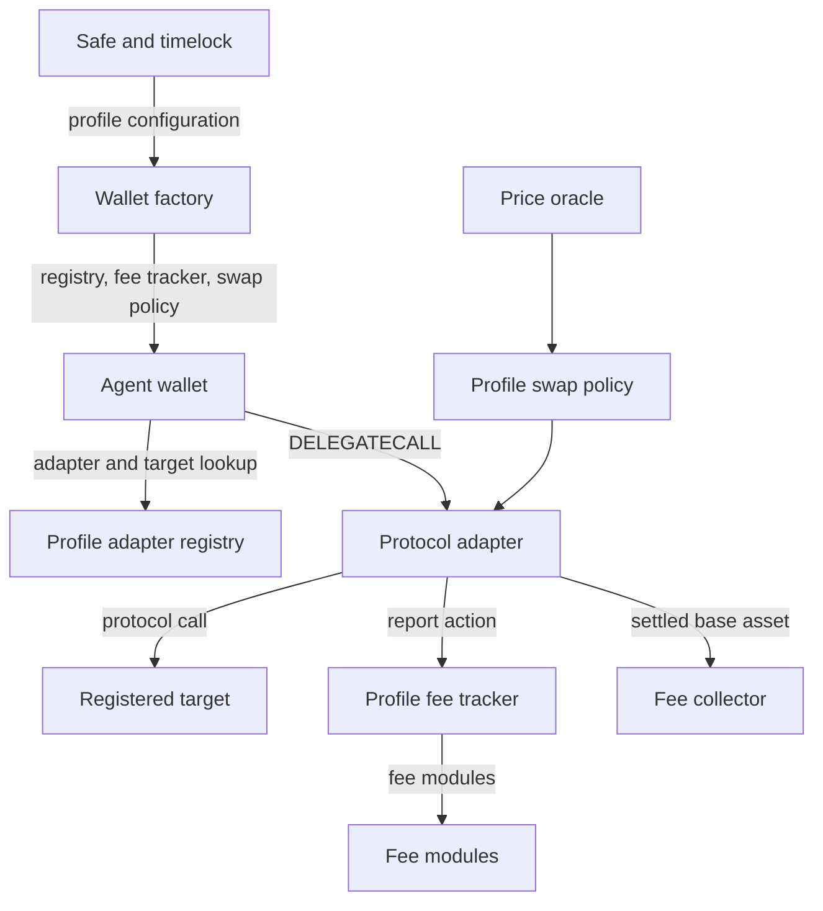

# YieldSeeker contracts

## Overview

YieldSeeker contracts run owner-controlled smart wallets for several agent types. Each wallet has an immutable `agentProfile`, a base asset and a cached adapter registry. The factory profile selects the registry, fee tracker and swap policy. Current profiles are `keccak256("vault")` and `keccak256("borrow")`; the factory can hold additional profiles as the platform adds agent types.

Wallets accept owner-authorized actions and operator-authorized adapter execution. A wallet checks the adapter and target against its registry, then calls the adapter with `DELEGATECALL`. The adapter runs in wallet context and validates protocol inputs. Standard arbitrary `execute` and `executeBatch` calls revert.

The contracts target Base, chain ID `8453`. Wallets accept ERC-4337 UserOperations from four EntryPoints at their canonical addresses: v0.6 (`UserOperation`, `0x5FF137D4b0FDCD49DcA30c7CF57E578a026d2789`) and v0.7, v0.8 and v0.9 (`PackedUserOperation`, `0x0000000071727De22E5E9d8BAf0edAc6f37da032`, `0x4337084D9E255Ff0702461CF8895CE9E3b5Ff108`, `0x433709009B8330FDa32311DF1C2AFA402eD8D009`). The same addresses are used on every chain, so a bundler of any of these versions can relay to a wallet. The contracts build with Solidity `0.8.38` (EVM `cancun`, via IR), OpenZeppelin Contracts `5.7.0` and Foundry `1.9.0`. Deployment and market-registration scripts contain Base addresses.

## Architecture

### Shared machinery

| Component | Role |
|---|---|
| `YieldSeekerAgentWalletV3` | Holds assets, validates signatures, runs adapters and provides owner exits and upgrades. |
| `YieldSeekerAgentWalletFactory` | Creates wallets and stores configuration by agent profile. Each wallet's profile is fixed at initialization. |
| `YieldSeekerAdapterRegistry` | Maps each target to one registered adapter for a profile. Wallets also have local adapter and target blocklists. |
| `YieldSeekerFeeTracker` and fee modules | Account for wallet actions and settle fees from the wallet's base asset. Each profile points to its own tracker. |
| Swap policies | Decide which sells and buys are allowed before an adapter swaps, then classify the measured result. |
| Adapters | Call registered vaults, markets, reward distributors and DEX routers from wallet context. |
| `YieldSeekerPriceOracle` | Supplies the borrow swap policy's price floor for swaps that sell the base asset. |
| `YieldSeekerAdminTimelock` | Delays administrative configuration. Emergency roles can pause or remove entries on selected contracts without waiting. |

### Execution and configuration



A wallet copies the factory's operator set and its profile's registry at `syncFromFactory()`. YieldSeeker wallets also copy the profile's fee tracker and swap policy. Anyone can sync a wallet. Registry contents are read during each adapter call, so registering, removing or pausing a target does not require a wallet sync.

The factory supports up to 10 `AGENT_OPERATOR_ROLE` addresses. The operator set applies across profiles, not per wallet. Wallets cache it; the cache decides both which ERC-4337 signatures count as an operator's and who may call `executeViaAdapter` directly.

Wallet state uses fixed `keccak256(namespace)` slots, not the ERC-7201 formula. `test_StorageSlotsStayFixedForUpgrades` pins the wallet and YieldSeeker extension slots; preserve them when changing storage layouts.

## Agent types

| Profile | Registry and tracker | Swap policy | Use |
|---|---|---|---|
| `vault` | `vaultAdapterRegistry`; `vaultFeeTracker` with `YIELD_FEE` | `YieldSeekerVaultSwapPolicy` | Supplies the base asset to registered vaults and converts sellable rewards to the base asset. |
| `borrow` | `borrowAdapterRegistry`; `borrowFeeTracker` with `YIELD_FEE` and `BORROW_FEE` | `YieldSeekerBorrowSwapPolicy` | Supplies base-asset collateral, borrows a different token, repays debt and can swap base asset into a token the wallet owes. |

The wallet factory and execution rules are shared. Profile-specific registries, fee modules and swap policies define what each type can do. Both types use the same V3 swap adapters and sell-token policy.

### Adding an agent type

Add a profile and wire its registry, fee tracker and swap policy in `script/Deploy.s.sol`. Add adapters and protocol targets to that profile's registry. Add or reuse fee modules and a swap policy as needed. If the profile's targets are routine configuration, add a section for them to `script/config/base.json` and `Configure.s.sol`, and add its registry to `Configure.s.sol`'s `_isAnyRegistryTarget` and drift report. Update the profile setup in the integration tests. Wallet creation selects the profile through `createAgentWallet(..., agentProfile, feePlans)`; an existing wallet cannot change its profile.

For a new fee action, add an ID and data struct in `src/fees/FeeActions.sol`, report it from the adapter, and implement it in the fee modules that charge for it. Deployed modules ignore unknown action IDs.

## Fees

### Action reporting and plans

Adapters report `DEPOSIT`, `WITHDRAW`, `SWAP`, `REWARD_SALE`, `CLAIM`, `DEBT_CHANGE` or `TRANSFER_OUT` to the wallet's `YieldSeekerFeeTracker`; the wallet reports `TRANSFER_OUT` before owner withdrawals. The tracker calls its modules in insertion order. Each module records the action and takes what it is owed from the base asset left by earlier modules. The adapter transfers the total to the collector once per report.

The tracker holds one module per fee type, ABI-encoded plans per fee type and wallet plan IDs. Only the timelock admin configures modules, plans, wallet factory and collector. Only the factory sets wallet plans at creation. Plans do not change; fee types without an explicit wallet plan use plan `0`. A new plan applies only to wallets assigned to it at creation, except a fee type's first plan `0` is used by wallets without a recorded choice.

A replacement module must use the same tracker and fee type and accept all existing plans. `isAccountedToken` and `feesOwedInBaseAsset` call each module with a gas limit; a failing module counts as false or zero in those views. A module that reverts during `reportAction` reverts the adapter action.

### Yield fee

`YieldSeekerYieldFeeModule` (`YIELD_FEE`) tracks cost basis per wallet and target. Deposits add the base asset actually spent. A withdrawal releases the same fraction of basis as the fraction of the position removed. Output above released basis is yield; a loss reduces basis for that target. Losses are not carried between targets.

Base-asset rewards and base asset received for a `REWARD_SALE` are yield. Other swaps, including base asset sold for a borrowed token, are not yield. Reward tokens, gifted shares and other positions with no recorded basis are charged as yield when they are withdrawn or sold for the base asset, except the two cases in [Known risks](#known-risks-accepted): rewards paid in a borrowed token, and rewards the owner sells through a route of their own. Fees round up.

### Borrow fee

`YieldSeekerBorrowFeeModule` (`BORROW_FEE`) charges a yearly rate on each debt position's last reported debt, including interest. The key is the lending adapter's `debtPosition(market)`: Aave V4 keys debt by spoke and debt reserve, so markets on the same reserve share it and are charged once, and other markets use `marketTarget(market)`. Look positions up with `debtPosition(market)`, not the market target. Lending adapters report borrows, repayments, collateral withdrawals and `checkpoint(market)` calls. A checkpoint reads current debt and moves no funds.

Each period is charged on debt at the previous report. The module converts the fee from the borrowed token into the base asset using the lending market's own price, not `YieldSeekerPriceOracle`. It uses the last reported price if a report has no price. Both accrual and conversion round up. Payment comes from base-asset balance at that report or a later reported action or outflow. The module records `tokenDebt(wallet, token)` across markets and accounts for borrowed tokens so owners may withdraw them.

Checkpoint each market with open debt at least daily and after a liquidation, but not much more often: each report can round the fee up by up to one raw debt-token unit, valued in the base asset (see the rounding item in Known risks). Debt changes outside the adapter are otherwise reflected only at the next report. See [Known risks (accepted)](#known-risks-accepted).

### Withdrawals and transfers

For fee-aware ERC20 owner withdrawals and agent-to-agent transfers, the wallet reports `TRANSFER_OUT` before sending tokens. The fee modules settle from the base asset. A successful fixed-amount ERC20 withdrawal sends exactly the requested token amount. `withdrawableBalance(asset)` reports the base-asset balance net of fees owed, the full balance of another accounted token, or zero for an unaccounted token.

Owner ERC20 withdrawal settlement is gas-limited and failure-tolerant. A module or collector failure during settlement does not block an owner exit; the wallet leaves fees owed and emits `FeeSettlementFailed`. Withdrawing a token other than the base asset, such as a borrowed token, first checks that the tracker accounts for it, and a reverting module makes that check fail, so those exits wait until the module is fixed. Adapter actions and agent transfers fail if a module or collector reverts. Native ETH withdrawals are owner-only and are not fee-settled.

## Roles and permissions

| Actor or role | Permissions |
|---|---|
| Wallet owner | Withdraw the base asset, fee-tracker-accounted ERC20s and ETH; block or unblock an adapter or target; upgrade to the factory-approved implementation. Position receipts must be unwound through an active adapter. |
| Agent operator | Create wallets; sign paymaster-sponsored ERC-4337 UserOperations for adapter execution, or call `executeViaAdapter` and `executeViaAdapterBatch` directly as plain transactions paying its own gas. An operator cannot authorize owner withdrawals or upgrades. |
| Timelock | Admin of the factory, registries, fee trackers, oracle and sell list: sets the implementation, profile configuration, registry contents, fee modules and plans, price sources, sell tokens and fee collectors. Every change waits for the timelock delay. Until the factory handover, the Safe holds the factory's admin role instead (see [Same wallet address on every chain](#same-wallet-address-on-every-chain)). |
| Safe | The Safe is timelock admin, proposer, canceller and sole executor in the deployment configuration. As timelock admin, it can grant or revoke timelock roles without a delay. It is the V3 factory's admin, emergency admin and operator until it hands those roles over, and its address fixes the factory's address. |
| Emergency role | On the V3 factory, registries and price oracle: the deployer and krishan711.eth. On the sell list and V2 vault registry: the old deployer `0xF8CB…7ecA` and krishan711.eth. krishan711.eth is `0xcec34E6E3babc36Ef72e31bd5808B87214F4A3A8` (`KRISHAN711_ETH` in `Deploy.s.sol`, which grants it on all six). On the factory, removes operators immediately. On a registry, pauses lookups, removes a target or unregisters an adapter. On the price oracle and sell-token policy, removes a source or sell token. It cannot unpause a registry or add operators. |
| Anyone | Calls `syncFromFactory()` on a wallet. Registry lookups and public views are permissionless. |

The wallet accepts an owner ECDSA signature, or an ERC-1271 approval from a contract owner. ECDSA is checked first, including for EIP-7702 EOAs. Owner UserOperations can pay their own gas. Operators use ECDSA and can authorize only `executeViaAdapter` or `executeViaAdapterBatch`, and only in a UserOperation with a paymaster whose address is not zero, so an operator can't spend the wallet's ETH or EntryPoint deposits on gas. Operators can also call those two functions directly. Malformed signatures return ERC-4337 validation failure rather than reverting.

The same rules apply through every accepted EntryPoint: v0.6 calls `validateUserOp(UserOperation, …)`, and v0.7, v0.8 and v0.9 call `validateUserOp(PackedUserOperation, …)`. Each EntryPoint hashes the UserOperation with its own address and the chain ID and keeps its own nonces, so a signature can't be replayed through another EntryPoint. The inherited `getNonce()` reads the v0.6 EntryPoint only. After validating a UserOperation, an accepted EntryPoint calls the wallet with the owner's permissions, so the wallet trusts all four EntryPoint contracts.

Validating an adapter call never reads the owner account, even with a dummy signature, as ERC-7562 bundler rules require. Validating any other UserOperation that isn't signed by the owner's key reads the owner account's code and, for a contract owner, its storage through ERC-1271. Bundlers that enforce ERC-7562 may therefore reject a Safe owner's UserOperations or dummy-signature estimates of owner actions. Contract owners such as a Safe call the wallet directly instead, including `executeViaAdapter`.

## Security model

### Execution constraints

The wallet checks its local blocklists, then requires `adapterRegistry().getTargetAdapter(target)` to equal the requested adapter. It calls the adapter with `DELEGATECALL`; the adapter receives the wallet as `address(this)`. There is no unrestricted execution path. An owner can block an adapter or target even when the global registry allows it.

The adapters validate their protocol-specific arguments. Vault adapters measure wallet balances for the amounts they report to fee modules; lending adapters report the amount requested or the amount the protocol returns, and measure collateral withdrawn from the position. DEX adapters validate route endpoints and refuse a swap after the deadline in its arguments (`SwapExpired`), so a signed swap can't run later against a stale minimum output. They require the wallet to spend exactly `sellAmount` (`SwapInputMismatch`) and count as output the measured increase capped at the router's reported `amountOut`. So tokens that reach the wallet during a swap from anywhere else, such as an owner withdrawal from another wallet that an operator submits to an EntryPoint from a token hook, make the swap revert if they are the sell token and are not counted if they are a plain ERC20 buy token. The Uniswap V3 and Aerodrome CL adapters first sweep any ETH the router holds to the wallet (`refundETH`), because those routers pay a WETH input from their own ETH. The Merkl adapter counts each claimed token as the increase in the distributor's `claimed(wallet, token)` record during the call, so tokens that reach the wallet mid-claim from elsewhere aren't charged, and reverts if the wallet's balance of that token rose by less (`ClaimDeliveryMismatch`). Fee-on-transfer rewards, reward tokens whose transfers round down (such as aTokens) and Merkl wrapper tokens that burn on receipt and pay out another token therefore can't be claimed; they stay in the distributor. One such token makes the whole claim revert, so the backend leaves it out of the claim. Swap policies prevent selling registry targets, which represent positions. Agent transfers can move accounted tokens only to another wallet with the same owner and factory, and both trackers must account for the token. They refuse a receiver that is mid-execution (`ReceiverIsExecuting`).

### Compromised operator

A compromised operator can sign adapter-execution UserOperations for any wallet whose cached operator set includes it, or call the adapter functions directly. It can use registered targets and adapters to manage or withdraw protocol positions into the wallet, claim rewards and make swaps allowed by the wallet's profile policy. It can transfer accounted assets to the owner's other wallets under the transfer-adapter rules.

It cannot use a direct arbitrary call, use an unregistered adapter or target, call owner-only withdrawals, send funds to an arbitrary external address, spend the wallet's ETH on gas, or upgrade a wallet.

What it can still do within those rules:

- Sell reward tokens at any price: reward sales have no oracle price floor.
- In borrow profiles, swap the base asset into a borrowed token. These swaps use an oracle floor, and the wallet may hold at most its last reported debt in that token plus `DEBT_BUFFER_BPS` (3%) afterwards. Swaps fix the amount sold, so the buffer lets a close buy enough to repay in full; the surplus stays in the wallet for the owner. The cap is on the balance held, not the total bought, so the operator can transfer the token to the owner's other wallets and swap again, losing up to 1% each time, plus however far a valid oracle answer lags the market within its staleness limit.
- In borrow profiles, borrow or withdraw collateral up to the protocol's limit, push a position into liquidation and collect the liquidation bonus itself. Each liquidation turns collateral into the borrowed token, which can't be turned back into collateral, so repeating it loses at most about the bonus share of the collateral (about 4% at Morpho's 86% LLTV). Debt the operator opens also costs protocol interest plus the borrow fee for as long as it stays open; that cost grows with time until the operator is revoked and the owner repays, which the owner can do directly on Aave V3 and Morpho.
- Deposit into and withdraw from a vault that charges an entry or exit fee as often as it likes, losing the fee on each round trip. Check vaults for such fees before registering them; yoUSD had a small withdrawal fee (`feeOnWithdraw` 1e13) in November 2026.
- As a factory operator, create another wallet for the same owner with any profile, base asset and existing fee plan, and move accounted tokens into it. A vault wallet's base asset is therefore exposed to the borrow risks above whenever a registered borrow market takes it as collateral.

### Operator revocation procedure

Wallets cache operators because ERC-4337 validation does not read the factory. Removing an operator in the factory does not clear each wallet's cache until it syncs.

1. Optionally call `pause()` on `vaultAdapterRegistry` and `borrowAdapterRegistry` with `EMERGENCY_ROLE`. A pause blocks adapter execution through that registry, including owner position exits.
2. Call `factory.removeAgentOperator(operator)` with `EMERGENCY_ROLE`. The removal is immediate. Only the timelock admin can add operators.
3. Call `syncFromFactory()` on every V3 wallet. Any account can do this. Check `isAgentOperator(operator)` on each wallet after sync.
4. If either registry was paused, schedule `unpause()` directly on the timelock and execute it after the delay. `Deploy.s.sol` and `Configure.s.sol` can't do it: they read the registry, so they revert while it is paused.
5. Before rerunning `Deploy.s.sol`, set `SERVER_ADDRESS` to the operator that should remain: a rerun grants `SERVER_ADDRESS` again if it is missing. Cancel any scheduled batch that would re-grant a revoked operator.

If the deployer key, which is a timelock proposer and canceller and an emergency admin of the V3 contracts, is compromised:

1. The Safe, as timelock admin, revokes the key's `PROPOSER_ROLE` and `CANCELLER_ROLE` on the timelock. This takes effect at once, and from then on the key can't cancel the Safe's operations.
2. Run `./script/check-timelock.sh` with `DEPLOYER_ADDRESS` set (and, before the factory handover, `SERVER_ADDRESS`) and cancel every pending operation not labelled `Safe`. The script labels an operation `Safe` only when a trace shows that the Safe, and no other account, made the call that emitted its `CallScheduled` event, and warns on any other operation sent through a Safe transaction. Operations the key sent itself are labelled `DEPLOYER_ADDRESS`.
3. At once, schedule one `unpause()` operation for each registry the key can pause (`vaultAdapterRegistry`, `borrowAdapterRegistry`, and `agentWalletV2AdapterRegistry` for keys that hold its role), each on its own. `schedule` doesn't call the target, so this works while the registry is unpaused; once ready, executing it reverts with `ExpectedPause` and leaves it ready until the registry is paused, and then the Safe can undo the pause as soon as its owners sign, without waiting for the delay. Executing it uses it up, so schedule a new one with a fresh salt afterwards. `check-timelock.sh` leaves a ready `unpause()` out of its bundle while its registry isn't paused and bundles at most one per registry.
4. Schedule one batch that revokes the key's `EMERGENCY_ROLE` on `vaultAdapterRegistry`, `borrowAdapterRegistry`, `priceOracle` and, after the handover, the factory, and then makes the re-grants of step 6. krishan711.eth keeps its emergency role, so pausing and operator removal stay available; grant the role to a new key too if krishan711.eth should not be the only one. If step 2 cancelled the `Deploy.s.sol` or `Configure.s.sol` batch before it ran, everything in it is gone, not just the krishan711.eth grants: profile wiring, fee modules and plans, adapters, targets, price sources and markets; a cancelled Deploy batch also leaves a Configure batch scheduled behind it unable to run. Have the Safe grant a new deployer key `PROPOSER_ROLE` and `CANCELLER_ROLE`, then, once no registry is paused, rerun `Deploy.s.sol` with that key and `Configure.s.sol` with the new Deploy batch's ID as predecessor (or without one once that batch has run). If the factory handover hasn't run yet, `check-timelock.sh` leaves it out of the bundle with a warning once the key is no longer a timelock proposer, and leaves out ready operations that call the factory; have the Safe send the calls `factory-handover.sh <factory> <safe> <timelock> <new emergency admin> <server> <rpc>` prints first. `Deploy.s.sol` makes the deployer an emergency admin of anything it deploys later, so rotate the deployer key too.
5. Until that batch runs, the key can still pause the registries, remove operators, targets and adapters, remove price sources and, if it holds the role on the sell list, remove sell tokens. Owner position exits stay frozen while a registry is paused, until the step 3 operation is ready.
6. Restore anything the key removed with calls scheduled directly on the timelock, in or after the step 4 batch so that the key can't undo them: `grantRole(AGENT_OPERATOR_ROLE, operator)` on the factory and then `syncFromFactory()` on every wallet, `registerAdapter`, `setTargetAdapter`, `setSource`, `addSellableTokens`. `Deploy.s.sol` and `Configure.s.sol` revert while a registry is paused.

The old deployer `0xF8CBf6437d2473eC59885299Af38D9A13cE97ecA` holds no timelock roles. It still holds `EMERGENCY_ROLE` on the sell list and the V2 vault registry, alongside krishan711.eth once the `Deploy.s.sol` batch has run. If it is compromised, revoke its role on those two contracts in one batch and follow steps 3, 5 and 6.

If the krishan711.eth key is compromised, schedule a batch that revokes its `EMERGENCY_ROLE` on the factory, both V3 registries, the price oracle, the sell list and the V2 vault registry, and follow steps 3, 5 and 6 above. Before the next `Deploy.s.sol` run, remove or replace `KRISHAN711_ETH` in `Deploy.s.sol`: a rerun grants it again whenever it is missing.

V2 wallets use the V2 factory and registry. Pause `agentWalletV2AdapterRegistry`, revoke the operator through the timelock, have owners or operators sync the affected wallets, then unpause through the timelock. `Configure.s.sol` reverts until the V2 registry is unpaused.

### Emergency target removal and recovery

After an emergency target removal, cancel any scheduled timelock operation that would restore it with `cancel(id)` and `CANCELLER_ROLE`, and repeat the removal in every registry that maps the target or registers the adapter: the V2 vault registry, the V3 vault registry and the borrow registry. The routers, Merkl and the agent-transfer adapter are in the borrow registry too. Scripts can put a removed target back:

- `Configure.s.sol` schedules every entry of `script/config/base.json` that is missing on-chain, so a run puts back a removed vault, market, price source or sellable token unless its entry is taken out of the config first.
- `Deploy.s.sol` schedules its fixed targets again whenever they are missing: the routers, Merkl and agent transfers in the borrow registry, and the CL2, CL3 and CL4 routers and agent transfers in the vault registry.
- `Deploy.s.sol` re-registers any V3 adapter in `deployments.json` that is not registered, so a rerun undoes an emergency unregistration unless that operation is cancelled or the adapter's key is replaced. It never registers V2 adapters.
- After an emergency `unregisterAdapter`, `Configure.s.sol` reverts for every config entry that uses that adapter until it is registered again (by a Deploy rerun for V3 adapters, by `registerAdapter` scheduled directly on the timelock for V2 adapters), or until those entries are taken out of the config.
- `Deploy.s.sol` grants `EMERGENCY_ROLE` to `KRISHAN711_ETH` again wherever it is missing, so a rerun undoes a revocation unless the constant is changed.

After an emergency removal, check the batch a rerun prints and cancel it if it would restore a removed target.

A removed position target can be restored by registering it again through the timelock. The owner or operator can then unwind the position through its adapter; the yield fee uses the target's recorded cost basis. If an adapter was unregistered, registering it again reactivates its previous target mappings. Unregistering an adapter is a pause mechanism, not a permanent target removal.

An unlisted reward token cannot be sold. Add it to `sellableTokens` in `script/config/base.json` and run `Configure.s.sol`, then an operator can sell it for the base asset. Other unaccounted tokens, such as unsolicited airdrops, cannot be withdrawn by the owner and remain in the wallet. A reward token that is itself a registry target, such as another base asset's vault share or aToken, can't be sold even when listed and can't be withdrawn, so it stays in the wallet for good.

### Known risks (accepted)

- Operator removal reaches each wallet only after it syncs. Pausing the registries closes the adapter-execution window while wallets sync.
- A stolen emergency key (the deployer key or krishan711.eth) can pause the registries. Unpausing goes through the timelock, so owner position exits can stay frozen until a standing `unpause()` operation scheduled after the theft is ready: up to the 4-day delay. Idle tokens can still be withdrawn. Aave V4 borrow wallets can't repay during the freeze. See the compromised-key steps above.
- Merkl governance is trusted. It can add an operator that claims for a wallet outside the adapter, so a base-asset reward claimed that way is never reported, and it can upgrade the distributor; an upgrade that stopped `claimed()` tracking payouts would make base-asset claims report nothing.
- `Deploy.s.sol` grants `SERVER_ADDRESS` when missing and does not remove old operators. For key rotation, grant the new operator through the timelock, remove the old operator with `EMERGENCY_ROLE`, then sync every wallet.
- Reward sales have no price floor. The operator chooses the route and `minBuyAmount`, so a compromised operator can claim a wallet's accrued Merkl and Moonwell rewards and sell them through a pool it controls in one batch: all of a wallet's claimable and held sell-list rewards are exposed, not only rewards already in the wallet. Only sell-list tokens are exposed: the policy refuses the base asset, registry targets (which include borrow collateral aTokens) and, in borrow profiles, borrowed tokens. USDC is on the sell list, so USDC rewards in wallets with another base asset are exposed too. Pausing the registries protects accrued rewards while an operator is being revoked. A floor was left out on purpose: some reward tokens have no Chainlink feed (e.g. SEAM), thin reward pools need a looser limit than the 1% borrow floor, and a stale or removed feed would block sales or drop the floor. Base-asset sales in borrow profiles use the oracle floor.
- The owner can also run adapters, so the owner can sell their own wallet's reward tokens through a pool they control at any price. The yield fee is a share of what the wallet receives, so the owner can avoid most of the fee on reward income this way. It costs them pool setup and gas, and only reward income is exposed: withdrawals from positions always report what they paid out.
- A reward paid in a token the wallet has borrowed pays no yield fee. Claims are charged only in the base asset, and the borrow policy never sells a borrowed token, so such a reward is never sold as a `REWARD_SALE`. The borrowed token is accounted, so it can repay debt, move to the owner's other wallets or be withdrawn by the owner without a fee. For example, a wallet that borrowed USDC and receives a USDC Merkl reward. `Deploy.s.sol` registers Merkl in the borrow registry, so the backend should not claim, on borrow wallets, Merkl campaigns that pay a token the wallet borrows.
- Fee calculations round up on each report. Yield fees can add about one raw base-asset unit per report. Borrow fees round up in the debt token and again when converting to the base asset, so the raw-base rounding depends on token decimals and price. More debt reports can realize additional rounding. With a low-decimal base asset this adds up: a cbBTC (8 decimals) borrow wallet with open debt pays at least one satoshi per report, about $0.001 at $100,000 per BTC, so a compromised operator checkpointing a market every block could overcharge it by up to about 0.16 BTC a year, paid to the fee collector and costing the operator about as much in gas. A daily checkpoint keeps it negligible. The borrow swap floor rounds up after an oracle quote that rounds down, so it can accept one raw unit below the exact limit.
- Cost basis is tracked per target. A loss in that target, including collateral seized by liquidation, is not charged again. Later gains there are fee-free until value rises above its remaining basis. Losses are not carried between targets. A fully liquidated collateral position keeps its old basis, so later collateral yield in that market can be undercharged. A gain realised by a partial withdrawal is not refunded if the rest of the position later loses value: a vault that rises 20%, is half withdrawn and then falls back pays the fee on the first half's gain although the wallet got back only what it deposited.
- Deposits have no minimum-output bound. Register only vaults reviewed for share-inflation protection.
- ERC-4626 withdrawals must pay out in the same call. An ERC-4626 redemption that pays nothing reverts, so a vault that queues redemptions it can't pay right away, such as yoUSD and yoEUR above their free balance, can only be withdrawn from within its free balance. The backend sizes those withdrawals to the vault's free balance. A vault that pays part of a redemption and queues the rest would be recorded as a full withdrawal; none on the current target list does that, so check new vaults for it before registering them. Vaults that only pay from idle cash (for example a Morpho VaultV2 without a liquidity adapter) revert above it, which loses nothing. Shares worth less than one raw unit can't be redeemed.
- ETH in a wallet's EntryPoint deposits (left over from owner UserOperations that paid their own gas) can't be withdrawn: `execute` is disabled and the wallet has no deposit-withdraw function, so ETH the platform deposits for a wallet can't be taken by its owner. It can only pay for later UserOperations through the same EntryPoint. Operator UserOperations always use a paymaster.
- Fee collection fails closed for adapter actions. A reverting module or collector blocks adapter actions until fixed. Owner exits of the base asset are fail-open and do not block; exits of other accounted tokens, such as borrowed tokens, wait until the module is fixed.
- The operator chooses a wallet's profile, base asset and fee plans at creation. Plans are timelock-created, capped by each module and fixed for the wallet's life. The address depends on the factory, owner and index, not on the profile or plan. The contracts do not check these inputs against an off-chain agent record. Tokens sent to a wallet's address before the wallet exists are exposed to this: a compromised operator can create the wallet with a different base asset, so the owner can't withdraw them, and if they are on the sell list it can sell them through its own pool.
- Debt changes outside lending adapters are charged at the last reported debt until the next report. The open period is charged at the next report, not when an owner withdraws idle base asset. Collateral exits go through the adapter and report the change. The operator must checkpoint each market with open debt at least daily. The base-asset-to-borrowed-token swap cap uses the same last reported debt.
- There is no on-chain health-factor floor. Borrow sizing is off-chain; this repository does not verify that policy.
- Swap policies reject registry targets, but do not generally identify position tokens. Vault positions are their own targets. A lending market's collateral receipt token (`collateralReceiptToken(market)`: the Aave V3 aToken; Morpho Blue and Aave V4 keep collateral themselves) is registered as a target of its lending adapter by `Configure.s.sol`; a new lending adapter must return its receipt token there. If the emergency role unregisters the Aave V3 lending adapter or removes an aToken target, that aToken is protected only by the sell list again. Never enable `allowSellingAllTokens` and never add a position token, such as a vault share or aToken, to the sell list. An unaccounted token that is not sellable, such as an unexpected Merkl reward, stays in the wallet until added to the sell list, unless it is a registry target (see above).
- Base assets must be plain ERC20s without fee-on-transfer or rebasing behavior because fees and cost basis use base-asset units.
- If a lending market's own oracle reverts while a debt report needs its price, the affected adapter action fails; the Base AaveOracle reverts on a non-positive source answer. A zero market price (from a Morpho oracle, or an Aave oracle that returns zero) is reported as zero, and a degenerate price too large for the borrow fee module to store is ignored by it. A borrow at either reverts with `UnusableDebtPrice`; other actions go ahead with the borrow fee module valuing the debt at its last price. Owners can repay directly on Aave V3 and Morpho. Aave V4 lets only the wallet or its position managers repay, so a reverting Aave V4 oracle also blocks repaying and collateral withdrawal until it recovers. Owners should add collateral only through the wallet (send base asset to it and have it supply): collateral supplied directly on Aave V3 or Morpho on the wallet's behalf has no cost basis, so it is charged the yield fee when withdrawn, like gifted shares.
- Anyone can supply a dust amount of another Aave V3 asset on a borrow wallet's behalf, and Aave enables it as the wallet's collateral; the wallet has no way to turn it off. If Aave later sets that asset's LTV to 0, or its price source starts reverting, Aave refuses the wallet's collateral withdrawals and borrows while any debt is open. Nothing is lost: once the debt is repaid in full, through the wallet or directly on Aave V3, the collateral can be withdrawn.
- The MAG7 tokens and SPCXc are Coinbase B20 tokenized stocks: Base precompiles whose issuer can pause them, block addresses through transfer policies and change their multiplier at once, with no onchain timelock. Balances never change; dividends and splits change the multiplier (shares per token) instead, and the "Coinbase" Chainlink feeds already include it, so the oracle values a token, not a share, through corporate actions. During a corporate action the feed freezes, so after the 12-hour staleness limit base-asset sales in tokenized-stock borrow wallets stop until it resumes. Dividends raise a token's value without changing balances, so they are not charged as yield. Coinbase lists about 300 such tokens, but in November 2026 only these eight, plus SNDKc, MSTRc, INTCc and CRCLc, had a Chainlink feed, and only these eight were Aave V4 collateral; Morpho's tokenized-stock markets on Base held under $20k each.
- Moonwell `claimReward(holder)` is permissionless, so anyone can claim a wallet's Moonwell rewards outside the adapter. Base-asset rewards claimed that way are never reported and pay no yield fee. The backend claims through the adapter regularly.
- The Safe holds the timelock's admin role and can change timelock roles without waiting for a delay.

## Contract map

| Contract | File | Role |
|---|---|---|
| `YieldSeekerAgentWalletV3` | `src/AgentWalletV3.sol` | YieldSeeker wallet implementation with fee-aware exits and profile-specific tracker and swap policy. |
| `AWKAgentWalletV3` | `src/agentwalletkit/AWKAgentWalletV3.sol` | ERC-4337 wallet logic, operator cache, blocklists, adapter execution and UUPS authorization. |
| `YieldSeekerAgentWalletFactory` | `src/AgentWalletFactory.sol` | Creates YieldSeeker wallets and configures registry, tracker and swap policy by profile. |
| `AWKAgentWalletFactory` | `src/agentwalletkit/AWKAgentWalletFactory.sol` | CREATE2 proxy factory, implementation pointer, profile registries and operator roles. |
| `YieldSeekerAdapterRegistry` | `src/AdapterRegistry.sol` | YieldSeeker alias for the target-to-adapter registry. |
| `AWKAdapterRegistry` | `src/agentwalletkit/AWKAdapterRegistry.sol` | Maps targets to active adapters and implements emergency pause and removal. |
| `YieldSeekerFeeTracker` | `src/fees/FeeTracker.sol` | Dispatches actions to fee modules, stores plans and reports accounted tokens and fees owed. |
| `YieldSeekerYieldFeeModule` | `src/fees/YieldFeeModule.sol` | Tracks target cost basis and yield fees. |
| `YieldSeekerBorrowFeeModule` | `src/fees/BorrowFeeModule.sol` | Tracks debt, token debt caps and borrow fees. |
| `FeeActions` | `src/fees/FeeActions.sol` | Action IDs and ABI data structures used by adapters and modules. |
| `YieldSeekerVaultSwapPolicy` | `src/swaps/VaultSwapPolicy.sol` | Allows sellable reward tokens to be sold for the base asset. |
| `YieldSeekerBorrowSwapPolicy` | `src/swaps/BorrowSwapPolicy.sol` | Adds the oracle-bounded base-asset-to-debt-token swap. |
| `YieldSeekerSwapSellPolicy` | `src/adapters/SwapSellPolicy.sol` | Shared sell-token list read by both profile policies. |
| `YieldSeekerPriceOracle` | `src/PriceOracle.sol` | Reads per-asset feeds, staleness limits and L2 sequencer status. |
| `YieldSeekerAdminTimelock` | `src/AdminTimelock.sol` | Timelock controller used for administrative operations. |
| `YieldSeekerERC4626Adapter` | `src/adapters/ERC4626Adapter.sol` | ERC-4626 vault deposits and withdrawals. |
| `YieldSeekerAaveV3Adapter` | `src/adapters/AaveV3Adapter.sol` | Aave V3 aToken vault deposits and withdrawals. |
| `YieldSeekerCompoundV3Adapter` | `src/adapters/CompoundV3Adapter.sol` | Compound V3 Comet supply and withdrawal. |
| `YieldSeekerCompoundV2Adapter` | `src/adapters/CompoundV2Adapter.sol` | Compound V2 and fork deposits and cToken redemptions. |
| `YieldSeekerAaveV3LendingAdapter` | `src/adapters/AaveV3LendingAdapter.sol` | Aave V3 collateral, borrowing, repayment and checkpoint operations. |
| `YieldSeekerAaveV4LendingAdapter` | `src/adapters/AaveV4LendingAdapter.sol` | Aave V4 spoke lending operations. |
| `YieldSeekerMorphoBlueLendingAdapter` | `src/adapters/MorphoBlueLendingAdapter.sol` | Morpho Blue lending operations. |
| `YieldSeekerMerklAdapter` | `src/adapters/MerklAdapter.sol` | Claims rewards for the wallet from Merkl. |
| `YieldSeekerMoonwellRewardAdapter` | `src/adapters/MoonwellRewardAdapter.sol` | Claims Moonwell rewards and reports base-asset and WELL rewards. |
| `YieldSeekerUniswapV3SwapAdapter` | `src/adapters/UniswapV3SwapAdapter.sol` | Uniswap V3 route execution. |
| `YieldSeekerAerodromeV2SwapAdapter` | `src/adapters/AerodromeV2SwapAdapter.sol` | Aerodrome V2 route execution. |
| `YieldSeekerAerodromeCLSwapAdapter` | `src/adapters/AerodromeCLSwapAdapter.sol` | Aerodrome Slipstream concentrated-liquidity route execution. |
| `YieldSeekerAgentTransferAdapter` | `src/adapters/AgentTransferAdapter.sol` | Transfers accounted assets between wallets of the same owner and factory. |
| AWK protocol adapters | `src/agentwalletkit/adapters/` | Protocol call implementations composed with YieldSeeker validation and fee-reporting layers. |

## Deployment and operations

### Environment and roles

Set these environment variables before running deployment scripts:

| Variable | Use |
|---|---|
| `DEPLOYER_PRIVATE_KEY` | Deployer address is a timelock proposer and canceller, and an emergency admin alongside krishan711.eth. |
| `DEPLOYER_ADDRESS` | The deployer's address; `check-timelock.sh` names it as the factory's emergency admin in the handover and checks it is the vault registry's emergency admin and still a timelock proposer. |
| `DEPLOYER_ADDRESS_OLD1` | Optional earlier deployer address; `check-timelock.sh` uses it only to label operations that address proposed. |
| `MULTISIG_ADMIN_ADDRESS` | Safe address used as timelock admin, proposer, canceller and sole executor. The factory's constructor Safe is the constant `FACTORY_ROOT_SAFE` in `Deploy.s.sol`, not this variable, so a different team Safe on another chain doesn't change wallet addresses. |
| `SERVER_ADDRESS` | Address granted `AGENT_OPERATOR_ROLE`. `check-timelock.sh` requires it to be an operator of the V2 factory before handing it the V3 factory's operator role. |
| `FEE_COLLECTOR_ADDRESS` | Receives collected fees. |
| `RPC_NODE_URL_8453` | Base RPC endpoint. |
| `RPC_ARCHIVE_NODE_URL_8453` | Archive RPC used by `script/check-timelock.sh`. It must support `debug_traceTransaction` with `callTracer` and `withLog`; without it, operations sent through Safe transactions show as unverified. |
| `ETHERSCAN_API_KEY` | Optional verification key for `--verify`. |

`Deploy.s.sol` sets the timelock delay to four days and makes the deployer and krishan711.eth emergency admins: the deployer through the constructors and the factory handover, krishan711.eth through `grantRole` in the configuration batch. The Safe and deployer can propose and cancel operations; the Safe executes them. To add a proposer, the Safe grants `PROPOSER_ROLE` and `CANCELLER_ROLE` to that address on the timelock. The grants take effect immediately. Use `revokeRole` to remove them. The Safe's timelock admin role can grant or revoke these roles directly.

### Deploy

`Deploy.s.sol` reads and updates `deployments.json`. It deploys missing V3 contracts, saves their addresses, wires factory profiles and fee trackers, grants `SERVER_ADDRESS` if it is not already an operator, and schedules configuration as one timelock batch. It schedules `setFeeCollector` when a tracker's collector differs. It registers the profile adapters, shared swap adapters and agent-transfer adapter, and maps the targets it owns: the CL2 and CL3 routers and agent transfers in the vault registry, and the routers, Merkl and agent transfers in the borrow registry. It grants `EMERGENCY_ROLE` to krishan711.eth wherever it is missing, including on the V2 vault registry; otherwise it does not deploy or reconfigure the V2 system, which remains under `agentWalletV2*` keys.

Everything else the registries, price oracle and sell list hold comes from `script/config/base.json` through `Configure.s.sol` (see [Configure](#configure-vaults-sellable-tokens-price-sources-and-borrow-markets)).

```bash
forge script script/Deploy.s.sol:DeployScript --rpc-url "$RPC_NODE_URL_8453" --broadcast --verify
```

Before a production run, use `./script/dry-run-deploy.sh`. It runs `Deploy.s.sol` on a local Base fork and has the Safe hand the factory over, schedules `Configure.s.sol` with the Deploy batch as predecessor, warps past the delay, executes both batches as the Safe and requires a second run of each script to schedule nothing. It fails if Configure reports an on-chain entry the config lacks or would move a target to another adapter, and if the handover and both batches together use more than 15,000,000 gas (they share one Safe transaction in production, under Base's 16,777,216 cap; the launch took about 10,000,000). It also checks that the factory is at the address computed from the Safe and its bytecode and that its roles ended with the timelock, the server, the deployer and krishan711.eth. It sends the Safe's calls one by one, so it does not exercise the Transaction Builder bundle that `check-timelock.sh` writes. It restores `deployments.json`, `broadcast/Deploy.s.sol` and `broadcast/Configure.s.sol` afterwards. It requires `anvil`, `cast`, `forge`, `jq` and `RPC_NODE_URL_8453`.

In production, the scripts schedule timelock operations. Wait for the four-day delay, then execute the emitted calls from the Safe. Use `./script/check-timelock.sh` to list operations and build Safe Transaction Builder instructions for ready operations. It rebuilds execute calls from timelock events in the order they were scheduled, including operations proposed by the Safe. It leaves out, as "ready but left out", any ready operation that would make the whole Safe transaction revert: one with an `unpause()` of a registry that isn't paused, a second `unpause()` of a registry already in the bundle, or, while the factory handover can't be bundled, a call to the factory. It warns when the bundle unpauses a registry. While the Safe still holds the V3 factory's roles, it puts the factory handover first in the same bundle; it then also needs `DEPLOYER_ADDRESS` and `SERVER_ADDRESS`, and leaves the handover out with a warning unless `DEPLOYER_ADDRESS` is the emergency admin of the V3 vault registry and still a timelock proposer and `SERVER_ADDRESS` is a V2 factory operator. It requires `cast`, `jq`, `RPC_NODE_URL_8453` and `RPC_ARCHIVE_NODE_URL_8453`.

### Same wallet address on every chain

A wallet's address depends only on the factory address, the owner and the owner's agent index. `Deploy.s.sol` creates the factory through the CREATE2 deployer `0x4e59b44847b379578588920cA78FbF26c0B4956C` with salt `0x711`, passing `FACTORY_ROOT_SAFE` (the Safe `0x403E…2fEa`) as admin, emergency admin and operator. The factory address therefore depends only on that Safe's address and the factory bytecode, not on the deployer key, the chain's timelock, its team Safe or the server. Every chain where the factory is deployed this way gives `(owner, index)` the same wallet address. If someone else deploys the same factory there first, `Deploy.s.sol` reuses it: its roles are still the Safe's.

The Safe then hands the factory over in one Safe transaction: it grants the admin role to that chain's timelock, the operator role to `SERVER_ADDRESS` and the emergency role to the deployer, and gives up all three (`script/factory-handover.sh` lists the calls and refuses a timelock address with no code). `check-timelock.sh` bundles these calls ahead of the deployment's timelock batch, which needs the timelock to be the factory admin. Wallets can't be created until the handover.

To keep that true:

- The Safe must exist at the same address on the new chain. Safe{Wallet} can add the Safe to another network: it recreates the Safe from its original setup, with its original owners and threshold. Owners changed on Base afterwards don't carry over, so enough of the original owners to meet the threshold must still be able to sign on the new chain. See [The Safe's original setup](#the-safes-original-setup).
- The CREATE2 deployer `0x4e59b44847b379578588920cA78FbF26c0B4956C` must exist on the new chain; `Deploy.s.sol` refuses to run without it.
- Deploy from the same factory bytecode. `foundry.toml` turns off compiler metadata (`bytecode_hash = "none"`, `cbor_metadata = false`), so comments and file paths don't change it. The factory's bytecode comes from `AgentWalletFactory.sol`, `AWKAgentWalletFactory.sol` (including the embedded `AWKAgentWalletProxy`), the OpenZeppelin code they use, the `AWKErrors` errors they use, the selectors of the wallet and tracker functions they call, and the compiler version and settings; changing a wallet function's body doesn't change it. Build with the same command as on Base, compute the predicted factory address and compare it with Base's before deploying a new chain.
- The wallet implementation, registries, trackers and adapters can differ per chain.

If a user sends tokens to their wallet's address on a chain where it doesn't exist yet, recreate the Safe there, deploy the V3 contracts, and create the wallet for the same owner and index with the stranded token as its base asset. The owner can then withdraw it, provided the owner can act on that chain: an EOA key, or a contract owner that also exists at its address there. Only one token per `(owner, index)` can be the base asset; another stranded ERC20 is not accounted, so the owner can't withdraw it. Native ETH can always be withdrawn. Create the recovery wallet as soon as the operator is set up there: whoever creates it first picks the base asset (see Known risks).

The scripts only support Base today. A new chain needs its protocol addresses in `Deploy.s.sol` (routers, the WELL token, Merkl and the sequencer feed), its own deployments file, and a `check-timelock.sh` for its timelock and Safe; its timelock address will differ from Base's. `YieldSeekerPriceOracle` needs an L2 sequencer uptime feed, which Ethereum mainnet doesn't have. zkSync Era is not supported: its CREATE2 addresses and bytecode differ from other EVM chains.

#### The Safe's original setup

The Safe `0x403EE3392A40D017a009384D1bE1a2Ca921C2fEa` was created on Base in transaction `0x45dbf6a7237f8547cdf855eaf92cd71700a5b98ee7acf15b570fc065efa2e017` by calling `createProxyWithNonce` on the Safe proxy factory `0x4e1DCf7AD4e460CfD30791CCC4F9c8a4f820ec67`:

| Field | Value |
|---|---|
| Singleton | `0x41675C099F32341bf84BFc5382aF534df5C7461a` (Safe 1.4.1) |
| Owners | `0xdCf1220Cd53506B1e7137bffC2b8814C6Cc24421`, `0xF3A535cEdf65cB8C287Cb5CAc67E970E94eb372D` |
| Threshold | `2` |
| Setup call | `0xBD89A1CE4DDe368FFAB0eC35506eEcE0b1fFdc54` with `0xfe51f643` (`setupToL2`) for the L2 singleton `0x29fcB43b46531BcA003ddC8FCB67FFE91900C762` |
| Fallback handler | `0xfd0732Dc9E303f09fCEf3a7388Ad10A83459Ec99` |
| Payment token, payment, payment receiver | `0x0`, `0`, `0x5afe7A11E7000000000000000000000000000000` |
| Salt nonce | `0` |

Replaying that call with the same arguments creates the Safe at the same address on any chain where these contracts exist; in November 2026 they existed on Ethereum, Optimism, Arbitrum and Polygon, and the replay's address was checked to match. The new copy starts with these two owners at threshold 2, whatever the Base Safe's owners are by then. Both owner keys must therefore stay available for good, even after they are removed from the Base Safe: keep their seed phrases backed up in separate places. Owners added later play no part in any address.

To deploy on a new chain:

1. Recreate the Safe there, with Safe{Wallet}'s "add another network" or by replaying the call above. Anyone can send it.
2. Run `Deploy.s.sol` on that chain with any deployer key. Check that the factory lands at the same address as on Base.
3. The two original owners sign that chain's factory handover, then add the owners and threshold the team uses by then.

### Two vault registries

V2 wallets use `agentWalletV2AdapterRegistry`, V2 adapters and the legacy V2 fee tracker. V3 vault wallets use `vaultAdapterRegistry`, V3 adapters and the V3 vault fee tracker. One registry maps a target to one adapter, so the V2 and V3 vault adapters cannot share a registry. Until all V2 wallets have moved to V3, the two registries must contain the same vault targets.

- `Configure.s.sol` maps every `vaultTargets` entry in both registries, to the V2 and the V3 adapter of its kind, in one timelock batch.
- Both profile policies read the same `swapSellPolicy` sell-token list.
- Repeat emergency target removals in every registry that maps the target, including the borrow registry.
- The V3 vault and borrow registries map the agent-transfer adapter to itself as a target. The V2 registry does not.

### Configure: vaults, sellable tokens, price sources and borrow markets

`script/config/base.json` is the desired state of everything routine: `sellableTokens`, `priceSources`, `vaultTargets` (vaults plus the Moonwell comptroller, Merkl and the first-generation routers that both vault registries map), `aaveV3Markets`, `aaveV4Markets` and `morphoMarkets`. To add a vault, a reward token, a feed or a market, add an entry and run:

```bash
forge script script/Configure.s.sol:ConfigureScript --rpc-url "$RPC_NODE_URL_8453" --broadcast
```

It compares every entry with the chain and schedules only what is missing or different, as one timelock batch of at most 130 operations (about 75,000 gas each; add larger changes over several runs); with nothing to do it schedules nothing. It never removes anything. It prints a `!!` warning for each sellable token, and each target of the V2 or V3 vault registry, on-chain that the config lacks: the V3 vault registry check skips targets mapped to Deploy's own adapters, targets of unregistered adapters don't show, and price sources aren't checked because the oracle can't list them. A borrow market on-chain that the config lacks (a borrow registry target of one of the three lending adapters) stops the run instead, since the market rules below only see markets in the config: keep a market in the config until an emergency removal has taken its target out of the registry. Removal is an emergency-role action, and a run schedules again any entry still in the config, so take an entry out of the config when it is removed in an emergency. It reverts while any of the three registries is paused, and refuses a config with an unknown section.

At launch, schedule it straight after `Deploy.s.sol`, with the Deploy batch's operation ID (Deploy prints it) as predecessor: `--sig "run(bytes32)" <DEPLOY_BATCH_ID>`. The predecessor must be a pending timelock operation; V3 adapters that are not registered yet then count as registered (V2 adapters must already be), and the timelock runs the Configure batch only after the Deploy batch, so launch needs one delay, not two. Pass only the Deploy batch that registers those adapters. `dry-run-deploy.sh` runs exactly this on a fork.

Before scheduling, it checks:

- **Sellable tokens:** nonzero, not a target in any registry on-chain or in the config, and `allowSellingAllTokens` off; in the other direction, no new target may be a token that is sellable on-chain. Never set `allowSellingAllTokens`: swap policies reject registry targets, but an allow-all list would let an operator sell any other token a wallet holds with no price floor.
- **Price sources:** a new or changed feed must be an aggregator proxy (`aggregator()` nonzero) with a positive answer, updated within the last four days (or the source's staleness limit, if longer). Four days covers the longest US market closure, so tokenized-stock feeds pass over a weekend; the oracle enforces each source's own staleness limit on every read. `YieldSeekerPriceOracle` also checks answer validity, timestamp and L2 sequencer status on each read and rejects prices during a sequencer outage and for one hour after recovery.
- **Vault targets:** the adapter kind is one of `erc4626`, `aaveV3`, `compoundV3`, `compoundV2`, `moonwellReward`, `merkl`, `uniswapV3`, `aerodromeV2`, `aerodromeCL`, and both adapters are registered (or, for the V3 adapter, the predecessor registers it).
- **Borrow markets:** it builds the canonical market bytes itself and pins the Base Aave V3 pool (eMode `0`), the Aave V4 spoke, and Morpho Blue with its adaptive IRM. It requires an Aave V3 collateral LTV above zero outside eMode and borrowing enabled on the debt reserve, an existing Morpho market, distinct collateral and debt assets, a `priceSources` entry for both assets, one market per Aave pool or spoke and collateral, and no borrowed token that is also some market's collateral. An Aave V4 market's collateral source must equal the spoke oracle's source for that reserve: for tokenized stocks that is the issuer's total-return feed. These market checks run on every run, so an Aave parameter change that breaks one blocks the run until the config is updated. `marketTarget(market)` is the hash-derived target for that encoded market. The same batch maps the market's collateral receipt token, if any, to the same adapter, so swap policies never sell it; the lending adapter rejects it as a call target (`MarketTargetMismatch`).

Price source settings: staleness limits are WETH and cbBTC `3600` seconds, USDC `90000` seconds, and tokenized stocks (MAG7 and SPCXc) `43200` seconds. Their feeds follow 24/5 trading and update on price moves; on Base (November 2026) weekday gaps reached about 7.6 hours and the weekend gap about 53 hours. The 12-hour limit keeps base-asset swaps working on weekdays and stops them over the weekend, when the price is unknown. These values are deployment settings, not contract constants; recheck feed behaviour before changing them. Every feed should be USD-denominated: `quote` divides one asset's USD price by the other's. Use the raw aggregator feed rather than a protocol wrapper that can cap an answer or rewrite its timestamp. The tokenized-stock feeds are the "Coinbase <TICKER>" total-return feeds the Aave V4 spoke oracle uses: they price one token (share price × the token's multiplier), not one share, so never use a plain per-share equity feed for them.

The launch config borrows USDC against WETH and cbBTC on Aave V3 and Morpho Blue (LLTV 0.86), and against the MAG7 (Aave V4 reserves 0-6) and SPCXc (reserve 8) on Aave V4. SPCXc was listed in October 2026 on harsher terms than the MAG7: 55% collateral factor, 6.5% liquidation bonus and a 10% collateral risk premium on the debt it backs.

Apply these configuration rules; `Configure.s.sol` enforces the first, second and fourth, and does not detect breaches of the third:

- Register no more than one market per `(pool or spoke, collateral)`. Markets on the same Aave pool or spoke and collateral share one collateral balance and cost basis (`collateralPosition`) but keep separate debt positions, so collateral backing one market's debt could leave through another without that debt being reported, and its borrow fee would go uncharged. Aave V4 markets on the same spoke and debt reserve share one debt position (`debtPosition`); give Aave V4 reserves of the same token the same price source, since a shared debt position is valued at the price of whichever market reports it.
- Aave V3 uses eMode `0`. `Configure.s.sol` only builds eMode `0` markets, and `YieldSeekerAaveV3LendingAdapter` reverts with `EModeNotAllowed` if another category reaches it. USDC has LTV 0 on Base, so it can't be Aave V3 collateral there.
- Do not register a base-asset Aave V3 vault in the borrow registry. It would share the aToken balance with the lending markets on that pool in the same way.
- Do not configure collateral-to-debt cycles, including opposite pairs or longer loops. Each base-to-borrowed swap can lose up to 1% against the oracle, and a cycle repeats that on every hop. Agent transfers move each hop's output to the wallet that sells it next, so a compromised operator can go round the cycle without limit: about 2% per round trip on an opposite pair, compounding until the wallets on the cycle are drained. The launch config borrows only USDC against non-USDC collateral and forms no cycle.

Execute the emitted batch from the Safe after the timelock delay (`./script/check-timelock.sh`).

### Aerodrome Slipstream routers

Aerodrome Slipstream has four pool factories, each with its own router. `YieldSeekerAerodromeCLSwapAdapter` takes its router in the constructor, so `Deploy.s.sol` deploys it once per router (`aerodromeCLSwapAdapter`, `aerodromeCL2SwapAdapter`, `aerodromeCL3SwapAdapter`, `aerodromeCL4SwapAdapter`). It maps the CL2, CL3 and CL4 routers in both V3 registries and the first router in the borrow registry; `Configure.s.sol` maps the first router in both vault registries. Routes may use any tick spacing the router's factory enabled. The tokenized-stock pools are at spacing 10 on two factories. In November 2026 the fourth (`0x9CB2…`, router `0x9eE3…d418`) held most of their liquidity: about $290k to $580k of USDC per pool against $11k to $47k on the third. `test/fork/SwapFork.t.sol` swaps through the third router at spacing 10 and through the fourth router's WETH/USDC pool, since tokenized stocks can't run in a fork.

### Selective redeployment

Set a contract's address to `0x0000000000000000000000000000000000000000` in `deployments.json` and rerun `Deploy.s.sol` to redeploy a stateless adapter, swap policy or wallet implementation after its code or constructor arguments changed. Contracts are created through CREATE2, so unchanged init code gives the same address, and the script reuses the contract already there instead of deploying a new one. An address in `deployments.json` with no code, which a failed or simulated run can leave behind, counts as not deployed. The script refuses to replace a registry, fee tracker or fee module already used by a factory or tracker. Those contracts hold per-wallet or per-target state; replace them deliberately through the timelock after planning state import. The sell list (`swapSellPolicy`, also used by the V2 swap adapters) and the price oracle hold configuration too: a new one starts empty, so add its tokens or sources again before the swap policies use it.

Don't rerun `Deploy.s.sol` while its previous configuration batch is still pending. The rerun schedules the same operations again, and executing both batches adds a second copy of each default fee plan, which can't be removed. If it happens, cancel the second batch with `CANCELLER_ROLE`.

A redeployed adapter is registered by `Deploy.s.sol`, which also moves its own fixed targets (routers, Merkl and agent transfers) to it. Vault targets and borrow markets belong to `Configure.s.sol`: after replacing an adapter, rerun it and execute the emitted batch; it moves every configured vault target and market of that kind, including each collateral receipt token. The old adapter remains registered until the emergency role unregisters it from each V3 registry that used it. Unregistering preserves target mappings, so re-registering the old adapter would reactivate them.

## Upgrades and fee changes

### Wallet and profile configuration

The timelock admin sets the implementation with `factory.setAgentWalletImplementation(newImplementation)`. A deployed wallet does not upgrade automatically. Its owner calls `upgradeToLatest()` or `upgradeToAndCall`; the target must equal the factory's current implementation. `upgradeToLatest()` runs `syncFromFactory()` through the upgrade call, so the new implementation performs the sync.

The timelock admin can replace an agent profile's registry, fee tracker or swap policy with `setAdapterRegistry`, `setFeeTracker` or `setSwapPolicy`. Existing wallets copy the new addresses at their next `syncFromFactory()`. Anyone can trigger that sync. Registry adapter and target changes apply through live lookups and need no wallet sync.

### Changing fee logic

Fee state lives in modules. Replacing a yield module without importing state loses open-position basis and can charge the full withdrawal as yield. Replacing a borrow module without importing state loses debt positions, unpaid fees, borrowed-token accounting and `tokenDebt`; owners may then be unable to withdraw borrowed tokens, and the borrow swap policy will not recognize them. A new tracker also needs existing wallet plans imported or wallets use plan `0`.

- A new fee type needs an `IYieldSeekerFeeModule` implementation, a `setFeeModule` call and plans created with `createPlan`. Existing adapters need no change unless they must report new actions.
- A new action needs a new ID and struct in `FeeActions`, reporting from the adapter and handling in any module that charges for it. Do not change existing action structs.
- Plans are immutable. A new plan can be assigned only when creating a wallet. Moving an existing wallet to a different plan requires a new wallet. A replacement module can accept old plans and add new plan formats.
- A replacement module can import state lazily from the previous module. On first use, import the wallet's cost basis, debt positions, fees owed and, for borrow fees, `isBorrowedToken` and `tokenDebt`. Until import, views such as `isAccountedToken` and `feesOwedInBaseAsset` need to fall back to the old module. A replacement tracker must also read old wallet plans until they are imported and use modules built for that tracker. Adding a new fee type avoids replacing existing module state.
- Never reinstate a module that was replaced. It resumes from the state it had when it was replaced and charges the time since then again. Roll back by deploying a fresh module that imports state.
- Charging a reward paid in a borrowed token (see [Known risks](#known-risks-accepted)) needs a fee module that values those claims. Until one exists, don't register other reward sources that pay borrowed tokens in a borrow registry.

## Development

Foundry is required. Tests live in `test/unit`, `test/integration` and `test/fork`. Fork tests need a Base RPC.

```bash
forge test --no-match-path 'test/fork/*'
forge test --match-path 'test/fork/*' --fork-url "$RPC_NODE_URL_8453"
```
