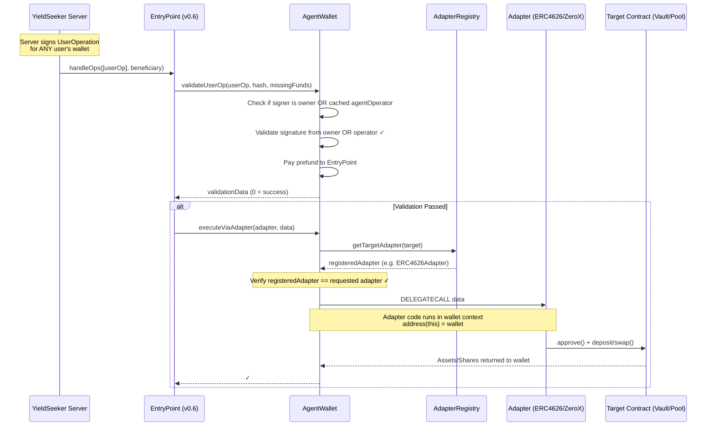
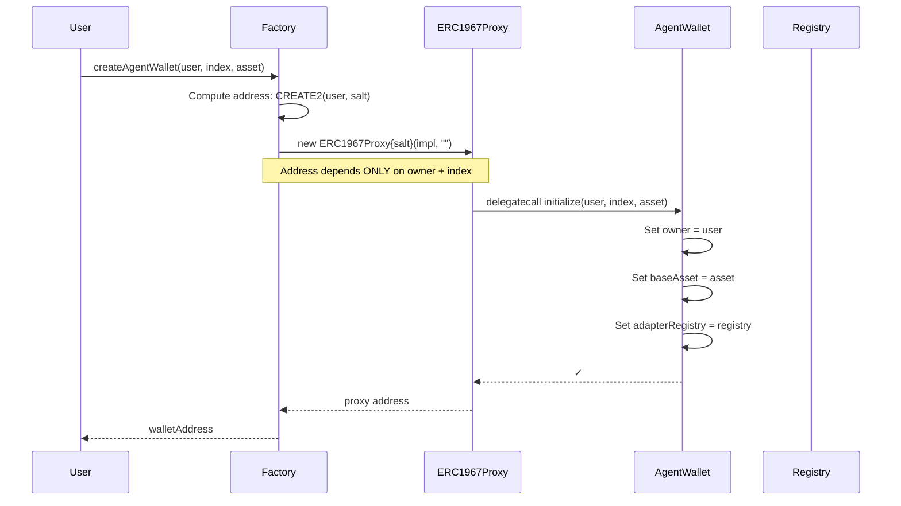
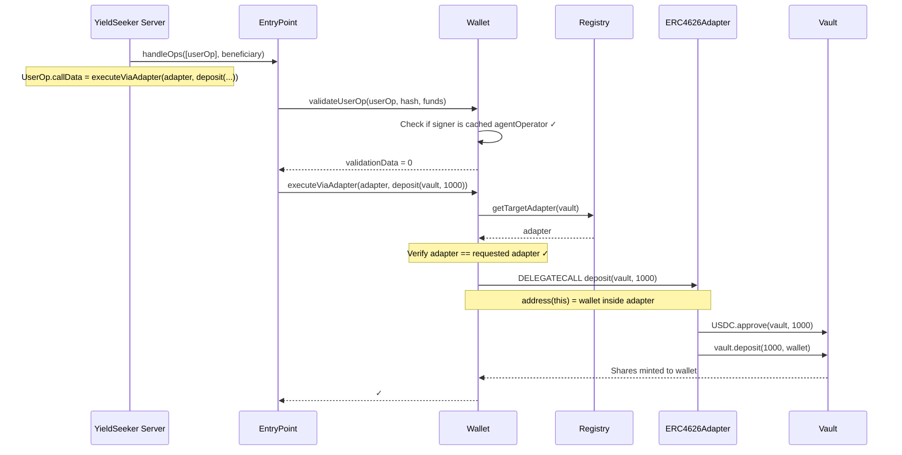
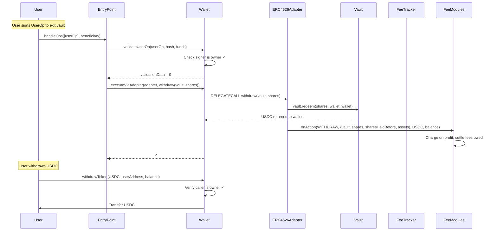
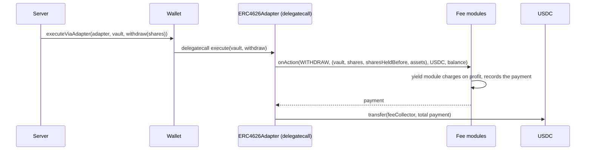
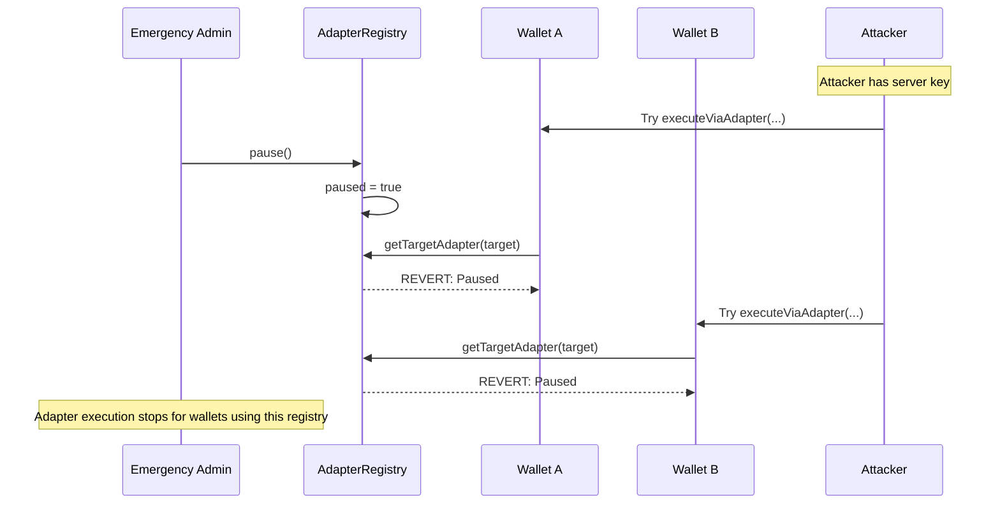

# YieldSeeker Contracts

## Overview

This is a **parameter-level validated smart wallet system** for autonomous agents. Unlike traditional smart wallets that only restrict which _functions_ can be called, this system validates the _parameters_ of each call and supports a centralized server that can manage multiple wallets without individual configuration.

### The Problem with Traditional Smart Wallets

Traditional smart wallets typically allow session keys with function selector restrictions:
- ✅ "Key X can call `swap()` on Uniswap"
- ❌ But they **cannot prevent**: `swap(USDC, attacker_wallet, 100%)`

If an operator key is compromised, an attacker can:
1. Call allowed functions with malicious parameters
2. Redirect funds to their own address
3. Drain the wallet completely

### Our Solution: Adapter-Based Execution with Onchain Proof

This system enforces **parameter-level validation** through protocol-specific adapters:

```
┌─────────────────────────────────────────────────────────────────────┐
│                         AgentWallet                                  │
│                                                                      │
│  ┌─────────────────────────────────────────────────────────────┐   │
│  │ executeViaAdapter(adapter, target, data)                     │   │
│  │                                                              │   │
│  │  1. Query AdapterRegistry: Is adapter registered?            │   │
│  │  2. Query AdapterRegistry: Is target mapped to this adapter? │   │
│  │  3. DELEGATECALL adapter.execute(target, data)               │   │
│  │     └─> Adapter validates ALL parameters in wallet context   │   │
│  └─────────────────────────────────────────────────────────────┘   │
│                                                                      │
│  ┌─────────────────────────────────────────────────────────────┐   │
│  │ execute(target, value, data) → DISABLED                      │   │
│  │  ❌ Cannot call arbitrary contracts                          │   │
│  └─────────────────────────────────────────────────────────────┘   │
└─────────────────────────────────────────────────────────────────────┘
```

**Key Security Properties:**
1. **Adapter Validation**: Every adapter function validates that outputs go to `address(this)` (the wallet)
2. **Target Whitelist**: Adapters can only interact with registered targets (vaults, pools, etc.)
3. **No Arbitrary Calls**: The `execute()` function is disabled - all operations must go through adapters
4. **Server Cannot Steal**: Even if the server is compromised, it can only call adapter functions that return assets to the wallet

### Emergency Controls and Stale Cache Mitigation

**Important Limitation**: Wallets cache `agentOperators` locally for ERC-4337 gas efficiency. This creates a window where:
- A removed operator can still sign for wallets that have not called `syncFromFactory()`
- A Factory role change does not push new authorization state into already deployed wallets

**Operator Revocation Procedure:**
1. **Pause first**: Call `AdapterRegistry.pause()` to stop adapter execution across all wallets immediately.
2. **Revoke globally**: Remove the operator's `AGENT_OPERATOR_ROLE` from the Factory.
3. **Synchronize every wallet**: Call `syncFromFactory()` on every existing wallet and verify that the revoked operator is no longer cached. This is a per-wallet operation; revoking the Factory role alone does not update deployed wallets. Calls may be submitted individually or through a batch process, but every wallet must complete synchronization.
4. **Resume**: Call `AdapterRegistry.unpause()` only after all wallets have synchronized.

Without the registry pause, unsynchronized wallets remain able to accept the revoked operator's adapter UserOperations until their local cache is refreshed.

### Standards Compliance

| Standard | Purpose |
|----------|---------|
| **ERC-4337** | Account Abstraction - gas sponsorship, UserOperations |
| **UUPS** | Upgradeable Proxies - user-controlled wallet upgrades |
| **ERC-7201** | Namespaced Storage - safe upgrades without storage collisions |

---

## Deployment & Security Requirements

### Chain Compatibility
- **Target Chain**: Base (Chain ID: 8453)
- **EntryPoint**: `0x5FF137D4b0FDCD49DcA30c7CF57E578a026d2789` (ERC-4337 v0.6)

### Adapter Requirements
- **Immutability**: All registered adapters MUST be immutable. They should not have upgradeability patterns (like `UUPS` or `TransparentProxy`) unless the proxy admin is the same as the `AdapterRegistry` admin.
- **No Self-Destruct**: Adapters MUST NOT contain the `selfdestruct` opcode.
- **Validation**: Adapters MUST follow the "Peek and Verify" pattern, taking the `target` address as their first argument to allow the `AgentWallet` to validate the call against the `AdapterRegistry`.
- **Stateless Design**: Adapters are designed to be **stateless code libraries** that execute via `delegatecall`. They should NEVER hold funds (ETH or tokens). All assets remain in the AgentWallet during adapter execution.

### Adapter Fund Handling
Since adapters execute via `delegatecall` in the wallet's context:
- All `approve()` calls are made FROM the wallet
- All `deposit()` calls send funds FROM the wallet
- All shares/receipts are minted TO the wallet (`address(this)` inside adapter = wallet address)
- Adapters cannot redirect funds to other addresses

### Technical Stack
- **Solidity Version**: `0.8.28`
- **Framework**: Foundry
- **ERC-4337 Version**: v0.6

---

## Fee Model

Adapters never decide fees. After every action they report what the wallet did (a deposit, a withdrawal, a swap, a claim, a debt change) to every fee module, and each module decides what that costs. The adapter then pays each module's fees due from the wallet's base asset to the fee collector, in the same transaction.

### Yield fee (`YIELD_FEE`, all agent types)

1. **On Deposit**: the module adds the base asset deposited to the target's cost basis
2. **On Withdrawal**: the adapter reports what share of the wallet's position it withdrew (shares, or balance for rebasing vaults); the same share of the cost basis is released, and anything received above it is yield
   - Fee = `yield * feeRate / 10000`, where `feeRate` is the owner's plan rate for `YIELD_FEE`
   - If loss: No fee, cost basis reduced for the remaining position
3. **Rewards**: rewards claimed in the base asset are yield. The base asset received for selling any other token is yield. Rewards paid as vault shares or rebasing tokens have no cost basis, so their value is yield when withdrawn.

### Borrow fee (`BORROW_FEE`)

A yearly fee on borrowed principal, counted in the borrowed token per market and reported by the lending adapters on every borrow, repay and collateral withdrawal. It is due in the base asset (the collateral) at the oracle price and paid at the first action that leaves base asset in the wallet; a token without a fresh price waits until it has one. Borrowed tokens can be withdrawn in full. The app shows the post-fee value by subtracting `borrowFeeModule.feesOwed(wallet, debtToken)` plus `pendingFee(wallet, market)`, converted with the price oracle.

### Key Properties
- **Loss Protection**: If a withdrawal results in a loss, the cost basis for the remaining position is reduced, and no fees are accrued.
- **No pending fees in the wallet**: fees are paid as soon as the wallet holds base asset, so the wallet's base-asset balance is what the owner can withdraw.
- **Non-Custodial**: Fees are only paid from the wallet's balance; the platform never has direct custody of user funds beyond the earned fees.

---

## Architecture Overview

### Execution Flow



### Key Architecture Points

1. **Single Server Key**: One server private key can sign UserOperations for ALL wallets
2. **No Per-Wallet Config**: Server is authorized via Factory role, not individual wallet settings
3. **Cached Auth**: Wallets cache `agentOperators` list from Factory for gas-efficient ERC-4337 validation
4. **Adapter Validation**: Every `executeViaAdapter` call verifies the adapter is registered for the target

### System Constants

| Constant | Value | Description |
|----------|-------|-------------|
| `ENTRY_POINT` | `0x5FF137D4b0FDCD49DcA30c7CF57E578a026d2789` | ERC-4337 v0.6 EntryPoint |
| `FEE_DENOMINATOR` | `10000` | Fee rate denominator (e.g., 1000 = 10%) |

---

## Contract Reference

### Core Contracts

#### AgentWallet (`src/AgentWallet.sol`)

The user's smart wallet that holds funds and executes validated operations.

**Inheritance Chain:**
```
BaseAccount (ERC-4337) → Initializable → UUPSUpgradeable
```

**Storage (ERC-7201 Namespaced):**
| Field | Type | Description |
|-------|------|-------------|
| `owner` | `address` | Wallet owner (can withdraw, upgrade) |
| `ownerAgentIndex` | `uint256` | Index of this agent for the owner |
| `baseAsset` | `IERC20` | The primary asset this agent manages (e.g. USDC) |
| `adapterRegistry` | `AdapterRegistry` | Cached reference to AdapterRegistry from Factory |
| `feeTracker` | `FeeTracker` | Cached reference to FeeTracker from Factory |
| `agentOperators` | `address[]` | Cached list of authorized operators from Factory |
| `isAgentOperator` | `mapping(address => bool)` | Fast lookup for operator status |
| `blockedAdapters` | `mapping(address => bool)` | User-level adapter blocklist |
| `blockedTargets` | `mapping(address => bool)` | User-level target blocklist |

**Events:**
```solidity
event SyncedFromFactory(address indexed adapterRegistry, address indexed feeTracker);
```

**Key Functions:**

| Function | Access | Description |
|----------|--------|-------------|
| `initialize(owner, index, asset)` | Factory only | Sets up wallet and syncs config from Factory |
| `executeViaAdapter(adapter, target, data)` | Executors | Execute via registered adapter (DELEGATECALL) |
| `executeViaAdapterBatch(adapters[], targets[], datas[])` | Executors | Execute multiple adapter calls in a batch |
| `validateUserOp(userOp, hash, funds)` | EntryPoint | ERC-4337 signature validation (owner OR operator) |
| `blockAdapter(adapter)` | Owner only | Block an adapter from being used by this wallet |
| `unblockAdapter(adapter)` | Owner only | Unblock a previously blocked adapter |
| `blockTarget(target)` | Owner only | Block a target from being used by this wallet |
| `unblockTarget(target)` | Owner only | Unblock a previously blocked target |
| `syncFromFactory()` | Anyone | Refresh cached config from Factory |
| `withdrawToken(token, to, amount)` | Owner only | Withdraw any ERC20 token |
| `withdrawETH(to, amount)` | Owner only | Withdraw ETH |
| `upgradeToAndCall(newImpl, data)` | Owner only | UUPS upgrade (validates against Factory) |

**Upgrade Restrictions:**
The wallet enforces that upgrades can only use implementations approved by the Factory:
- User calls `upgradeToAndCall(newImplementation, data)`
- Wallet checks: `factory.isApprovedImplementation(newImplementation)` must be true
- This prevents users from upgrading to malicious implementations
- Factory admin controls which implementations are approved

**User Exit Rights:**
Despite Factory-controlled upgrades, users maintain sovereignty:
- **Withdrawal**: Owner can always call `withdrawToken()` and `withdrawETH()` to exit completely
- **Block Adapters**: Owner can block any adapter/target they don't trust
- **Exit Right**: During the timelock period, owners can withdraw all funds if they reject the upgrade

This design ensures:
- Users maintain complete sovereignty over their wallets
- No third party can force upgrades (aligns with "verify, don't trust")
- Security through factory approval and timelock notice period
- Users can choose to upgrade, wait, or exit entirely

**Operator Authorization:**
The wallet validates UserOperation signatures from either:
1. The wallet's owner (user's EOA)
2. Any address in the cached `agentOperators` list (synced from Factory)

**Important**: The operator list is cached locally for gas efficiency. After operator changes at the Factory level, wallets must call `syncFromFactory()` to refresh their cache. See [Emergency Controls](#emergency-controls-and-stale-cache-mitigation) for details on this limitation and mitigations.

---

#### AgentWalletFactory (`src/AgentWalletFactory.sol`)

Deploys new agent wallets as ERC1967 proxies and manages global configuration.

**Roles:**
| Role | Description |
|------|-------------|
| `DEFAULT_ADMIN_ROLE` | Manages implementation, registry, and roles |
| `AGENT_OPERATOR_ROLE` | Authorized to create wallets and sign for agents |

**Key Functions:**

| Function | Access | Description |
|----------|--------|-------------|
| `createAgentWallet(owner, index, asset)` | Operator | Deploys new wallet via CREATE2 |
| `getAddress(owner, index)` | View | Predicts address before deployment |
| `setAgentWalletImplementation(newImpl)` | Admin | Updates implementation for NEW wallets |
| `setAdapterRegistry(newRegistry)` | Admin | Updates registry for NEW wallets |
| `setFeeTracker(newTracker)` | Admin | Updates fee tracker for NEW wallets |

**Features:**
- **Deterministic Addresses**: Same owner + index = same address across chains (Asset-agnostic)
- **User Sovereignty**: Factory cannot force-upgrade existing wallets
- **ERC-4337 Compatible**: Implements `IEntryPoint.getSenderAddress()` pattern

---

#### AdapterRegistry (`src/AdapterRegistry.sol`)

The central registry that manages authorized adapters and their targets.

**Roles:**
| Role | Description |
|------|-------------|
| `DEFAULT_ADMIN_ROLE` | Can register adapters and targets |
| `EMERGENCY_ROLE` | Can remove targets/adapters and pause instantly |

**Key Functions:**

| Function | Access | Description |
|----------|--------|-------------|
| `registerAdapter(adapter)` | Admin | Register a new adapter contract |
| `setTargetAdapter(target, adapter)` | Admin | Map a target (vault/pool) to its adapter |
| `removeTarget(target)` | Emergency | Remove target mapping instantly |
| `unregisterAdapter(adapter)` | Emergency | Disable adapter (mappings preserved for re-registration) |
| `pause()` / `unpause()` | Emergency / Admin | Emergency pause/unpause |
| `getTargetAdapter(target)` | View | Returns adapter for target (reverts if paused) |
| `getAllTargets()` | View | Returns list of all registered targets |

---

#### FeeTracker (`src/fees/FeeTracker.sol`) and fee modules

The fee tracker holds the fee plans, the fee collector and one module per fee type. After every action, the adapter reports it to every module with one call, `onAction(action, data, baseAsset, available)`. Actions and their data layouts are listed in `FeeActions` (`DEPOSIT`, `WITHDRAW`, `SWAP`, `CLAIM`, `DEBT_CHANGE`). Each module records what the action costs, then returns what the wallet pays now (at most `available`, recorded as paid); the adapter sends the total to the fee collector in one transfer. Modules are keyed on `msg.sender`, so a caller can only affect its own accounting.

| Contract | Role |
|----------|------|
| `YieldSeekerFeeTracker` | Plans (a rate per fee type per plan; every owner starts on plan 0), `feeCollector`, `setFeeModule` (adds or replaces a fee type's module), `feeRateBps(feeType, wallet)`, and `withdrawReserve(wallet, token)`, which combines every module's answer (each called with a gas limit; a failing module counts as allowing nothing, and the base asset can always leave) |
| `YieldSeekerYieldFeeModule` (`YIELD_FEE`) | Cost basis per target; charges on withdrawals above cost basis, base-asset claims and base asset received from swaps |
| `YieldSeekerBorrowFeeModule` (`BORROW_FEE`) | Debt positions per market; charges yearly on principal at every debt change; fees due in the base asset at the oracle price |

Adding a fee type needs only a new module (`setFeeModule`, then `setPlanRate` for every plan); adapters, the tracker and wallets don't change. Adding an action (for a new agent type's adapters) needs a new `FeeActions` constant; deployed modules ignore actions they don't know, so only modules that should charge for it change.

---

### Adapters (`src/adapters/`)

Adapters are stateless contracts that execute protocol interactions via DELEGATECALL. They inherit from adapter base classes to enforce security constraints and provide common functionality.

#### Base Classes

**YieldSeekerAdapter (`src/adapters/Adapter.sol`)**
Abstract base class for all adapters providing:
- `onlyDelegateCall` modifier to prevent direct calls
- Fee reporting: `_report(action, data)` (tells every fee module, then pays the fees they settle in one transfer)
- Base asset validation: `_requireBaseAsset(address)`

#### Concrete Adapters

#### ERC4626Adapter (`src/adapters/ERC4626Adapter.sol`)

For Yearn V3, MetaMorpho, Morpho Blue, and other ERC4626 vaults.

**Functions:**
- `deposit(vault, assetAmount)` - Deposit base asset into vault
- `depositPercentage(vault, percentageBps)` - Deposit percentage of wallet balance
- `withdraw(vault, shareAmount)` - Withdraw shares from vault

**Validation:**
- Enforces that the vault's underlying asset matches the wallet's `baseAsset`
- Reports deposits and withdrawals (shares redeemed out of shares held) to the fee modules

**Known Limitation / Future Work**:
- Deposits do not accept a `minShares` bound, and withdrawals do not accept a `minAssets` bound.
- Future ERC4626 adapter versions should add explicit minimum-output parameters. The current version relies on approved vaults and does not add slippage bounds.

---

#### ZeroXAdapter (`src/adapters/ZeroXAdapter.sol`)

For 0x Protocol swaps.

**Functions:**
- `swap(zeroXTarget, swapCalldata)` - Execute a 0x swap

**Validation:**
- Decodes swap calldata to verify `recipient` is the wallet
- Prevents swaps that would send tokens elsewhere

---

#### MerklAdapter (`src/adapters/MerklAdapter.sol`)

For claiming Merkl rewards.

**Functions:**
- `claim(distributor, users[], tokens[], amounts[], proofs[][])` - Claim rewards

**Validation:**
- Verifies all `users` in the claim are the wallet address
- Prevents claiming rewards to other addresses

---

#### AaveV3Adapter (`src/adapters/AaveV3Adapter.sol`)

For Aave V3 lending pools. Handles deposits/withdrawals to Aave pools where the underlying asset is supplied to earn yield via aTokens.

**Functions:**
- `deposit(pool, assetAmount)` - Supply base asset to Aave pool, receive aTokens
- `depositPercentage(pool, percentageBps)` - Deposit percentage of wallet balance
- `withdraw(pool, assetAmount)` - Withdraw underlying from Aave pool by burning aTokens

**Validation:**
- Enforces that the pool's underlying asset matches the wallet's `baseAsset`
- Reports deposits and withdrawals (balance withdrawn out of balance held) to the fee modules

**Technical Notes:**
- Aave V3 uses rebasing aTokens where balance increases automatically with accrued yield
- The adapter queries the aToken address from the pool's reserve data
- Withdrawals burn aTokens and return the underlying asset plus accrued interest

---

#### CompoundV3Adapter (`src/adapters/CompoundV3Adapter.sol`)

For Compound V3 (Comet) markets. Handles deposits/withdrawals to Compound V3 markets where the base asset earns supply APY.

**Functions:**
- `deposit(comet, assetAmount)` - Supply base asset to Comet market
- `depositPercentage(comet, percentageBps)` - Deposit percentage of wallet balance
- `withdraw(comet, assetAmount)` - Withdraw assets from Comet market

**Validation:**
- Enforces that the Comet's base token matches the wallet's `baseAsset`
- Reports deposits and withdrawals (balance withdrawn out of balance held) to the fee modules

**Technical Notes:**
- Compound V3 uses a rebasing balance model where `balanceOf()` returns principal + accrued interest
- Unlike Compound V2, there are no cTokens; the Comet contract itself tracks balances
- The adapter uses the wallet's Comet balance change to determine shares received

---

#### CompoundV2Adapter (`src/adapters/CompoundV2Adapter.sol`)

For Compound V2 and its forks (Moonwell, Venus, etc.). Handles deposits/withdrawals via cToken/mToken mint and redeem operations.

**Functions:**
- `deposit(cToken, assetAmount)` - Mint cTokens by supplying underlying asset
- `depositPercentage(cToken, percentageBps)` - Deposit percentage of wallet balance
- `withdraw(cToken, cTokenAmount)` - Redeem cTokens for underlying

**Validation:**
- Enforces that the cToken's underlying matches the wallet's `baseAsset`
- Reports deposits and withdrawals (cTokens redeemed out of cTokens held) to the fee modules
- Wraps underlying paid out as native ETH back into the base asset

**Technical Notes:**
- Compound V2 uses an exchange rate model where cTokens appreciate over time
- `mint(amount)` supplies underlying and mints cTokens at the current exchange rate
- `redeem(cTokens)` burns cTokens and pays out underlying at the current exchange rate
- Exchange rate = (totalCash + totalBorrows - reserves) / totalSupply
- Works with Moonwell (mTokens), Venus (vTokens), and other Compound V2 forks

---

## Security Model

### Actors

| Actor | Description |
|-------|-------------|
| **User** | EOA that owns a wallet. Can withdraw funds and upgrade their wallet. |
| **YieldSeeker Server** | Centralized backend service that can sign UserOperations for ANY wallet. |
| **Platform Admin** | Manages the AdapterRegistry and Factory. |
| **Emergency Admin** | Can instantly pause, remove adapters, or targets in case of compromise. |

---

### Permissions by Contract

#### AgentWallet

| Action | Owner | Server | Adapter | Anyone |
|--------|-------|--------|---------|--------|
| `executeViaAdapter()` | ✅ | ✅ | ❌ | ❌ |
| `withdrawToken()` | ✅ | ❌ | ❌ | ❌ |
| `withdrawETH()` | ✅ | ❌ | ❌ | ❌ |
| `upgradeToAndCall()` | ✅ | ❌ | ❌ | ❌ |
| `blockAdapter()` | ✅ | ❌ | ❌ | ❌ |
| `blockTarget()` | ✅ | ❌ | ❌ | ❌ |
| `syncFromFactory()` | ✅ | ✅ | ✅ | ✅ |
| `execute()` | ❌ (DISABLED) | ❌ (DISABLED) | ❌ | ❌ |
| Receive deposits | ✅ | ✅ | ✅ | ✅ |

---

#### AgentWalletFactory

| Action | Admin | Operator | Anyone |
|--------|-------|----------|--------|
| `createAgentWallet()` | ✅ | ✅ | ❌ |
| `setAgentWalletImplementation()` | ✅ | ❌ | ❌ |
| `setAdapterRegistry()` | ✅ | ❌ | ❌ |
| `setFeeTracker()` | ✅ | ❌ | ❌ |
| `grantRole()` | ✅ | ❌ | ❌ |
| `getAddress()` | ✅ | ✅ | ✅ |

---

#### AdapterRegistry

| Action | Admin | Emergency | Anyone |
|--------|-------|-----------|--------|
| `registerAdapter()` | ✅ | ❌ | ❌ |
| `setTargetAdapter()` | ✅ | ❌ | ❌ |
| `removeTarget()` | ✅ | ✅ | ❌ |
| `unregisterAdapter()` | ✅ | ✅ | ❌ |
| `pause()` | ❌ | ✅ | ❌ |
| `unpause()` | ✅ | ❌ | ❌ |
| `getTargetAdapter()` | ✅ | ✅ | ✅ |

---

### Attack Scenarios

#### Scenario 1: Server Key Compromised

**Attack Vector**: Attacker obtains the YieldSeeker server private key.

**What Attacker CAN Do:**
- Sign UserOperations for any wallet
- Call `executeViaAdapter()` with registered adapters
- Deposit funds into registered vaults
- Swap tokens via registered 0x targets

**What Attacker CANNOT Do:**
- ❌ Transfer tokens directly (no `execute()`)
- ❌ Call unregistered adapters
- ❌ Interact with unregistered targets
- ❌ Withdraw to external addresses (adapters validate `recipient == wallet`)
- ❌ Upgrade wallets (owner only)

**Mitigation:**
1. Emergency admin calls `AdapterRegistry.pause()` - instantly stops all operations
2. Admin removes compromised operator from Factory
3. Users call `syncFromFactory()` to refresh their wallet's operator cache

---

#### Scenario 2: Malicious Adapter Registered

**Attack Vector**: Admin accidentally registers a malicious adapter that drains funds.

**Protection Layers:**
1. **Timelock**: Admin operations go through `AdminTimelock` with delay
2. **User Blocklist**: Users can call `blockAdapter(maliciousAdapter)` on their wallet
3. **Emergency Removal**: Emergency admin can instantly `unregisterAdapter()`

---

#### Scenario 3: User Wants to Exit

**User Rights:**
- Call `withdrawToken(USDC, userAddress, balance)` - always works
- Call `withdrawETH(userAddress, balance)` - always works
- No approval from server or platform needed
- User maintains complete sovereignty

---

## Example Flows

### Flow 1: Agent Wallet Creation

**Actors:**
- User (EOA that will own the wallet)
- Anyone (can call factory)

**Pre-requisites:**
- Factory deployed with implementation

**Sequence:**



**Result:**
- New wallet deployed at deterministic address (Asset-agnostic)
- User is owner (can withdraw, upgrade)
- Wallet ready to receive deposits
- Server can sign UserOperations for this wallet (no configuration needed)

**Code Example:**
```solidity
// Anyone with AGENT_OPERATOR_ROLE can create wallet for user
address walletAddr = factory.createAgentWallet(
    userAddress,     // Owner
    0,               // Index
    usdcAddress      // Base Asset
);

// User can now deposit USDC
IERC20(USDC).transfer(walletAddr, 1000e6);

// Server can immediately manage this wallet (no setup needed)
```

---

### Flow 2: User Deposits USDC, Server Manages Vault Positions

**Actors:**
- User (EOA that owns the wallet)
- YieldSeeker Server (signs UserOperations)

**Pre-requisites:**
- Agent wallet already created for user
- ERC4626Adapter registered in AdapterRegistry
- Target vault registered in AdapterRegistry (mapped to ERC4626Adapter)
- Server address set as `agentOperator` in Factory

**Step 1: User deposits USDC to their wallet**
```solidity
// User sends 1000 USDC to their agent wallet
IERC20(USDC).transfer(walletAddress, 1000e6);
```

**Step 2: Server deposits USDC into ERC4626 vault**



**Security Properties:**
- Server cannot transfer tokens directly out of wallet
- User retains full control and can withdraw at any time
- Single server key manages all wallets (no per-wallet configuration)

---

### Flow 3: User Withdraws Funds

**Actors:**
- User (EOA that owns the wallet)

**Pre-requisites:**
- User has funds in wallet (either USDC or vault shares)

**Option A: Direct Token Withdrawal**
```solidity
// User withdraws USDC directly from wallet
AgentWallet(walletAddress).withdrawToken(
    USDC,           // token
    userAddress,    // to
    1000e6          // amount
);
```

**Option B: Exit Vault Position First, Then Withdraw**



**Security Properties:**
- Only the owner can call `withdrawToken()` and `withdrawETH()`
- No server or platform approval needed
- User can exit at any time regardless of server status

---

### Flow 4: Fee Payment

**Actors:**
- Server (agent operator)
- User's Wallet

**Pre-requisites:**
- The wallet has a vault position in profit

**Sequence:**



**Fee Calculation:**
- Fee is only charged on realized profits
- If user deposits 1000 USDC and withdraws 1100 USDC worth of shares:
  - Profit = 100 USDC
  - Fee (at 10% rate) = 10 USDC

---

### Flow 5: Emergency Pause

**Actors:**
- Emergency Admin
- All Wallets

**Trigger:** Server key compromise detected

**Sequence:**



**Key Properties:**
- A single `pause()` call blocks adapter execution through the paused registry.
- Direct owner withdrawals through `withdrawToken()` / `withdrawETH()` remain available.
- Pausing the borrow registry also blocks adapter-based repay and collateral withdrawal until the timelock unpauses it.

---

## Deployment

### Setup

Set these environment variables before running the scripts:
- `DEPLOYER_PRIVATE_KEY`: deployer and timelock proposer key
- `MULTISIG_ADMIN_ADDRESS`: timelock admin and executor
- `SERVER_ADDRESS`: backend operator address
- `PLAN_MANAGER_ADDRESS`: can move users to cheaper fee plans
- `FEE_COLLECTOR_ADDRESS`: receives fees
- `RPC_NODE_URL_8453`: Base RPC endpoint
- `ETHERSCAN_API_KEY`: optional contract verification key

The scripts target Base (chain ID 8453). `Deploy.s.sol` keeps the deployer as emergency admin.

### Deploy

`Deploy.s.sol` deploys contracts whose addresses are missing or zero in `deployments.json`. It deploys the V3 vault registry and borrow registry with their adapters, the fee tracker and its vault and borrow fee modules, configures the static borrow targets, copies every V2 vault registry target into the V3 vault registry (see below), wires the factory and fee tracker, grants the operator role, and schedules a configuration batch. It never deploys or changes the V2 system, which stays in `deployments.json` under `agentWalletV2*` keys.

```bash
forge script script/Deploy.s.sol:DeployScript --rpc-url "$RPC_NODE_URL_8453" --broadcast --verify
```

New and reused addresses are saved to `deployments.json`. In production, execute the emitted deploy configuration batch and wait for it to complete before setting price sources or registering borrow markets.

### Two vault registries

V2 wallets keep using the V2 vault registry (`agentWalletV2AdapterRegistry`), whose adapters record fees on the legacy V2 FeeTracker. V3 vault wallets use the V3 vault registry (`vaultAdapterRegistry`), whose adapters record fees on the V3 vault fee module. A registry maps each target to one adapter, so the two systems can't share one registry. Until every V2 wallet has moved to V3, the two vault registries must hold exactly the same targets:
- `Deploy.s.sol` maps every V2 vault registry target onto the V3 adapter of the same kind (and fails on a V2 adapter it doesn't know). Re-running it schedules any target the V3 registry is missing.
- `RegisterVault.s.sol` always registers a vault in both registries in one timelock batch.
- Sellable tokens live in the one `swapSellPolicy` that both registries' swap adapters read, so they can't drift.
- An emergency `removeTarget` or `unregisterAdapter` on one registry must be repeated on the other.
- The V3 vault registry also maps the wallet link registry to the agent transfer adapter; the V2 registry doesn't.

### Configure vaults and sellable tokens

Register each vault target that vault agents may use (in both vault registries, in one timelock batch):

```bash
forge script script/RegisterVault.s.sol:RegisterVaultScript --rpc-url "$RPC_NODE_URL_8453" --broadcast --sig "run(address,string)" <VAULT_ADDRESS> erc4626

# Add tokens that agents are allowed to sell in swaps
forge script script/AddSellableTokens.s.sol:AddSellableTokensScript --rpc-url "$RPC_NODE_URL_8453" --broadcast --sig "run(address[])" "[<token_1>, <token_2>, ...]"
```

### Set price sources

Set all collateral and debt asset price sources before registering borrow markets. Staleness limits are in seconds: WETH and cbBTC use one hour (`3600`), USDC uses 25 hours (`90000`), and MAG7 equity feeds use two hours (`7200`). The short MAG7 limit stops swaps and collateral fee payments when the stock market is closed; fees remain owed until they can be paid.

```bash
WETH=0x4200000000000000000000000000000000000006
CBBTC=0xcbB7C0000aB88B473b1f5aFd9ef808440eed33Bf
USDC=0x833589fCD6eDb6E08f4c7C32D4f71b54bdA02913
AAVE_V4_SPOKE=0x17905Db0e4A3514467539956c084180616AE7B8D
RESERVE_COUNT=$(cast call "$AAVE_V4_SPOKE" "getReserveCount()(uint256)" --rpc-url "$RPC_NODE_URL_8453")

# WETH, cbBTC, and USDC Chainlink USD feeds
forge script script/SetPriceSource.s.sol:SetPriceSourceScript --rpc-url "$RPC_NODE_URL_8453" --broadcast --sig "run(address,address,uint32)" "$WETH" 0x71041dddad3595F9CEd3DcCFBe3D1F4b0a16Bb70 3600
forge script script/SetPriceSource.s.sol:SetPriceSourceScript --rpc-url "$RPC_NODE_URL_8453" --broadcast --sig "run(address,address,uint32)" "$CBBTC" 0x07DA0E54543a844a80ABE69c8A12F22B3aA59f9D 3600
forge script script/SetPriceSource.s.sol:SetPriceSourceScript --rpc-url "$RPC_NODE_URL_8453" --broadcast --sig "run(address,address,uint32)" "$USDC" 0x7e860098F58bBFC8648a4311b374B1D669a2bc6B 90000

# Configure each MAG7 reserve token from the Aave V4 spoke oracle (excluding USDC reserve 7)
AAVE_V4_ORACLE=$(cast call "$AAVE_V4_SPOKE" "ORACLE()(address)" --rpc-url "$RPC_NODE_URL_8453")
for ((reserveId=0; reserveId<RESERVE_COUNT; reserveId++)); do
  [ "$reserveId" -eq 7 ] && continue
  RESERVE=$(cast call "$AAVE_V4_SPOKE" "getReserve(uint256)((address,address,uint16,uint8,uint24,uint8,uint32))" "$reserveId" --rpc-url "$RPC_NODE_URL_8453" --json)
  ASSET=$(printf '%s' "$RESERVE" | jq -r '.[0]')
  case "$ASSET" in "$WETH"|"$CBBTC"|"$USDC") continue ;; esac
  FEED=$(cast call "$AAVE_V4_ORACLE" "getReserveSource(uint256)(address)" "$reserveId" --rpc-url "$RPC_NODE_URL_8453")
  forge script script/SetPriceSource.s.sol:SetPriceSourceScript --rpc-url "$RPC_NODE_URL_8453" --broadcast --sig "run(address,address,uint32)" "$ASSET" "$FEED" 7200
done
```

Each `SetPriceSource` run prints the feed decimals, description, and latest round data, and rejects nonpositive or stale answers. In production, execute the emitted price-source timelock operations before continuing.

### Register borrow markets

The script validates the Base protocol addresses, requires collateral and debt to differ, and requires price sources for both assets. Market bytes are ABI encodings of protocol and market parameters; `cast abi-encode` produces the `bytes` argument. It prints the raw market bytes and target so the multisig can recompute the registration target.

Configuration rules:
- Register at most one borrow market per `(pool or spoke, collateral)` pair; do not add eMode variants.
- Do not register a base-asset Aave V3 vault in the borrow registry.
- Do not register opposite borrow pairs: if X is collateral and Y is debt, do not also register Y as collateral and X as debt.

```bash
WETH=0x4200000000000000000000000000000000000006
USDC=0x833589fCD6eDb6E08f4c7C32D4f71b54bdA02913
CBBTC=0xcbB7C0000aB88B473b1f5aFd9ef808440eed33Bf
AAVE_V3_POOL=0xA238Dd80C259a72e81d7e4664a9801593F98d1c5

# Aave V3 WETH/USDC and cbBTC/USDC, eMode 0
MARKET=$(cast abi-encode "f(address,address,address,uint8)" "$AAVE_V3_POOL" "$WETH" "$USDC" 0)
forge script script/RegisterBorrowMarket.s.sol:RegisterBorrowMarketScript --rpc-url "$RPC_NODE_URL_8453" --broadcast --sig "run(string,bytes)" aavev3 "$MARKET"
MARKET=$(cast abi-encode "f(address,address,address,uint8)" "$AAVE_V3_POOL" "$CBBTC" "$USDC" 0)
forge script script/RegisterBorrowMarket.s.sol:RegisterBorrowMarketScript --rpc-url "$RPC_NODE_URL_8453" --broadcast --sig "run(string,bytes)" aavev3 "$MARKET"

# Morpho Blue USDC loans against WETH and cbBTC, LLTV 0.86e18
MORPHO_BLUE=0xBBBBBbbBBb9cC5e90e3b3Af64bdAF62C37EEFFCb
MORPHO_ADAPTIVE_IRM=0x46415998764C29aB2a25CbeA6254146D50D22687
MORPHO_WETH_USDC_ORACLE=0xFEa2D58cEfCb9fcb597723c6bAE66fFE4193aFE4
MORPHO_CBBTC_USDC_ORACLE=0x663BECd10daE6C4A3Dcd89F1d76c1174199639B9
LLTV=860000000000000000
MARKET=$(cast abi-encode "f(address,(address,address,address,address,uint256))" "$MORPHO_BLUE" "($USDC,$WETH,$MORPHO_WETH_USDC_ORACLE,$MORPHO_ADAPTIVE_IRM,$LLTV)")
forge script script/RegisterBorrowMarket.s.sol:RegisterBorrowMarketScript --rpc-url "$RPC_NODE_URL_8453" --broadcast --sig "run(string,bytes)" morpho "$MARKET"
MARKET=$(cast abi-encode "f(address,(address,address,address,address,uint256))" "$MORPHO_BLUE" "($USDC,$CBBTC,$MORPHO_CBBTC_USDC_ORACLE,$MORPHO_ADAPTIVE_IRM,$LLTV)")
forge script script/RegisterBorrowMarket.s.sol:RegisterBorrowMarketScript --rpc-url "$RPC_NODE_URL_8453" --broadcast --sig "run(string,bytes)" morpho "$MARKET"

# Aave V4 MAG7 collateral against USDC reserve 7
AAVE_V4_SPOKE=0x17905Db0e4A3514467539956c084180616AE7B8D
RESERVE_COUNT=$(cast call "$AAVE_V4_SPOKE" "getReserveCount()(uint256)" --rpc-url "$RPC_NODE_URL_8453")
for ((reserveId=0; reserveId<RESERVE_COUNT; reserveId++)); do
  [ "$reserveId" -eq 7 ] && continue
  MARKET=$(cast abi-encode "f(address,uint256,uint256)" "$AAVE_V4_SPOKE" "$reserveId" 7)
  forge script script/RegisterBorrowMarket.s.sol:RegisterBorrowMarketScript --rpc-url "$RPC_NODE_URL_8453" --broadcast --sig "run(string,bytes)" aavev4 "$MARKET"
done
```

In production, execute each emitted borrow-market timelock operation after the required delay.

### Execute from the multisig

In production, scripts schedule timelock operations rather than executing them immediately. Wait for each operation's delay, then execute the deploy configuration and vault registrations with `executeBatch(address[],uint256[],bytes[],bytes32,bytes32)` or an individual market/source update with `execute(address,uint256,bytes,bytes32,bytes32)`. Copy the emitted arguments exactly.

### Selective redeployment

To redeploy a contract, set its address to `0x0000000000000000000000000000000000000000` in `deployments.json` and run the deployment script again.

---

## Development

### Requirements
- Foundry

### Running Tests
```bash
forge test -vvv
```

### Test Coverage

We have comprehensive tests in `test/`:

| Test File | Description |
|-----------|-------------|
| `Integration.t.sol` | Full lifecycle tests (create wallet, deposit, withdraw) |

**Key Tests:**
- ✅ Happy path: Create wallet, deposit to vault, withdraw
- ✅ Security: Cannot execute via unregistered adapter
- ✅ Security: Cannot call `execute()` directly (disabled)
- ✅ Server auth: Server can sign UserOperations for any wallet
- ✅ Server auth: Cannot execute with invalid server signature
- ✅ Server auth: Owner can still sign their own UserOperations

---

## Upgrade Guide

### Upgrading a Wallet

1. **Admin approves new implementation** in Factory
2. **User initiates upgrade**:
   ```solidity
   wallet.upgradeToAndCall(newImplementation, "");
   ```
3. **Wallet validates** that `factory.isApprovedImplementation(newImpl)` is true
4. **Upgrade executes** via UUPS pattern

### Upgrading Factory Configuration

1. Admin calls `factory.setAdapterRegistry(newRegistry)` or `factory.setFeeTracker(newTracker)`
2. This affects **NEW wallets only**
3. Existing wallets must call `syncFromFactory()` to get updated references

---

### Changing fee logic

Fee accounting lives in the fee modules, per wallet (`YieldFeeModule`: cost basis per target and fees owed; `BorrowFeeModule`: debt positions and fees owed per borrowed token). Replacing a module with `setFeeModule`, or pointing the factory at a new tracker, moves wallets to **zero state**: open cost bases and borrow positions, and fees owed, stay behind in the old module.

- **New fee types:** write a module that implements `IYieldSeekerFeeModule` and charges for the actions it cares about (e.g. a rebalance fee on `WITHDRAW` + `DEPOSIT`), then `setFeeModule(newFeeType, module)` and `setPlanRate` for **every** existing plan (a plan without a rate charges 0 for that fee type). No adapter changes.
- **New actions:** add a constant and its data layout to `FeeActions` and report it from the new adapters. Deployed modules ignore it; a module that should charge for it is deployed (or replaced) with that action handled.
- **New plans:** set a rate for every fee type when creating a plan. Unset fee types are 0%, and the plan manager can move owners onto a plan that is cheaper for any fee type it doesn't set.
- **Replacing a module:** losing vault cost bases means profit made before the switch is never charged; losing borrow positions means the fee built up so far is lost. Migrate the state first if that matters (it needs the list of vaults and markets each wallet used, from off-chain indexing).

---

## Server Authorization Deep Dive

### How Server Signs for Any Wallet

```solidity
// In AgentWallet.validateUserOp():
function _validateSignature(PackedUserOperation calldata userOp, bytes32 userOpHash)
    internal view override returns (uint256)
{
    bytes32 hash = userOpHash.toEthSignedMessageHash();
    address recovered = hash.recover(userOp.signature);

    // Check if signer is owner
    if (recovered == l.owner) {
        return SIG_VALIDATION_SUCCESS;
    }

    // Check if signer is in cached agentOperators list
    if (l.isAgentOperator[recovered]) {
        return SIG_VALIDATION_SUCCESS;
    }

    return SIG_VALIDATION_FAILED;
}
```

### Key Points:
1. **No wallet-specific config**: Server doesn't need to be added to each wallet
2. **Cached for gas**: `isAgentOperator` mapping avoids external calls during validation
3. **Factory is source of truth**: `syncFromFactory()` refreshes the cache
4. **Instant revocation via pause**: Even with stale cache, pausing registry stops all operations

---

## Design Decisions

### Error Handling
Contracts use custom errors for:
- Gas-efficient reverts
- Clear error messages for debugging
- Consistent patterns across contracts

### EnumerableMap vs Simple Mapping Tradeoff
`AdapterRegistry` uses `EnumerableMap` for target→adapter mappings to enable `getAllTargets()` enumeration. Trade-off: Higher gas for writes, but essential for UI/monitoring.

### UUPS over Transparent Proxy
Chosen because:
- Lower deployment cost (no separate ProxyAdmin)
- Upgrade logic in implementation (user controls their wallet)
- Gas savings on every call (no admin slot check)

### ERC-7201 Namespaced Storage
Implementation contracts use ERC-7201 namespaced storage to:
- Prevent storage collisions during upgrades
- Enable safe addition of new storage variables
- Support multiple inheritance patterns
- Follow OpenZeppelin v5 best practices

### Caching vs Real-time Lookups
Wallets cache `agentOperators` and `adapterRegistry` references locally because:
- **ERC-4337 Gas Limits**: External calls during validation would exceed ~50k gas limit
- **Cost Efficiency**: Saves ~8k gas per operation (local SLOAD vs external CALL)
- **User Experience**: Enables sponsored transactions and lower fees
- **Trade-off**: Requires manual `syncFromFactory()` calls after config changes

### Adapter Base Classes
The inheritance hierarchy provides:
- `YieldSeekerAdapter`: Base class with `onlyDelegateCall` protection and helper functions
- `YieldSeekerVaultAdapter`: Abstract vault adapter with standard deposit/withdraw interface
- Concrete adapters: Protocol-specific implementations

This enables:
- Code reuse across similar protocols
- Standardized interfaces for rebalancing logic
- Consistent fee tracking patterns

---

## Gas Considerations

### Transaction Overhead

| Operation | Approximate Gas |
|-----------|-----------------|
| Wallet Creation | ~300k |
| ERC4626 Deposit | ~150k |
| ERC4626 Withdraw | ~180k |
| 0x Swap | ~200k (varies) |
| Merkl Claim | ~100k per token |

### Gas Optimization Strategies
1. **Batch Operations**: Use `executeViaAdapterBatch()` for multiple operations
2. **Paymaster**: Use ERC-4337 paymaster for gas sponsorship
3. **Off-peak Timing**: Execute during low gas periods

---

## Benefits

1. **Onchain Proof** - All operations verifiable on-chain via adapter validation
2. **Parameter Validation** - Adapters validate targets, not just function selectors
3. **Centralized Management** - Single server key manages all wallets
4. **Easy Key Rotation** - Update server address once, affects all wallets
5. **User Sovereignty** - Users can always withdraw and upgrade their wallets
6. **Gas Efficient** - ERC-4337 enables gas sponsorship
7. **Secure** - Strict validation prevents fund theft even if server is compromised
8. **Easier to Extend** - Just register new adapters/targets, no per-wallet updates needed
