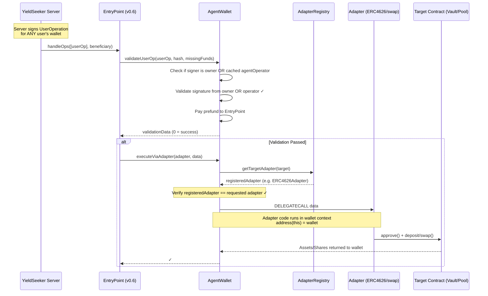
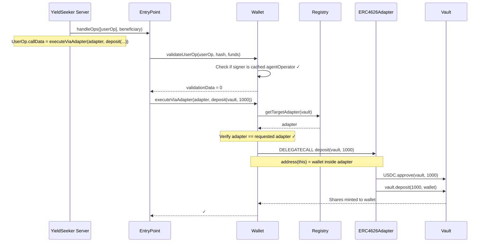
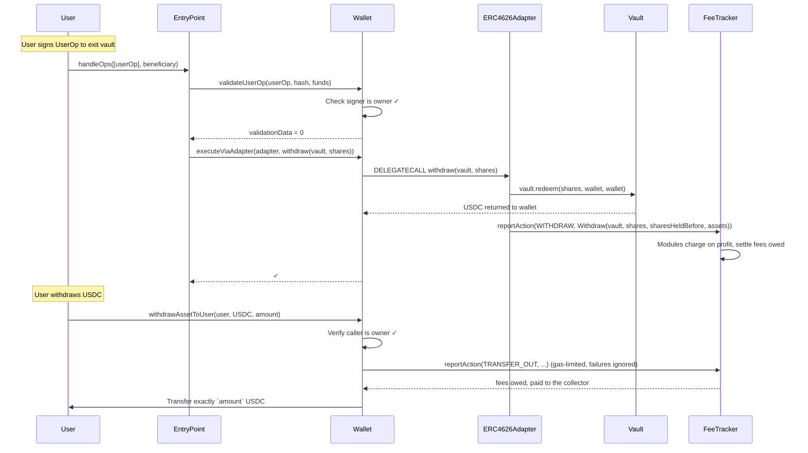
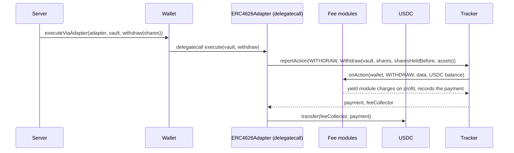
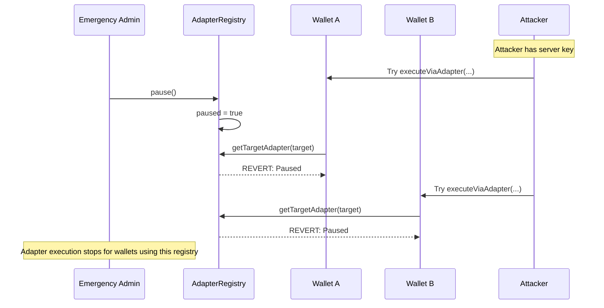

# YieldSeeker Contracts

## Overview

This is a **parameter-level validated smart wallet system** for autonomous agents. Unlike traditional smart wallets that only restrict which _functions_ can be called, this system validates the _parameters_ of each call and supports a centralized server that can manage multiple wallets without individual configuration.

### The Problem with Traditional Smart Wallets

Traditional smart wallets typically allow session keys with function selector restrictions:
- ✅ "Key X can call `swap()` on Uniswap"
- ❌ But they **cannot prevent**: `swap(USDC, attacker_wallet, 100%)`

If an operator key is compromised, an attacker can:
1. Call allowed functions with malicious parameters
2. Redirect funds to their own address
3. Drain the wallet completely

### Our Solution: Adapter-Based Execution with Onchain Proof

This system enforces **parameter-level validation** through protocol-specific adapters:

```
┌─────────────────────────────────────────────────────────────────────┐
│                         AgentWallet                                  │
│                                                                      │
│  ┌─────────────────────────────────────────────────────────────┐   │
│  │ executeViaAdapter(adapter, target, data)                     │   │
│  │                                                              │   │
│  │  1. Query AdapterRegistry: Is adapter registered?            │   │
│  │  2. Query AdapterRegistry: Is target mapped to this adapter? │   │
│  │  3. DELEGATECALL adapter.execute(target, data)               │   │
│  │     └─> Adapter validates ALL parameters in wallet context   │   │
│  └─────────────────────────────────────────────────────────────┘   │
│                                                                      │
│  ┌─────────────────────────────────────────────────────────────┐   │
│  │ execute(target, value, data) → DISABLED                      │   │
│  │  ❌ Cannot call arbitrary contracts                          │   │
│  └─────────────────────────────────────────────────────────────┘   │
└─────────────────────────────────────────────────────────────────────┘
```

**Key Security Properties:**
1. **Adapter Validation**: Adapters constrain outputs to the wallet, except agent transfers, which can send accounted assets only to another agent wallet of the same owner
2. **Target Whitelist**: Adapters can only interact with registered targets (vaults, pools, etc.)
3. **No Arbitrary Calls**: The `execute()` function is disabled - all DeFi protocol interactions must go through adapters
4. **Server Cannot Steal**: Even if compromised, the server cannot send assets to arbitrary external addresses; agent transfers are restricted to the owner's other agent wallets from the same factory

### Emergency Controls and Stale Cache Mitigation

**Important Limitation**: Wallets cache `agentOperators` locally for ERC-4337 gas efficiency (signature validation can't read the factory). A removed operator can still sign for a wallet until that wallet syncs. Anyone can call `syncFromFactory()` on any wallet (it takes no input and only copies the factory's configuration), so the platform syncs every wallet itself instead of waiting for owners.

**Operator Revocation Procedure** (V3 factory; minutes, no user action):
1. **Optional pause**: `pause()` (`EMERGENCY_ROLE`) on `vaultAdapterRegistry` and `borrowAdapterRegistry` closes the window while steps 2–3 run, at the cost of the timelocked unpause (step 4).
2. **Remove the operator**: `factory.removeAgentOperator(operator)` (`EMERGENCY_ROLE`, instant). The emergency role can only remove operators; adding one stays with the timelock.
3. **Sync every wallet**: call `syncFromFactory()` on every V3 wallet (any account, individually or batched) and check `isAgentOperator(operator)` is false on each.
4. **Resume**: if you paused, schedule `unpause()` on each paused registry through the timelock (at least 4 days).

V2 wallets keep the V2 factory, where operator removal and sync are not emergency powers: pause the V2 vault registry `agentWalletV2AdapterRegistry`, revoke the operator through the timelock, have owners or operators sync, then unpause through the timelock.

**After an emergency target removal**: cancel any scheduled timelock operation that would set that target again (`cancel(id)`, `CANCELLER_ROLE`), and remove it from both vault registries; re-running `Deploy.s.sol` copies every V2 vault registry target into the V3 vault registry.

**Recovering stuck positions and tokens**: owners can withdraw only the base asset and tokens a fee module accounts for (borrowed tokens), so that position yield and reward sales are charged. A position whose target was removed comes back by registering the target again through the timelock; the operator or owner then withdraws it through the adapter and the yield fee is charged as usual. A reward token that isn't on the sell list comes back by adding it (`AddSellableTokens.s.sol`), after which the operator sells it for the base asset. Other tokens (e.g. unsolicited airdrops) stay in the wallet.

### Standards Compliance

| Standard | Purpose |
|----------|---------|
| **ERC-4337** | Account Abstraction - gas sponsorship, UserOperations |
| **UUPS** | Upgradeable Proxies - user-controlled wallet upgrades |
| **Namespaced storage** | Fixed `keccak256` slots per namespace (not the ERC-7201 formula) - safe upgrades without storage collisions |

---

## Deployment & Security Requirements

### Chain Compatibility
- **Target Chain**: Base (Chain ID: 8453)
- **EntryPoint**: `0x5FF137D4b0FDCD49DcA30c7CF57E578a026d2789` (ERC-4337 v0.6)

### Adapter Requirements
- **Immutability**: All registered adapters MUST be immutable. They should not have upgradeability patterns (like `UUPS` or `TransparentProxy`) unless the proxy admin is the same as the `AdapterRegistry` admin.
- **No Self-Destruct**: Adapters MUST NOT contain the `selfdestruct` opcode.
- **Validation**: Adapters MUST follow the "Peek and Verify" pattern, taking the `target` address as their first argument to allow the `AgentWallet` to validate the call against the `AdapterRegistry`.
- **Stateless Design**: Adapters are **stateless code libraries** executed via `delegatecall` and should not hold funds themselves. Assets are controlled by the wallet; protocol interactions may move them temporarily, and agent transfers may move accounted assets to another agent wallet of the same owner.

### Adapter Fund Handling
Since adapters execute via `delegatecall` in the wallet's context:
- All `approve()` calls are made FROM the wallet
- All `deposit()` calls send funds FROM the wallet
- All shares/receipts are minted TO the wallet (`address(this)` inside adapter = wallet address)
- Adapter interactions return assets to the wallet; the agent transfer adapter can transfer accounted assets only to another agent wallet of the same owner

### Technical Stack
- **Solidity Version**: `0.8.28`
- **Framework**: Foundry
- **ERC-4337 Version**: v0.6

---

## Fee Model

Adapters report actions to the fee tracker. Before a fee-aware ERC20 owner withdrawal or a transfer to another agent, the outflow is reported first (`TRANSFER_OUT`), so modules settle as much as possible from the wallet's base asset. A successful fixed-amount withdrawal sends exactly the requested token amount. Native ETH withdrawals are owner-only but are not fee-tracker-settled.

### Yield fee (`YIELD_FEE`, all agent types)

1. **On Deposit**: the module adds the base asset deposited to the target's cost basis (a vault, or a lending market's collateral for borrow agents)
2. **On Withdrawal**: the adapter reports what share of the wallet's position it withdrew (shares, or balance for rebasing vaults and lending collateral); the same share of the cost basis is released, and anything received above it is yield
   - Fee = `ceil(yield * rateBps / 10000)`; yield fees round up, where `rateBps` comes from the wallet's `YIELD_FEE` plan
   - If loss: No fee, cost basis reduced for the remaining position
3. **Rewards**: rewards claimed in the base asset are yield. The base asset received for selling a reward token (`REWARD_SALE`) is yield; other trades (`SWAP`, e.g. collateral sold for a borrowed token) are not. Rewards paid as vault shares or rebasing tokens have no cost basis, so their value is yield when withdrawn.
4. **Fund wallets with the base asset**: cost basis only comes from deposits made through the adapters. Vault tokens transferred into a wallet directly (e.g. an owner moving an existing vault position in) have no cost basis, so their whole value, principal included, is charged as yield when withdrawn.

### Borrow fee (`BORROW_FEE`)

A yearly fee on each lending market's debt (interest included), tracked in the borrowed token per market (keyed by the market's registry target, `marketTarget(market)`) and accrued when lending adapters report a borrow, repay, collateral withdrawal or checkpoint. Each period is charged on the debt at the previous report, so after a debt change outside the adapters (a liquidation or direct protocol repay) the server calls the lending adapter's `checkpoint(market)`, which moves no funds and reports the real debt; until then the fee keeps accruing on the old debt. **Operating requirement:** the server checkpoints every market with open debt at least daily and right after any liquidation of a wallet, which bounds both the overcharge after a liquidation and how stale a period's price can be. When charged, the fee is converted to the base asset (the collateral) using the lending market's own price (Aave's oracle, Morpho's oracle or the Aave V4 spoke's oracle), not the YieldSeeker oracle. If a report has no price because debt was cleared outside the adapters, the module values that period at the market's last reported price. Both the fee in the borrowed token and its conversion to the base asset round up. Fees are paid from the base asset at the first reported action or outflow with available balance. Borrowed tokens can be withdrawn in full. The module also keeps the wallet's debt per borrowed token as of each market's last report (`tokenDebt`), which bounds swaps into that token. The app shows the post-fee value by subtracting `borrowFeeModule.feesOwed(wallet)` (base asset) plus `pendingFee(wallet, marketTarget(market))` (borrowed token, not yet charged). For Aave V3, supplying collateral always enables it as collateral, and `withdrawCollateral(market, amount)` withdraws all when `amount >=` the current collateral balance. Collateral that was fully liquidated keeps its old cost basis, so later collateral yield on that market is undercharged (never overcharged).

### Key Properties
- **Loss Protection**: If a withdrawal results in a loss, the cost basis for the remaining position is reduced, and no fees are accrued.
- **Fees are settled before funds leave**: fee-aware ERC20 owner withdrawals and adapter actions report outflows/actions so modules collect fees from the base asset. `withdrawableBalance(asset)` returns the base-asset balance net of `feesOwedInBaseAsset`, the full balance of a fee-tracker-accounted non-base token, or zero for an unaccounted token. A fixed ERC20 amount is sent exactly if the withdrawal succeeds; `withdrawAllAssetToUser` sends the remaining balance after successful fee settlement. Owner ERC20 withdrawal settlement is gas-limited and failure-tolerant, so a module or collector failure does not block the withdrawal; fees remain owed and `FeeSettlementFailed` is emitted. Adapter actions are not isolated the same way: a reverting fee module or a collector that cannot receive blocks agent actions (including vault exits and repays) until the issue is fixed. Native ETH withdrawals are not fee-settled.
- **Non-Custodial**: Fees are only paid from the wallet's balance; the platform never has direct custody of user funds beyond the earned fees.

---

## Architecture Overview

### Execution Flow



### Key Architecture Points

1. **Single Server Key**: One server private key can sign UserOperations for ALL wallets
2. **No Per-Wallet Config**: Server is authorized via Factory role, not individual wallet settings
3. **Cached Auth**: Wallets cache `agentOperators` list from Factory for gas-efficient ERC-4337 validation
4. **Adapter Validation**: Every `executeViaAdapter` call verifies the adapter is registered for the target

### System Constants

| Constant | Value | Description |
|----------|-------|-------------|
| `ENTRY_POINT` | `0x5FF137D4b0FDCD49DcA30c7CF57E578a026d2789` | ERC-4337 v0.6 EntryPoint |
| `FEE_DENOMINATOR` | `10000` | Fee rate denominator (e.g., 1000 = 10%) |

---

## Contract Reference

### Core Contracts

#### YieldSeekerAgentWalletV3 (`src/AgentWalletV3.sol`; factory alias `AgentWallet`)

The user's smart wallet that holds funds and executes validated operations.

**Inheritance:**
`YieldSeekerAgentWalletV3` extends `AWKAgentWalletV3` and `IAgentWallet`; `AWKAgentWalletV3` implements `IAWKAgentWallet` and inherits `BaseAccount` (ERC-4337), `Initializable`, `UUPSUpgradeable` and `ReentrancyGuardTransient`.

**Storage (namespaced, fixed `keccak256` slots):**
| Field | Type | Description |
|-------|------|-------------|
| `owner` | `address` | Wallet owner (can withdraw, upgrade) |
| `ownerAgentIndex` | `uint256` | Index of this agent for the owner |
| `baseAsset` | `IERC20` | The primary asset this agent manages (e.g. USDC) |
| `adapterRegistry` | `AdapterRegistry` | Cached reference to AdapterRegistry from Factory |
| `feeTracker` | `FeeTracker` | Cached reference to its agent profile's FeeTracker from Factory |
| `swapPolicy` | `IYieldSeekerSwapPolicy` | Cached reference to its agent profile's swap policy from Factory (appended in V3) |
| `agentOperators` | `address[]` | Cached list of authorized operators from Factory |
| `isAgentOperator` | `mapping(address => bool)` | Fast lookup for operator status |
| `blockedAdapters` | `mapping(address => bool)` | User-level adapter blocklist |
| `blockedTargets` | `mapping(address => bool)` | User-level target blocklist |

**Events:**
```solidity
event SyncedFromFactory(address indexed adapterRegistry, address indexed feeTracker, address indexed swapPolicy);
```

**Key Functions:**

| Function | Access | Description |
|----------|--------|-------------|
| `initialize(owner, index, asset, agentProfile)` | Public initializer (factory creation flow) | Factory calls it atomically during `createAgentWallet` to initialize and sync config |
| `executeViaAdapter(adapter, target, data)` | Executors | Execute via registered adapter (DELEGATECALL) |
| `executeViaAdapterBatch(adapters[], targets[], datas[])` | Executors | Execute multiple adapter calls in a batch |
| `validateUserOp(userOp, hash, funds)` | EntryPoint | ERC-4337 signature validation (owner OR operator) |
| `blockAdapter(adapter)` | Owner only | Block an adapter from being used by this wallet |
| `unblockAdapter(adapter)` | Owner only | Unblock a previously blocked adapter |
| `blockTarget(target)` | Owner only | Block a target from being used by this wallet |
| `unblockTarget(target)` | Owner only | Unblock a previously blocked target |
| `syncFromFactory()` | Anyone | Refresh cached config from Factory (takes no input; not from inside an adapter call) |
| `withdrawAssetToUser(recipient, asset, amount)` | Owner only | Withdraw the base asset or a fee-tracker-accounted ERC20 token; attempts fee settlement first |
| `withdrawAllAssetToUser(recipient, asset)` | Owner only | Withdraw the base asset or a fee-tracker-accounted ERC20 token; attempts fee settlement first |
| `withdrawEthToUser(recipient, amount)` | Owner only | Withdraw ETH (not fee-settled) |
| `withdrawAllEthToUser(recipient)` | Owner only | Withdraw all ETH (not fee-settled) |
| `upgradeToLatest()` | Owner only | Upgrade to the Factory's current implementation and sync Factory config |
| `upgradeToAndCall(newImpl, data)` | Owner only | UUPS upgrade; target must be the Factory's current implementation |

**Upgrade Restrictions:**
Wallet implementation upgrades require the owner; the Factory cannot upgrade a deployed wallet:
- The owner can call `upgradeToLatest()`, which selects `factory.agentWalletImplementation()` and then syncs Factory configuration
- UUPS validates that an upgrade target equals the Factory's current `agentWalletImplementation()`
- The Factory admin selects that implementation for new wallets and for owners' later upgrades; wallets do not upgrade automatically

**User Exit Rights:**
Owners control implementation upgrades and can directly withdraw the base asset, fee-tracker-accounted ERC20 tokens and native ETH. Vault shares, aTokens and other position receipts must first be unwound through adapters; non-accounted ERC20 tokens cannot be owner-withdrawn.

- **Withdrawal**: Owner-only token withdrawals are limited to the base asset or tokens the fee tracker accounts for; ERC20 fee settlement is attempted first, and ETH withdrawals are not fee-settled.
- **Block Adapters**: Owner can block any adapter/target they don't trust.
- **Factory configuration**: Registry, fee-tracker and swap-policy changes reach existing wallets on their next `syncFromFactory()`; owners, cached operators and EntryPoint can call it.
- **Timelock**: Factory-admin implementation and profile-configuration updates go through the timelock; owners can decline an upgrade, while position exits still require an active adapter.

This design ensures:
- No third party can force an implementation upgrade; only the owner can upgrade to the Factory's current implementation
- Factory configuration can affect existing wallets when they sync, and registry contents are read live
- Owners can choose whether to upgrade; position exits still require a registered, unpaused adapter

**Operator Authorization:**
The wallet validates UserOperation signatures from either:
1. The wallet's owner (user's EOA)
2. Any address in the cached `agentOperators` list (synced from Factory)

**Important**: The operator list is cached locally for gas efficiency. After operator changes at the Factory level, an owner, cached operator or EntryPoint can call `syncFromFactory()` to refresh the wallet. See [Emergency Controls](#emergency-controls-and-stale-cache-mitigation) for details on this limitation and mitigations.

---

#### YieldSeekerAgentWalletFactory (`src/AgentWalletFactory.sol`)

Deploys new agent wallets as ERC1967 proxies and manages global configuration.

**Roles:**
| Role | Description |
|------|-------------|
| `DEFAULT_ADMIN_ROLE` | Manages implementation, registry, and roles |
| `AGENT_OPERATOR_ROLE` | Authorized to create wallets and sign for agents |

**Key Functions:**

| Function | Access | Description |
|----------|--------|-------------|
| `createAgentWallet(owner, index, asset, agentProfile, feePlans)` | Operator | Deploys new wallet via CREATE2; sets its fee plan per fee type (`FeePlanChoice[]`), fixed for life |
| `getAddress(owner, index)` | View | Predicts address before deployment |
| `setAgentWalletImplementation(newImpl)` | Admin | Updates implementation for NEW wallets |
| `setAdapterRegistry(agentProfile, newRegistry)` | Admin | Updates an agent profile's registry (existing wallets pick it up at sync) |
| `setFeeTracker(agentProfile, newTracker)` | Admin | Updates an agent profile's fee tracker (existing wallets pick it up at sync) |
| `setSwapPolicy(agentProfile, newPolicy)` | Admin | Updates an agent profile's swap policy (existing wallets pick it up at sync) |

**Features:**
- **Deterministic Addresses**: Salt is `keccak256(abi.encode(owner, ownerAgentIndex))`; the address is asset-agnostic and deterministic for a given Factory address and proxy init code
- **User Sovereignty**: The Factory cannot force-upgrade an existing wallet; only its owner can call `upgradeToLatest()`. Registry, fee-tracker and swap-policy changes can reach it at its next `syncFromFactory()`, which cached operators can call
- **Wallet Creation**: An `AGENT_OPERATOR_ROLE` holder creates and initializes wallets through `createAgentWallet`; the EntryPoint does not deploy wallets via `initCode`

---

#### AdapterRegistry (`src/AdapterRegistry.sol`)

The central registry that manages authorized adapters and their targets.

**Roles:**
| Role | Description |
|------|-------------|
| `DEFAULT_ADMIN_ROLE` | Can register adapters and targets |
| `EMERGENCY_ROLE` | Can remove targets/adapters and pause instantly |

**Key Functions:**

| Function | Access | Description |
|----------|--------|-------------|
| `registerAdapter(adapter)` | Admin | Register a new adapter contract |
| `setTargetAdapter(target, adapter)` | Admin | Map a target (vault/pool) to its adapter |
| `removeTarget(target)` | Emergency | Remove target mapping instantly |
| `unregisterAdapter(adapter)` | Emergency | Disable adapter (mappings preserved for re-registration) |
| `pause()` / `unpause()` | Emergency / Admin | Emergency pause/unpause |
| `getTargetAdapter(target)` | View | Returns adapter for target (reverts if paused) |
| `getAllTargets()` | View | Returns list of all registered targets |

---

#### FeeTracker (`src/fees/FeeTracker.sol`) and fee modules

Each agent profile has its own fee tracker (`factory.feeTracker(agentProfile)`), holding only the fee modules that apply to that agent type: the vault tracker has `YIELD_FEE`, the borrow tracker `YIELD_FEE` and `BORROW_FEE`. A wallet copies its profile's tracker at sync, so its actions only go through its own type's modules. The tracker holds the fee modules (one per fee type), their plans, each wallet's plans, the wallet factory and the fee collector. After every action, the adapter reports it to the tracker with `reportAction(action, data)`; the tracker passes it to every module (`onAction(wallet, action, data, maxPayment)`, callable only by the tracker), in the order the modules were added. Actions are listed in `FeeActions`, each with a struct for its data (`DEPOSIT`/`Deposit`, `WITHDRAW`/`Withdraw`, `REWARD_SALE`/`Swap`, `SWAP`/`Swap`, `CLAIM`/`Claim`, `DEBT_CHANGE`/`DebtChange`). Each module records what the action costs, then pays what it can from the wallet's base asset left by the modules before it; the tracker returns the total and the collector, and the adapter makes one transfer. `msg.sender` of `reportAction` is the wallet, so a caller can only affect its own accounting. A module is bound to one tracker (`FEE_TRACKER`), so the yield fee is deployed once per tracker.

**Plans:** each module defines its own `Plan` struct (its rates; today both modules use `Plan { rateBps }`). Each tracker stores its plans ABI-encoded, numbered per fee type from 0 (so plan IDs are per agent type); the timelock creates them (`createPlan(feeType, abi.encode(Module.Plan(...)))`) and the module validates them (`isValidPlan`, within its fixed maximums). Plans never change. A replacement module must accept every existing plan of its fee type (`setFeeModule` checks) and can add new plans in a richer format. The factory (`walletFactory`, set by the timelock) sets a wallet's plans in its profile's tracker when it creates the wallet (`createAgentWallet(..., feePlans)` → `initWalletPlans`) and they never change either; fee types not listed use plan 0. Moving a user to another plan means moving their agent to a new wallet.

| Contract | Role |
|----------|------|
| `YieldSeekerFeeTracker` | Modules (`setFeeModule` adds or replaces one), `reportAction`, plans (`createPlan`, `plan`), wallet plans (`initWalletPlans`, wallet factory only; `walletPlanId`, `walletPlan`), `walletFactory`, `feeCollector`; `isAccountedToken(wallet, token)` (the base asset, or a token a module accounts for) and `feesOwedInBaseAsset(wallet)`; module calls for these views are gas-limited and failures count as false/0, while a reverting module can revert action reporting |
| `YieldSeekerYieldFeeModule` (`YIELD_FEE`) | Cost basis per target; charges on withdrawals above cost basis, base-asset claims and base asset received from reward sales (`REWARD_SALE`); yield fees round up; other trades (`SWAP`) are not yield |
| `YieldSeekerBorrowFeeModule` (`BORROW_FEE`) | Debt positions per market target; charges yearly on the debt at every debt change or `checkpoint`, using the last reported market price if a report has none; both fee accrual and base-asset conversion round up; fees are paid from the base asset; accounts for borrowed tokens |

Adding a fee type needs only a new module (`setFeeModule`, then `createPlan` for plan 0 and any others); adapters, the tracker and wallets don't change. Adding an action (for a new agent type's adapters) needs a new `FeeActions` ID and struct; deployed modules ignore actions they don't know, so only modules that should charge for it change.

### Swap policies

The swap adapters (Uniswap V3, Aerodrome V2/CL; one contract per DEX, registered in both V3 registries) only do the swap. The rules come from the wallet's swap policy: the factory holds one per agent profile (`swapPolicy(agentProfile)`, set by the timelock with `setSwapPolicy`), the wallet copies it at sync (`swapPolicy()`), and the adapter reads it from the wallet at every swap, so a policy can be replaced on its own (then `syncFromFactory` on the profile's wallets). A wallet without a policy can't swap (`NoSwapPolicy`). The policy checks the swap before it runs (`checkSwap`) and the result after (`checkSwapResult`, which returns the action to report: `REWARD_SALE` or `SWAP`). A reward sale cannot sell any token the wallet's adapter registry maps as a target (a position), regardless of whether `swapSellPolicy` allows it. A swap that sells the base asset reverts with `FeesOwed` if fees owed are not fully paid afterwards.

| Policy | Agent profile | Rules |
|---|---|---|
| `YieldSeekerVaultSwapPolicy` | vault | Sellable reward tokens that are not registry targets → base asset (`REWARD_SALE`), as on `main` |
| `YieldSeekerBorrowSwapPolicy` | borrow | Vault reward-sale rules, plus base asset → a token the wallet borrowed (the `BORROW_FEE` module's `isAccountedToken`), at most `MAX_SLIPPAGE_BPS` below `YieldSeekerPriceOracle` and only while the wallet then holds no more of that token than it owes (`tokenDebt`, `SwapAboveDebt`) (`SWAP`); borrowed tokens can't be sold |

---

### Adapters (`src/adapters/`)

Adapters are stateless contracts that execute protocol interactions via DELEGATECALL. They inherit from adapter base classes to enforce security constraints and provide common functionality.

#### Base Classes

**YieldSeekerAdapter (`src/adapters/Adapter.sol`)**
Abstract base class for all adapters providing:
- `onlyDelegateCall` modifier to prevent direct calls
- Fee reporting: `_reportAction(action, data)` (reports to the fee tracker and pays the fees its modules settle in one transfer)
- Base asset validation: `_requireBaseAsset(address)`

**One shape for every adapter.** Each call goes through three layers:

```
execute            decodes and validates the input (per protocol / DEX)
  ▼
_xOperation        YieldSeeker overrides this: rules + fee reports
  ▼
_x                 the AWK protocol implementation
```

The YieldSeeker layers are written once per adapter family: `YieldSeekerVaultAdapter` (`_depositOperation` / `_withdrawOperation`), `YieldSeekerSwapAdapter` (`_swapOperation`), `YieldSeekerLendingAdapter` (the five lending operations). Reward adapters override `_claimOperation` directly. A YieldSeeker protocol adapter is the AWK protocol contract plus its family's YieldSeeker layer; Solidity requires it to restate each operation as `override(AWKBase, YieldSeekerBase)`, which only calls `super`.

#### Concrete Adapters

#### ERC4626Adapter (`src/adapters/ERC4626Adapter.sol`)

For Yearn V3, MetaMorpho, Morpho Blue, and other ERC4626 vaults.

**Functions:**
- `deposit(vault, assetAmount)` - Deposit base asset into vault
- `depositPercentage(vault, percentageBps)` - Deposit percentage of wallet balance
- `withdraw(vault, shareAmount)` - Withdraw shares from vault

**Validation:**
- Enforces that the vault's underlying asset matches the wallet's `baseAsset`
- Reports deposits and withdrawals (shares redeemed out of shares held) to the fee modules

**Known Limitation / Future Work**:
- Deposits do not accept a `minShares` bound, and withdrawals do not accept a `minAssets` bound.
- Future ERC4626 adapter versions should add explicit minimum-output parameters. The current version relies on approved vaults and does not add slippage bounds.

---

#### Swap adapters (`src/adapters/{UniswapV3,AerodromeV2,AerodromeCL}SwapAdapter.sol`)

One adapter per DEX router; the registry target is the router.

**Functions:**
- `swap(sellToken, buyToken, route, sellAmount, minBuyAmount)` - swap through the router along `route`

**Validation:**
- The route must start at `sellToken` and end at `buyToken`; amounts sold and bought are measured from the wallet's balances, and `minBuyAmount` is enforced on the measured output
- What may be swapped, and the price floor, come from the wallet's swap policy (see Swap policies)

---

#### MerklAdapter (`src/adapters/MerklAdapter.sol`)

For claiming Merkl rewards.

**Functions:**
- `claim(tokens[], amounts[], proofs[][])` (target = the distributor) - Claim the wallet's own rewards; the adapter passes the wallet as the user for every token

**Validation:**
- Verifies all `users` in the claim are the wallet address
- Prevents claiming rewards to other addresses

---

#### AaveV3Adapter (`src/adapters/AaveV3Adapter.sol`)

For Aave V3 lending pools. Handles deposits/withdrawals to Aave pools where the underlying asset is supplied to earn yield via aTokens.

**Functions:**
- `deposit(pool, assetAmount)` - Supply base asset to Aave pool, receive aTokens
- `depositPercentage(pool, percentageBps)` - Deposit percentage of wallet balance
- `withdraw(pool, assetAmount)` - Withdraw underlying from Aave pool by burning aTokens

**Validation:**
- Enforces that the pool's underlying asset matches the wallet's `baseAsset`
- Reports deposits and withdrawals (balance withdrawn out of balance held) to the fee modules

**Technical Notes:**
- Aave V3 uses rebasing aTokens where balance increases automatically with accrued yield
- The adapter queries the aToken address from the pool's reserve data
- Withdrawals burn aTokens and return the underlying asset plus accrued interest

---

#### CompoundV3Adapter (`src/adapters/CompoundV3Adapter.sol`)

For Compound V3 (Comet) markets. Handles deposits/withdrawals to Compound V3 markets where the base asset earns supply APY.

**Functions:**
- `deposit(comet, assetAmount)` - Supply base asset to Comet market
- `depositPercentage(comet, percentageBps)` - Deposit percentage of wallet balance
- `withdraw(comet, assetAmount)` - Withdraw assets from Comet market

**Validation:**
- Enforces that the Comet's base token matches the wallet's `baseAsset`
- Reports deposits and withdrawals (balance withdrawn out of balance held) to the fee modules

**Technical Notes:**
- Compound V3 uses a rebasing balance model where `balanceOf()` returns principal + accrued interest
- Unlike Compound V2, there are no cTokens; the Comet contract itself tracks balances
- The adapter uses the wallet's Comet balance change to determine shares received

---

#### CompoundV2Adapter (`src/adapters/CompoundV2Adapter.sol`)

For Compound V2 and its forks (Moonwell, Venus, etc.). Handles deposits/withdrawals via cToken/mToken mint and redeem operations.

**Functions:**
- `deposit(cToken, assetAmount)` - Mint cTokens by supplying underlying asset
- `depositPercentage(cToken, percentageBps)` - Deposit percentage of wallet balance
- `withdraw(cToken, cTokenAmount)` - Redeem cTokens for underlying

**Validation:**
- Enforces that the cToken's underlying matches the wallet's `baseAsset`
- Reports deposits and withdrawals (cTokens redeemed out of cTokens held) to the fee modules
- Wraps underlying paid out as native ETH back into the base asset

**Technical Notes:**
- Compound V2 uses an exchange rate model where cTokens appreciate over time
- `mint(amount)` supplies underlying and mints cTokens at the current exchange rate
- `redeem(cTokens)` burns cTokens and pays out underlying at the current exchange rate
- Exchange rate = (totalCash + totalBorrows - reserves) / totalSupply
- Works with Moonwell (mTokens), Venus (vTokens), and other Compound V2 forks

#### MoonwellRewardAdapter (`src/adapters/MoonwellRewardAdapter.sol`)

`claimReward(holder = wallet, mTokens)` claims the wallet's Moonwell rewards and reports what arrived (`CLAIM`): WELL (charged when sold for the base asset) and the base asset when a market pays rewards in it (charged at claim). Moonwell's `claimReward` is permissionless, so anyone, the owner included, can claim for a wallet outside the adapter: WELL claimed that way is still charged when sold, but base-asset rewards arrive uncharged. The backend claims frequently to keep that small; the leak is bounded by the yield fee on base-asset Moonwell rewards.

---

## Security Model

### Actors

| Actor | Description |
|-------|-------------|
| **User** | EOA that owns a wallet. Can withdraw funds and upgrade their wallet. |
| **YieldSeeker Server** | Centralized backend service that can sign UserOperations for ANY wallet. |
| **Platform Admin** | Manages the AdapterRegistry and Factory. |
| **Emergency Admin** | Can instantly pause, remove adapters, or targets in case of compromise. |

---

### Permissions by Contract

#### AgentWallet

| Action | Owner | Cached Operator | EntryPoint | Adapter | Anyone |
|--------|-------|----------------|------------|---------|--------|
| `executeViaAdapter()` | ✅ | ✅ | ✅ | ❌ | ❌ |
| `withdrawAssetToUser()` / `withdrawAllAssetToUser()` | ✅ | ❌ | ❌ | ❌ | ❌ |
| `withdrawEthToUser()` / `withdrawAllEthToUser()` | ✅ | ❌ | ❌ | ❌ | ❌ |
| `upgradeToLatest()` / `upgradeToAndCall()` | ✅ | ❌ | ❌ | ❌ | ❌ |
| `blockAdapter()` | ✅ | ❌ | ❌ | ❌ | ❌ |
| `blockTarget()` | ✅ | ❌ | ❌ | ❌ | ❌ |
| `syncFromFactory()` | ✅ | ✅ | ✅ | ❌ | ✅ |
| `execute()` | ❌ (DISABLED) | ❌ (DISABLED) | ❌ (DISABLED) | ❌ | ❌ |
| Receive deposits | ✅ | ✅ | ✅ | ✅ | ✅ |

---

#### AgentWalletFactory

| Action | Admin | Operator | Anyone |
|--------|-------|----------|--------|
| `createAgentWallet()` | ✅ | ✅ | ❌ |
| `setAgentWalletImplementation()` | ✅ | ❌ | ❌ |
| `setAdapterRegistry()` | ✅ | ❌ | ❌ |
| `setFeeTracker()` / `setSwapPolicy()` | ✅ | ❌ | ❌ |
| `grantRole()` | ✅ | ❌ | ❌ |
| `removeAgentOperator()` | ❌ | ❌ | ❌ (`EMERGENCY_ROLE` only, instant) |
| `getAddress()` | ✅ | ✅ | ✅ |

---

#### AdapterRegistry

| Action | Admin | Emergency | Anyone |
|--------|-------|-----------|--------|
| `registerAdapter()` | ✅ | ❌ | ❌ |
| `setTargetAdapter()` | ✅ | ❌ | ❌ |
| `removeTarget()` | ✅ | ✅ | ❌ |
| `unregisterAdapter()` | ✅ | ✅ | ❌ |
| `pause()` | ❌ | ✅ | ❌ |
| `unpause()` | ✅ | ❌ | ❌ |
| `getTargetAdapter()` | ✅ | ✅ | ✅ |

---

### Attack Scenarios

#### Scenario 1: Server Key Compromised

**Attack Vector**: Attacker obtains the YieldSeeker server private key.

**What Attacker CAN Do:**
- Sign UserOperations for any wallet
- Call `executeViaAdapter()` with registered adapters
- Deposit funds into registered vaults
- Swap through registered DEX routers as the swap policy allows: reward tokens to the base asset (no price floor, see Known risks), and in borrow wallets the base asset to a borrowed token within 1% of the oracle

**What Attacker CANNOT Do:**
- ❌ Transfer tokens directly (no `execute()`)
- ❌ Call unregistered adapters
- ❌ Interact with unregistered targets
- ❌ Call owner-only withdrawal functions or send assets to an arbitrary external address (agent transfers are limited to another agent wallet of the same owner)
- ❌ Upgrade wallets (owner only)

**Mitigation:**
1. Emergency admin calls `factory.removeAgentOperator(operator)` (instant), optionally after `AdapterRegistry.pause()`
2. The platform calls `syncFromFactory()` on every wallet (anyone may), which drops the operator from each wallet's cache
3. If paused, the timelock unpauses

---

#### Scenario 2: Malicious Adapter Registered

**Attack Vector**: Admin accidentally registers a malicious adapter that drains funds.

**Protection Layers:**
1. **Timelock**: Admin operations go through `AdminTimelock` with delay
2. **User Blocklist**: Users can call `blockAdapter(maliciousAdapter)` on their wallet
3. **Emergency Removal**: Emergency admin can instantly `unregisterAdapter()`

---

#### Scenario 3: User Wants to Exit

**User Rights:**
- Owner can call `withdrawAssetToUser` / `withdrawAllAssetToUser` for the base asset or a fee-tracker-accounted token, and `withdrawEthToUser` / `withdrawAllEthToUser` for ETH
- ERC20 withdrawals attempt fee settlement first; native ETH withdrawals are not fee-settled
- Vault shares, aTokens and other positions must be unwound through adapters; non-accounted ERC20 tokens cannot be owner-withdrawn
- Direct owner withdrawals need no server or platform approval; position exits require an active, unpaused registry

---

### Known risks (accepted)

Trade-offs we have chosen; each has a reason and, where useful, an operating rule.

- **Operator removal reaches a wallet when it syncs.** `removeAgentOperator` is instant in the factory, but each wallet keeps its cached operator set (ERC-4337 validation can't read the factory) until `syncFromFactory()` runs. Follow the Operator Revocation Procedure; pausing the registries closes the window.
- **Rotating the server key**: grant the new operator through the timelock, then `removeAgentOperator(old)` and sync every wallet. `Deploy.s.sol` only grants `SERVER_ADDRESS`; it never removes operators.
- **Reward sales have no price floor.** The operator chooses the route and `minBuyAmount`, so a compromised operator can sell a wallet's reward tokens through a pool it controls. Only reward tokens on the sell list are exposed (never principal, positions or borrowed tokens), and the backend sells them regularly. Base-asset sales in borrow wallets do have an oracle floor.
- **Fees round up** on every report: at most one raw unit of the base asset per report and fee type.
- **Deposits have no minimum-output bound**; only vaults reviewed for share-inflation protection are registered.
- **Fee collection fails closed for agent actions**: a reverting fee module or a collector that can't receive the base asset stops adapter actions until the admin fixes it. Owner exits are fail-open (they never block).
- **The operator chooses a wallet's fee plans and configuration at creation** (plans are created by the timelock, capped by each module and fixed for life; the wallet address is one per `(owner, index)` and does not commit to the configuration). The backend deploys from the agent record.
- **Borrow fee timing**: debt changed outside the adapters (a third-party repayment, a liquidation) is charged at the last reported debt until the next report, and the open period is charged at the next report rather than on an owner withdrawal of idle base asset (collateral can only leave through the adapter, which reports). The operator checkpoints every market at least daily. The base → borrowed swap cap uses the same last reported debt.
- **No on-chain health-factor floor**: the backend sizes borrows.
- **Swap policies only refuse registry targets**: never enable `allowSellingAllTokens` and never put a position token (a vault share, an aToken) on the sell list.
- **Base assets must be plain ERC20s** (no fee-on-transfer, no rebasing): fees and cost basis are measured in base-asset units.
- **A lending market whose own oracle reverts or returns zero** blocks that market's adapter actions; owners can still repay directly on Aave V3 and Morpho.
- **The Safe holds the timelock's admin role**, so it can change timelock roles without the delay.

## Example Flows

### Flow 1: Agent Wallet Creation

**Actors:**
- User (EOA that will own the wallet)
- Operator holding `AGENT_OPERATOR_ROLE` (creates the wallet for the user)

**Pre-requisites:**
- Factory deployed with implementation

**Sequence:**

```mermaid
sequenceDiagram
    participant User
    participant Operator
    participant Factory
    participant Proxy as AWKAgentWalletProxy (ERC1967Proxy)
    participant Wallet as AgentWallet
    participant Registry

    Operator->>Factory: createAgentWallet(owner, index, asset, agentProfile, feePlans)
    Factory->>Factory: salt = keccak256(abi.encode(owner, ownerAgentIndex))
    Factory->>Proxy: new AWKAgentWalletProxy{salt: salt}()
    Note over Factory, Proxy: CREATE2 address also depends on factory address + proxy init code, not the asset
    Proxy->>Wallet: delegatecall initialize(owner, index, asset, agentProfile)
    Wallet->>Wallet: Set owner = owner
    Wallet->>Wallet: Set baseAsset = asset
    Wallet->>Wallet: Set adapterRegistry = registry
    Wallet-->>Proxy: ✓
    Proxy-->>Factory: proxy address
    Factory-->>Operator: walletAddress
    Operator-->>User: walletAddress

**Result:**
- New wallet deployed at an asset-agnostic deterministic address for that Factory and proxy init code
- User is owner (can withdraw supported assets and authorize upgrades)
- Wallet ready to receive deposits
- Server can sign UserOperations for this wallet (no configuration needed)

**Code Example:**
```solidity
// An AGENT_OPERATOR_ROLE holder creates wallet for user
address walletAddr = factory.createAgentWallet(
    userAddress,             // Owner
    0,                       // Index
    usdcAddress,             // Base Asset
    keccak256("vault"),      // Agent profile
    new FeePlanChoice[](0)   // Fee plans (empty: plan 0 for every fee type)
);

// User can now deposit USDC
IERC20(USDC).transfer(walletAddr, 1000e6);

// Server can immediately manage this wallet (no setup needed)
```

---

### Flow 2: User Deposits USDC, Server Manages Vault Positions

**Actors:**
- User (EOA that owns the wallet)
- YieldSeeker Server (signs UserOperations)

**Pre-requisites:**
- Agent wallet already created for user
- ERC4626Adapter registered in AdapterRegistry
- Target vault registered in AdapterRegistry (mapped to ERC4626Adapter)
- Server address set as `agentOperator` in Factory

**Step 1: User deposits USDC to their wallet**
```solidity
// User sends 1000 USDC to their agent wallet
IERC20(USDC).transfer(walletAddress, 1000e6);
```

**Step 2: Server deposits USDC into ERC4626 vault**



**Security Properties:**
- Server cannot withdraw directly to an arbitrary external address; the agent transfer adapter can transfer accounted assets only to another agent wallet of the same owner
- User retains ownership: base-asset and fee-tracker-accounted balances can be withdrawn directly; vault shares and other positions must be unwound through an active adapter
- A single server key can manage all wallets, without per-wallet operator configuration

---

### Flow 3: User Withdraws Funds

**Actors:**
- User (EOA that owns the wallet)

**Pre-requisites:**
- User has funds in wallet (either USDC or vault shares)

**Option A: Direct Token Withdrawal**
```solidity
// User withdraws USDC directly from wallet
AgentWallet(walletAddress).withdrawAssetToUser(
    userAddress,    // recipient
    USDC,           // base asset
    1000e6          // amount
);
```

**Option B: Exit Vault Position First, Then Withdraw**



- Only the owner can call the ERC20 and ETH withdrawal functions
- ERC20 withdrawals are limited to the base asset or a fee-tracker-accounted token; native ETH is not fee-settled
- No server or platform approval is needed for direct owner withdrawals
- Position assets must be exited through adapters, so exits depend on the corresponding registry being unpaused

---

### Flow 4: Fee Payment

**Actors:**
- Server (agent operator)
- User's Wallet

**Pre-requisites:**
- The wallet has a vault position in profit

**Sequence:**



**Fee Calculation:**
- Fee is only charged on realized profits
- If user deposits 1000 USDC and withdraws 1100 USDC worth of shares:
  - Profit = 100 USDC
  - Fee (at 10% rate) = 10 USDC

---

### Flow 5: Emergency Pause

**Actors:**
- Emergency Admin
- All Wallets

**Trigger:** Server key compromise detected

**Sequence:**



**Key Properties:**
- A single `pause()` call blocks adapter execution through the paused registry, including adapter actions submitted by the owner.
- Direct owner withdrawals of the base asset, fee-tracker-accounted tokens and ETH remain available; ERC20 withdrawals are fee-settled best-effort.
- Pausing the borrow registry blocks owners' adapter-based repay and collateral withdrawal (and pausing a vault registry blocks position exits) until the timelock unpauses it, at least `getMinDelay()` (4 days) later; unpausing is deliberately not an emergency power. During a pause an owner can still repay a borrow wallet's debt directly on Aave V3 or Morpho (both accept a repay on behalf of any account; checkpoint the market afterwards), but not on Aave V4, where only the wallet can repay its own debt.

---

## Deployment

### Setup

Set these environment variables before running the scripts:
- `DEPLOYER_PRIVATE_KEY`: deployer key (timelock proposer and canceller, emergency admin)
- `MULTISIG_ADMIN_ADDRESS`: the Safe (timelock admin, proposer, canceller and only executor)
- `SERVER_ADDRESS`: backend operator address
- `FEE_COLLECTOR_ADDRESS`: receives fees
- `RPC_NODE_URL_8453`: Base RPC endpoint
- `ETHERSCAN_API_KEY`: optional contract verification key

The scripts target Base (chain ID 8453). `Deploy.s.sol` keeps the deployer as emergency admin.

Timelock roles: the deployer and the Safe can both propose and cancel; only the Safe executes; the Safe is the admin. To add a proposer (e.g. a new deployer key), the Safe calls `grantRole(PROPOSER_ROLE, address)` and `grantRole(CANCELLER_ROLE, address)` on the timelock; they apply at once, and `revokeRole` removes them. Operations proposed by the Safe show as `Safe` in `check-timelock.sh`, which rebuilds every execute call from the timelock's events, so it works whoever proposed.

### Deploy

`Deploy.s.sol` deploys contracts whose addresses are missing or zero in `deployments.json`. It deploys the V3 vault registry and borrow registry with their adapters, the fee tracker and its vault and borrow fee modules, configures the static borrow targets, copies every V2 vault registry target into the V3 vault registry (see below), wires the factory and fee tracker, grants the operator role, and schedules a configuration batch. It never deploys or changes the V2 system, which stays in `deployments.json` under `agentWalletV2*` keys.

```bash
forge script script/Deploy.s.sol:DeployScript --rpc-url "$RPC_NODE_URL_8453" --broadcast --verify
```

New and reused addresses are saved to `deployments.json`. In production, execute the emitted deploy configuration batch and wait for it to complete before setting price sources or registering borrow markets.

Before a real run, `./script/dry-run-deploy.sh` runs the same deployment on a local fork of Base, executes its batch as the Safe and checks that a second run has nothing left to configure; it restores `deployments.json` and `broadcast/Deploy.s.sol` afterwards.

### Two vault registries

V2 wallets keep using the V2 vault registry (`agentWalletV2AdapterRegistry`), whose adapters record fees on the legacy V2 FeeTracker. V3 vault wallets use the V3 vault registry (`vaultAdapterRegistry`), whose adapters record fees on the V3 vault fee module. A registry maps each target to one adapter, so the two systems can't share one registry. Until every V2 wallet has moved to V3, the two vault registries must hold exactly the same targets:
- `Deploy.s.sol` maps every V2 vault registry target onto the V3 adapter of the same kind (and fails on a V2 adapter it doesn't know). Re-running it schedules any target the V3 registry is missing.
- `RegisterVault.s.sol` always registers a vault in both registries in one timelock batch.
- Sellable tokens live in the one `swapSellPolicy` that both swap policies read, so they can't drift.
- An emergency `removeTarget` or `unregisterAdapter` on one registry must be repeated on the other.
- The V3 vault and borrow registries also map the agent transfer adapter to itself (its own target); the V2 registry doesn't.

### Configure vaults and sellable tokens

Register each vault target that vault agents may use (in both vault registries, in one timelock batch):

```bash
forge script script/RegisterVault.s.sol:RegisterVaultScript --rpc-url "$RPC_NODE_URL_8453" --broadcast --sig "run(address,string)" <VAULT_ADDRESS> erc4626

# Add tokens that agents are allowed to sell in swaps
forge script script/AddSellableTokens.s.sol:AddSellableTokensScript --rpc-url "$RPC_NODE_URL_8453" --broadcast --sig "run(address[])" "[<token_1>, <token_2>, ...]"
```

Never turn on `allowSellingAllTokens` on the sell list: swap policies only refuse registry targets, so with it on a compromised operator could sell any other token the wallet holds (e.g. borrow-wallet collateral aTokens) through any pool, with no price floor. List each reward token instead.

### Set price sources

Set all collateral and debt asset price sources before registering borrow markets. Staleness limits are in seconds: WETH and cbBTC use one hour (`3600`), USDC uses 25 hours (`90000`), and MAG7 equity feeds use 12 hours (`43200`). The MAG7 feeds follow 24/5 trading and update on price moves, so overnight gaps of up to ~7.6 hours are normal (measured on Base in November 2026) and the weekend gap is ~53 hours. The YieldSeeker oracle only bounds swaps that sell the base asset, so the 12-hour limit keeps those swaps working on weekdays and pauses them over the weekend, when the price is unknown; borrow fees don't use it.

```bash
WETH=0x4200000000000000000000000000000000000006
CBBTC=0xcbB7C0000aB88B473b1f5aFd9ef808440eed33Bf
USDC=0x833589fCD6eDb6E08f4c7C32D4f71b54bdA02913
AAVE_V4_SPOKE=0x17905Db0e4A3514467539956c084180616AE7B8D

# WETH, cbBTC, and USDC Chainlink USD feeds
forge script script/SetPriceSource.s.sol:SetPriceSourceScript --rpc-url "$RPC_NODE_URL_8453" --broadcast --sig "run(address,address,uint32)" "$WETH" 0x71041dddad3595F9CEd3DcCFBe3D1F4b0a16Bb70 3600
forge script script/SetPriceSource.s.sol:SetPriceSourceScript --rpc-url "$RPC_NODE_URL_8453" --broadcast --sig "run(address,address,uint32)" "$CBBTC" 0x07DA0E54543a844a80ABE69c8A12F22B3aA59f9D 3600
forge script script/SetPriceSource.s.sol:SetPriceSourceScript --rpc-url "$RPC_NODE_URL_8453" --broadcast --sig "run(address,address,uint32)" "$USDC" 0x7e860098F58bBFC8648a4311b374B1D669a2bc6B 90000

# MAG7 reserve tokens (Aave V4 reserves 0-6: AAPL, AMZN, GOOGL, META, MSFT, NVDA, TSLA) with the spoke oracle's raw feeds
AAVE_V4_ORACLE=$(cast call "$AAVE_V4_SPOKE" "ORACLE()(address)" --rpc-url "$RPC_NODE_URL_8453")
for reserveId in 0 1 2 3 4 5 6; do
  ASSET=$(cast call "$AAVE_V4_SPOKE" "getReserve(uint256)((address,address,uint16,uint8,uint24,uint8,uint32))" "$reserveId" --rpc-url "$RPC_NODE_URL_8453" --json | jq -r '.[0][0]')
  FEED=$(cast call "$AAVE_V4_ORACLE" "getReserveSource(uint256)(address)" "$reserveId" --rpc-url "$RPC_NODE_URL_8453")
  forge script script/SetPriceSource.s.sol:SetPriceSourceScript --rpc-url "$RPC_NODE_URL_8453" --broadcast --sig "run(address,address,uint32)" "$ASSET" "$FEED" 43200
done
```

Each `SetPriceSource` run prints the feed decimals, description, aggregator and latest round data, and rejects nonpositive or stale answers and feeds that aren't aggregator proxies (`aggregator()`). Use the raw feed, never a protocol's wrapper (e.g. Aave's "Capped USDC/USD" adapter for Aave V4 reserve 7, which the loop above skips): wrappers can cap or rewrite answers and timestamps, so the staleness check would not see a dead feed. Every source must be priced in USD (check the printed description, e.g. `ETH / USD`): `quote` divides one asset's price by another's, so a feed in another currency (e.g. `cbETH / ETH`) makes the floor wrong, and too low a base asset price disables it. In production, execute the emitted price-source timelock operations before continuing.

### Register borrow markets

The script validates the Base protocol addresses, requires collateral and debt to differ, requires price sources for both assets and rejects market bytes that are not the exact canonical ABI encoding for the selected protocol. `cast abi-encode` produces the `bytes` argument. It prints the raw market bytes and target so the multisig can recompute the registration target.

Configuration rules:
- Register at most one borrow market per `(pool or spoke, collateral)` pair (collateral is one yield-fee position per market). Aave V3 markets must use eMode 0; the YieldSeeker Aave V3 lending adapter reverts `EModeNotAllowed` otherwise.
- Do not register a base-asset Aave V3 vault in the borrow registry.
- Do not register borrow markets whose collateral → debt pairs form a cycle (the simplest being opposite pairs: X collateral / Y debt and Y collateral / X debt; also longer loops such as USDC → WETH, WETH → cbBTC, cbBTC → USDC). Base → borrowed swaps are capped at each wallet's debt in the token, so a loop can't drain more than the wallets' debts, but a cycle still lets a compromised operator lose up to 1% per hop on that amount. Launch markets all borrow USDC against non-USDC collateral, so there is no cycle.

```bash
WETH=0x4200000000000000000000000000000000000006
USDC=0x833589fCD6eDb6E08f4c7C32D4f71b54bdA02913
CBBTC=0xcbB7C0000aB88B473b1f5aFd9ef808440eed33Bf
AAVE_V3_POOL=0xA238Dd80C259a72e81d7e4664a9801593F98d1c5

# Aave V3 WETH/USDC and cbBTC/USDC, eMode 0
MARKET=$(cast abi-encode "f(address,address,address,uint8)" "$AAVE_V3_POOL" "$WETH" "$USDC" 0)
forge script script/RegisterBorrowMarket.s.sol:RegisterBorrowMarketScript --rpc-url "$RPC_NODE_URL_8453" --broadcast --sig "run(string,bytes)" aavev3 "$MARKET"
MARKET=$(cast abi-encode "f(address,address,address,uint8)" "$AAVE_V3_POOL" "$CBBTC" "$USDC" 0)
forge script script/RegisterBorrowMarket.s.sol:RegisterBorrowMarketScript --rpc-url "$RPC_NODE_URL_8453" --broadcast --sig "run(string,bytes)" aavev3 "$MARKET"

# Morpho Blue USDC loans against WETH and cbBTC, LLTV 0.86e18
MORPHO_BLUE=0xBBBBBbbBBb9cC5e90e3b3Af64bdAF62C37EEFFCb
MORPHO_ADAPTIVE_IRM=0x46415998764C29aB2a25CbeA6254146D50D22687
MORPHO_WETH_USDC_ORACLE=0xFEa2D58cEfCb9fcb597723c6bAE66fFE4193aFE4
MORPHO_CBBTC_USDC_ORACLE=0x663BECd10daE6C4A3Dcd89F1d76c1174199639B9
LLTV=860000000000000000
MARKET=$(cast abi-encode "f(address,(address,address,address,address,uint256))" "$MORPHO_BLUE" "($USDC,$WETH,$MORPHO_WETH_USDC_ORACLE,$MORPHO_ADAPTIVE_IRM,$LLTV)")
forge script script/RegisterBorrowMarket.s.sol:RegisterBorrowMarketScript --rpc-url "$RPC_NODE_URL_8453" --broadcast --sig "run(string,bytes)" morpho "$MARKET"
MARKET=$(cast abi-encode "f(address,(address,address,address,address,uint256))" "$MORPHO_BLUE" "($USDC,$CBBTC,$MORPHO_CBBTC_USDC_ORACLE,$MORPHO_ADAPTIVE_IRM,$LLTV)")
forge script script/RegisterBorrowMarket.s.sol:RegisterBorrowMarketScript --rpc-url "$RPC_NODE_URL_8453" --broadcast --sig "run(string,bytes)" morpho "$MARKET"

# Aave V4 MAG7 collateral (reserves 0-6) against USDC reserve 7
AAVE_V4_SPOKE=0x17905Db0e4A3514467539956c084180616AE7B8D
for reserveId in 0 1 2 3 4 5 6; do
  MARKET=$(cast abi-encode "f(address,uint256,uint256)" "$AAVE_V4_SPOKE" "$reserveId" 7)
  forge script script/RegisterBorrowMarket.s.sol:RegisterBorrowMarketScript --rpc-url "$RPC_NODE_URL_8453" --broadcast --sig "run(string,bytes)" aavev4 "$MARKET"
done
```

In production, execute each emitted borrow-market timelock operation after the required delay.

### Execute from the multisig

In production, scripts schedule timelock operations rather than executing them immediately. Wait for each operation's delay, then execute the deploy configuration and vault registrations with `executeBatch(address[],uint256[],bytes[],bytes32,bytes32)` or an individual market/source update with `execute(address,uint256,bytes,bytes32,bytes32)`. Copy the emitted arguments exactly.

### Selective redeployment

To redeploy a contract, set its address to `0x0000000000000000000000000000000000000000` in `deployments.json` and run the deployment script again. This works for stateless contracts (adapters, swap policies, the wallet implementation). `Deploy.s.sol` refuses to replace a registry, fee tracker or fee module that the factory or a tracker already uses (`Refusing to replace …`): they hold per-wallet or per-target state, so a replacement must import it (see "Changing fee logic") and is set deliberately in its own timelock operation.

Redeploying an adapter registers the new one and moves the targets `Deploy.s.sol` knows (V2-copied vault targets, routers, Merkl, agent transfers) onto it. It does not know borrow markets, and it leaves the old adapter registered. So after redeploying an adapter:
1. Execute the Deploy batch.
2. For a lending adapter, rerun `RegisterBorrowMarket.s.sol` for every market on it (it schedules the move when a market points at another adapter) and execute those operations.
3. With the emergency role, `unregisterAdapter(oldAdapter)` on every V3 registry that registered it (it takes effect at once; the V2 registry has its own adapters).

---

## Development

### Requirements
- Foundry

### Running Tests
```bash
forge test -vvv
```

### Test Coverage

We have comprehensive tests in `test/`:

| Test File | Description |
|-----------|-------------|
| `Integration.t.sol` | Full lifecycle tests (create wallet, deposit, withdraw) |

**Key Tests:**
- ✅ Happy path: Create wallet, deposit to vault, withdraw
- ✅ Security: Cannot execute via unregistered adapter
- ✅ Security: Cannot call `execute()` directly (disabled)
- ✅ Server auth: Server can sign UserOperations for any wallet
- ✅ Server auth: Cannot execute with invalid server signature
- ✅ Server auth: Owner can still sign their own UserOperations

---

## Upgrade Guide

### Upgrading a Wallet

1. **Admin sets the new implementation** with `factory.setAgentWalletImplementation(newImplementation)`
2. **Owner upgrades when ready** by calling `wallet.upgradeToLatest()`, which upgrades to the Factory's current implementation and syncs Factory configuration
3. The UUPS authorization allows only the wallet owner and checks that the target equals `factory.agentWalletImplementation()`
4. Upgrade executes via UUPS; the Factory cannot upgrade an existing wallet automatically

### Upgrading Factory Configuration

1. Admin calls `factory.setAdapterRegistry(agentProfile, newRegistry)`, `factory.setFeeTracker(agentProfile, newTracker)` or `factory.setSwapPolicy(agentProfile, newPolicy)`
2. New wallets use the updated profile configuration; existing wallets pick up the new registry, fee tracker or swap policy on their next `syncFromFactory()`
3. Existing wallets must call `syncFromFactory()` to get updated references (anyone can call it for every wallet)
4. A registry's contents (adapters, targets, pause) are read live, so changing them needs no sync; only replacing the registry contract itself does

---

### Changing fee logic

Fee accounting lives in the fee modules, per wallet (`YieldFeeModule`: cost basis per target, including borrow collateral, and fees owed; `BorrowFeeModule`: debt positions, borrowed tokens and fees owed, already in the base asset). Replacing a module with `setFeeModule`, or pointing the factory at a new tracker, starts wallets from **zero state** in the new module unless it imports the old state. Without an import, a new yield module has no cost basis for open positions, so their next withdrawal is charged on the whole amount (**overcharge**); a new borrow module has no positions, so existing debt accrues no fee, and doesn't know the wallet's borrowed tokens, so the owner can no longer withdraw or swap into them; unpaid fees stay behind. A new tracker also has no wallet plans, so every wallet would fall back to plan 0. `setFeeModule` only accepts a module built for this tracker and fee type (`FEE_TRACKER`, `FEE_TYPE`), and Deploy redeploys the modules whenever it deploys a new tracker.

- **New fee types:** write a module that implements `IYieldSeekerFeeModule`, defines its `Plan` struct and charges for the actions it cares about (e.g. a rebalance fee on `WITHDRAW` + `DEPOSIT`), then `setFeeModule(newFeeType, module)` and `createPlan(newFeeType, abi.encode(Module.Plan(...)))` for plan 0 (existing wallets use it). No adapter changes.
- **New actions:** add an ID and a struct to `FeeActions` and report it from the new adapters. Deployed modules ignore it; a module that should charge for it is deployed (or replaced) with that action handled. Never change an existing struct.
- **New plans:** `createPlan(feeType, plan)`; only new wallets can be put on it. Plans never change, so a different rate for existing users means moving their agents to new wallets. A replacement module can read old plans and accept new ones in a richer format (e.g. decode by length), so it can add rates without touching existing plans.
- **Replacing a module:** write the replacement to import state lazily: it takes the old module's address in its constructor, and the first time it touches a wallet's position (a vault target, a market) or fees owed, it copies them from the old module's public getters (`costBasis`, `debtPositions`, `feesOwed`, and for the borrow fee `isBorrowedToken` and `tokenDebt`) and marks them imported. Views that can't import (e.g. `isAccountedToken`, `feesOwedInBaseAsset`) fall back to the old module until the wallet is imported. No off-chain indexing or migration transaction is needed, and the cost is a few reads on first touch. Adding behaviour as a new fee type instead of replacing a module avoids the question entirely. A borrow fee module that doesn't import is unsafe, not just lossy: the borrow swap policy reads borrowed tokens from it, so borrowed tokens would look like reward tokens (sellable to the base asset and charged the yield fee if the sell list has them, e.g. USDC), owners couldn't withdraw them, and base → borrowed swaps would stop.
- **Replacing the tracker:** the new tracker must import wallet plans the same way (an admin-set pointer to the old tracker, read when a wallet has no plan recorded), or every existing wallet moves to plan 0, and every module must be replaced with one built for the new tracker (importing its state as above).
- **Rewards in a borrowed token are not charged:** the yield fee only charges base-asset rewards and base asset received from sales, and borrowed tokens can't be sold back into the base asset, so a reward paid in a token the wallet borrowed (e.g. Merkl USDC to a WETH wallet that borrowed USDC) leaves fee-free. Don't register reward sources that pay borrowed tokens in the borrow registry, or add a module that values such claims at the oracle price.

---

## Server Authorization Deep Dive

### How Server Signs for Any Wallet

```solidity
// In AgentWallet.validateUserOp():
function _validateSignature(PackedUserOperation calldata userOp, bytes32 userOpHash)
    internal view override returns (uint256)
{
    bytes32 hash = userOpHash.toEthSignedMessageHash();
    address recovered = hash.recover(userOp.signature);

    // Check if signer is owner
    if (recovered == l.owner) {
        return SIG_VALIDATION_SUCCESS;
    }

    // Check if signer is in cached agentOperators list
    if (l.isAgentOperator[recovered]) {
        return SIG_VALIDATION_SUCCESS;
    }

    return SIG_VALIDATION_FAILED;
}
```

### Key Points:
1. **No wallet-specific config**: Server doesn't need to be added to each wallet
2. **Cached for gas**: `isAgentOperator` mapping avoids external calls during validation
3. **Factory is source of truth**: `syncFromFactory()` refreshes the cache
4. **Fast revocation**: the emergency role removes the operator from the factory at once, and anyone syncs every wallet; pausing every adapter registry stops all operations even before that

---

## Design Decisions

### Error Handling
Contracts use custom errors for:
- Gas-efficient reverts
- Clear error messages for debugging
- Consistent patterns across contracts

### EnumerableMap vs Simple Mapping Tradeoff
`AdapterRegistry` uses `EnumerableMap` for target→adapter mappings to enable `getAllTargets()` enumeration. Trade-off: Higher gas for writes, but essential for UI/monitoring.

### UUPS over Transparent Proxy
Chosen because:
- Lower deployment cost (no separate ProxyAdmin)
- Upgrade logic in implementation (user controls their wallet)
- Gas savings on every call (no admin slot check)

### Namespaced Storage
Implementation contracts keep their state at fixed `keccak256(namespace)` slots (not the ERC-7201 formula; `test_StorageSlotsStayFixedForUpgrades` pins them) to:
- Prevent storage collisions during upgrades
- Enable safe addition of new storage variables
- Support multiple inheritance patterns

### Caching vs Real-time Lookups
Wallets cache `agentOperators` and `adapterRegistry` (and, for YieldSeeker wallets, the fee tracker and swap policy) locally because:
- **ERC-4337 validation rules**: `validateUserOp` may only read storage associated with the wallet (ERC-7562); reading the factory's role list there would make bundlers reject the wallet's UserOperations
- **Cost Efficiency**: a local SLOAD instead of an external call per operation
- **Trade-off**: configuration changes reach a wallet only when it syncs (`syncFromFactory()`, callable by anyone); see Known risks

### Adapter Base Classes
The inheritance hierarchy provides:
- `YieldSeekerAdapter`: Base class with `onlyDelegateCall` protection and helper functions
- `YieldSeekerVaultAdapter` / `YieldSeekerSwapAdapter` / `YieldSeekerLendingAdapter`: the YieldSeeker rules and fee reports for each adapter family, as operation overrides
- Concrete adapters: the AWK protocol implementation plus the family's YieldSeeker layer

This enables:
- Code reuse across similar protocols
- Standardized interfaces for rebalancing logic
- Consistent fee tracking patterns

---

## Gas Considerations

### Transaction Overhead

| Operation | Approximate Gas |
|-----------|-----------------|
| Wallet Creation | ~300k |
| ERC4626 Deposit | ~150k |
| ERC4626 Withdraw | ~180k |
| 0x Swap | ~200k (varies) |
| Merkl Claim | ~100k per token |

### Gas Optimization Strategies
1. **Batch Operations**: Use `executeViaAdapterBatch()` for multiple operations
2. **Paymaster**: Use ERC-4337 paymaster for gas sponsorship. A UserOperation without a paymaster is prepaid from the wallet's ETH, and the unused part stays in the wallet's EntryPoint deposit. The wallet deliberately has no function to withdraw that deposit (so ETH the platform might ever deposit for a wallet can't be taken by its owner), so always sponsor through a paymaster. Owner actions work either as direct calls or as owner-signed UserOperations: the latter exist so integrators can sponsor their users' withdrawals with their own relayer and paymaster (the owner signs, the integrator pays gas). The owner signs with its key (ECDSA, including EIP-7702 EOAs) or, if the owner is a contract (a Safe or smart wallet), approves through ERC-1271 `isValidSignature`. Bundlers that apply the ERC-7562 storage rules may refuse ERC-1271 validation, since it reads the owner contract's storage; the integrator's own bundler decides. A contract owner must already be deployed (no ERC-6492).
3. **Off-peak Timing**: Execute during low gas periods

---

## Benefits

1. **Onchain Proof** - All operations verifiable on-chain via adapter validation
2. **Parameter Validation** - Adapters validate targets, not just function selectors
3. **Centralized Management** - Single server key manages all wallets
4. **Easy Key Rotation** - Update server address once, affects all wallets
5. **User Sovereignty** - Owners control upgrades and direct withdrawals of base-asset and fee-tracker-accounted balances; position exits require an active, unpaused adapter
6. **Gas Efficient** - ERC-4337 enables gas sponsorship
7. **Secure** - Strict validation prevents fund theft even if server is compromised
8. **Easier to Extend** - Just register new adapters/targets, no per-wallet updates needed
