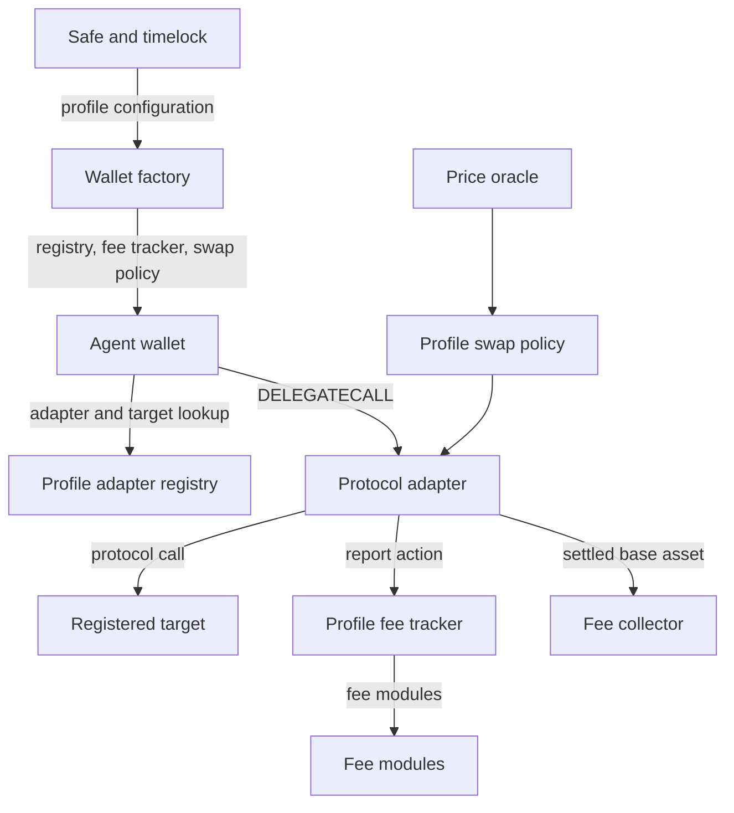

# YieldSeeker contracts

## Overview

YieldSeeker contracts run owner-controlled smart wallets for several agent types. Each wallet has an immutable `agentProfile`, a base asset and a cached adapter registry. The factory profile selects the registry, fee tracker and swap policy. Current profiles are `keccak256("vault")` and `keccak256("borrow")`; the factory can hold additional profiles as the platform adds agent types.

Wallets accept owner-authorized actions and operator-authorized adapter execution. A wallet checks the adapter and target against its registry, then calls the adapter with `DELEGATECALL`. The adapter runs in wallet context and validates protocol inputs. Standard arbitrary `execute` and `executeBatch` calls revert.

The contracts target Base, chain ID `8453`, and use ERC-4337 v0.6 with EntryPoint `0x5FF137D4b0FDCD49DcA30c7CF57E578a026d2789`. Solidity is `0.8.28`. Deployment and market-registration scripts contain Base addresses.

## Architecture

### Shared machinery

| Component | Role |
|---|---|
| `YieldSeekerAgentWalletV3` | Holds assets, validates signatures, runs adapters and provides owner exits and upgrades. |
| `YieldSeekerAgentWalletFactory` | Creates wallets and stores configuration by agent profile. Each wallet's profile is fixed at initialization. |
| `YieldSeekerAdapterRegistry` | Maps each target to one registered adapter for a profile. Wallets also have local adapter and target blocklists. |
| `YieldSeekerFeeTracker` and fee modules | Account for wallet actions and settle fees from the wallet's base asset. Each profile points to its own tracker. |
| Swap policies | Decide which sells and buys are allowed after an adapter validates the route and measures balances. |
| Adapters | Call registered vaults, markets, reward distributors and DEX routers from wallet context. |
| `YieldSeekerPriceOracle` | Supplies the borrow swap policy's price floor for swaps that sell the base asset. |
| `YieldSeekerAdminTimelock` | Delays administrative configuration. Emergency roles can pause or remove entries on selected contracts without waiting. |

### Execution and configuration



A wallet copies its profile's operator set and registry from the factory at `syncFromFactory()`. YieldSeeker wallets also copy the profile's fee tracker and swap policy. Anyone can sync a wallet. Registry contents are read during each adapter call, so registering, removing or pausing a target does not require a wallet sync.

The factory supports up to 10 `AGENT_OPERATOR_ROLE` addresses. The operator set applies across profiles, not per wallet. Wallets cache it for ERC-4337 validation.

Wallet state uses fixed `keccak256(namespace)` slots, not the ERC-7201 formula. `test_StorageSlotsStayFixedForUpgrades` pins the wallet and YieldSeeker extension slots; preserve them when changing storage layouts.

## Agent types

| Profile | Registry and tracker | Swap policy | Use |
|---|---|---|---|
| `vault` | `vaultAdapterRegistry`; `vaultFeeTracker` with `YIELD_FEE` | `YieldSeekerVaultSwapPolicy` | Supplies the base asset to registered vaults and converts sellable rewards to the base asset. |
| `borrow` | `borrowAdapterRegistry`; `borrowFeeTracker` with `YIELD_FEE` and `BORROW_FEE` | `YieldSeekerBorrowSwapPolicy` | Supplies base-asset collateral, borrows a different token, repays debt and can swap base asset into a token the wallet owes. |

The wallet factory and execution rules are shared. Profile-specific registries, fee modules and swap policies define what each type can do. Both types use the same V3 swap adapters and sell-token policy.

### Adding an agent type

Add a profile and wire its registry, fee tracker and swap policy in `script/Deploy.s.sol`. Add adapters and protocol targets to that profile's registry. Add or reuse fee modules and a swap policy as needed. Update the profile setup in the integration tests. Wallet creation selects the profile through `createAgentWallet(..., agentProfile, feePlans)`; an existing wallet cannot change its profile.

For a new fee action, add an ID and data struct in `src/fees/FeeActions.sol`, report it from the adapter, and implement it in the fee modules that charge for it. Deployed modules ignore unknown action IDs.

## Fees

### Action reporting and plans

Adapters report `DEPOSIT`, `WITHDRAW`, `SWAP`, `REWARD_SALE`, `CLAIM` or `DEBT_CHANGE` to the wallet's `YieldSeekerFeeTracker`. The tracker calls its modules in insertion order. Each module records the action and takes what it is owed from the base asset left by earlier modules. The adapter transfers the total to the collector once.

The tracker holds one module per fee type, ABI-encoded plans per fee type and wallet plan IDs. Only the timelock admin configures modules, plans, wallet factory and collector. Only the factory sets wallet plans at creation. Plans do not change; fee types without an explicit wallet plan use plan `0`. A new plan applies only to wallets assigned to it at creation, except a fee type's first plan `0` is used by wallets without a recorded choice.

A replacement module must use the same tracker and fee type and accept all existing plans. `isAccountedToken` and `feesOwedInBaseAsset` call each module with a gas limit; a failing module counts as false or zero in those views. A module that reverts during `reportAction` reverts the adapter action.

### Yield fee

`YieldSeekerYieldFeeModule` (`YIELD_FEE`) tracks cost basis per wallet and target. Deposits add the base asset actually spent. A withdrawal releases the same fraction of basis as the fraction of the position removed. Output above released basis is yield; a loss reduces basis for that target. Losses are not carried between targets.

Base-asset rewards and base asset received for a `REWARD_SALE` are yield. Other swaps, including base asset sold for a borrowed token, are not yield. Reward tokens, gifted shares and other positions with no recorded basis are charged as yield when they are withdrawn or sold for the base asset. Fees round up.

### Borrow fee

`YieldSeekerBorrowFeeModule` (`BORROW_FEE`) charges a yearly rate on each market's last reported debt, including interest. The market key is `marketTarget(market)`. Lending adapters report borrows, repayments, collateral withdrawals and `checkpoint(market)` calls. A checkpoint reads current debt and moves no funds.

Each period is charged on debt at the previous report. The module converts the fee from the borrowed token into the base asset using the lending market's own price, not `YieldSeekerPriceOracle`. It uses the last reported price if a report has no price. Both accrual and conversion round up. Payment comes from base-asset balance at a later reported action or outflow. The module records `tokenDebt(wallet, token)` across markets and accounts for borrowed tokens so owners may withdraw them.

Checkpoint each market with open debt at least daily and after a liquidation. Debt changes outside the adapter are otherwise reflected only at the next report. See [Known risks (accepted)](#known-risks-accepted).

### Withdrawals and transfers

For fee-aware ERC20 owner withdrawals and agent-to-agent transfers, the wallet reports `TRANSFER_OUT` before sending tokens. The fee modules settle from the base asset. A successful fixed-amount ERC20 withdrawal sends exactly the requested token amount. `withdrawableBalance(asset)` reports the base-asset balance net of fees owed, the full balance of another accounted token, or zero for an unaccounted token.

Owner ERC20 withdrawal settlement is gas-limited and failure-tolerant. A module or collector failure does not block an owner exit; the wallet leaves fees owed and emits `FeeSettlementFailed`. Adapter actions and agent transfers fail if a module or collector reverts. Native ETH withdrawals are owner-only and are not fee-settled.

## Roles and permissions

| Actor or role | Permissions |
|---|---|
| Wallet owner | Withdraw the base asset, fee-tracker-accounted ERC20s and ETH; block or unblock an adapter or target; upgrade to the factory-approved implementation. Position receipts must be unwound through an active adapter. |
| Agent operator | Create wallets and sign ERC-4337 UserOperations for adapter execution. An operator signature cannot authorize owner withdrawals or upgrades. |
| Timelock | Admin of the factory, registries, fee trackers, oracle and sell list: sets the implementation, profile configuration, registry contents, fee modules and plans, price sources, sell tokens and fee collectors. Every change waits for the timelock delay. |
| Safe | The Safe is timelock admin, proposer, canceller and sole executor in the deployment configuration. As timelock admin, it can grant or revoke timelock roles without a delay. |
| Emergency role | On the factory, removes operators immediately. On a registry, pauses lookups, removes a target or unregisters an adapter. On the price oracle and sell-token policy, removes a source or sell token. It cannot unpause a registry or add operators. |
| Anyone | Calls `syncFromFactory()` on a wallet. Registry lookups and public views are permissionless. |

The wallet accepts an owner ECDSA signature, or an ERC-1271 approval from a contract owner. ECDSA is checked first, including for EIP-7702 EOAs. Operators use ECDSA and can authorize only `executeViaAdapter` or `executeViaAdapterBatch`. Malformed signatures return ERC-4337 validation failure rather than reverting.

## Security model

### Execution constraints

The wallet checks its local blocklists, then requires `adapterRegistry().getTargetAdapter(target)` to equal the requested adapter. It calls the adapter with `DELEGATECALL`; the adapter receives the wallet as `address(this)`. There is no unrestricted execution path. An owner can block an adapter or target even when the global registry allows it.

The adapters validate their protocol-specific arguments and measure wallet balances for amounts reported to fee modules. DEX adapters validate route endpoints and measured output. Swap policies prevent selling registry targets, which represent positions. Agent transfers can move accounted tokens only to another wallet with the same owner and factory, and both trackers must account for the token.

### Compromised operator

A compromised operator can sign adapter-execution UserOperations for any wallet whose cached operator set includes it. It can use registered targets and adapters to manage or withdraw protocol positions into the wallet, claim rewards and make swaps allowed by the wallet's profile policy. It can transfer accounted assets to the owner's other wallets under the transfer-adapter rules.

It cannot use a direct arbitrary call, use an unregistered adapter or target, call owner-only withdrawals, send funds to an arbitrary external address, or upgrade a wallet. Reward sales have no oracle price floor. In borrow profiles, swaps that sell the base asset use an oracle floor and may buy only an accounted borrowed token, capped at the wallet's last reported debt.

### Operator revocation procedure

Wallets cache operators because ERC-4337 validation does not read the factory. Removing an operator in the factory does not clear each wallet's cache until it syncs.

1. Optionally call `pause()` on `vaultAdapterRegistry` and `borrowAdapterRegistry` with `EMERGENCY_ROLE`. A pause blocks adapter execution through that registry, including owner position exits.
2. Call `factory.removeAgentOperator(operator)` with `EMERGENCY_ROLE`. The removal is immediate. Only the timelock admin can add operators.
3. Call `syncFromFactory()` on every V3 wallet. Any account can do this. Check `isAgentOperator(operator)` on each wallet after sync.
4. If either registry was paused, schedule `unpause()` through the timelock and execute it after its delay.

V2 wallets use the V2 factory and registry. Pause `agentWalletV2AdapterRegistry`, revoke the operator through the timelock, have owners or operators sync the affected wallets, then unpause through the timelock.

### Emergency target removal and recovery

After an emergency target removal, cancel any scheduled timelock operation that would restore it with `cancel(id)` and `CANCELLER_ROLE`. Repeat emergency removals in both vault registries. `Deploy.s.sol` copies every V2 vault target into the V3 vault registry, so rerunning it can schedule a target that was removed only from V3.

A removed position target can be restored by registering it again through the timelock. The owner or operator can then unwind the position through its adapter; the yield fee uses the target's recorded cost basis. If an adapter was unregistered, registering it again reactivates its previous target mappings. Unregistering an adapter is a pause mechanism, not a permanent target removal.

An unlisted reward token cannot be sold. Add it through `script/AddSellableTokens.s.sol`, then an operator can sell it for the base asset. Other unaccounted tokens, such as unsolicited airdrops, cannot be withdrawn by the owner and remain in the wallet.

### Known risks (accepted)

- Operator removal reaches each wallet only after it syncs. Pausing the registries closes the adapter-execution window while wallets sync.
- `Deploy.s.sol` grants `SERVER_ADDRESS` when missing and does not remove old operators. For key rotation, grant the new operator through the timelock, remove the old operator with `EMERGENCY_ROLE`, then sync every wallet.
- Reward sales have no price floor. The operator chooses the route and `minBuyAmount`, so a compromised operator can sell a wallet's unsold reward tokens through a pool it controls. Only sell-list tokens are exposed: the policy refuses registry targets and, in borrow profiles, borrowed tokens. The backend claims and sells rewards in the same autoseek run, so claimed rewards don't sit in wallets; unclaimed rewards stay in the distributor. A floor was left out on purpose: some reward tokens have no Chainlink feed (e.g. SEAM), thin reward pools need a looser limit than the 1% borrow floor, and a stale or removed feed would block sales or drop the floor. Base-asset sales in borrow profiles use the oracle floor.
- Fee calculations round up on each report. Yield fees can add less than one raw base-asset unit per report. Borrow fees round up in the debt token and again when converting to the base asset, so the raw-base rounding depends on token decimals and price. More debt reports can realize additional rounding. The borrow swap floor rounds up after an oracle quote that rounds down, so it can accept one raw unit below the exact limit.
- Cost basis is tracked per target. A loss in that target, including collateral seized by liquidation, is not charged again. Later gains there are fee-free until value rises above its remaining basis. Losses are not carried between targets. A fully liquidated collateral position keeps its old basis, so later collateral yield in that market can be undercharged.
- Deposits have no minimum-output bound. Register only vaults reviewed for share-inflation protection.
- Fee collection fails closed for adapter actions. A reverting module or collector blocks adapter actions until fixed. Owner exits are fail-open and do not block.
- The operator chooses a wallet's profile, base asset and fee plans at creation. Plans are timelock-created, capped by each module and fixed for the wallet's life. The address depends on the factory, owner and index, not on the profile or plan. The contracts do not check these inputs against an off-chain agent record.
- Debt changes outside lending adapters are charged at the last reported debt until the next report. The open period is charged at the next report, not when an owner withdraws idle base asset. Collateral exits go through the adapter and report the change. The operator must checkpoint each market with open debt at least daily. The base-asset-to-borrowed-token swap cap uses the same last reported debt.
- There is no on-chain health-factor floor. Borrow sizing is off-chain; this repository does not verify that policy.
- Swap policies reject registry targets, but do not generally identify position tokens. Never enable `allowSellingAllTokens` and never add a position token, such as a vault share or aToken, to the sell list. An unaccounted token that is not sellable, such as an unexpected Merkl reward, stays in the wallet until added to the sell list.
- Base assets must be plain ERC20s without fee-on-transfer or rebasing behavior because fees and cost basis use base-asset units.
- If a lending market's own oracle reverts or returns zero while a debt report needs its price, the affected adapter action fails. Owners can repay directly on Aave V3 and Morpho.
- Moonwell `claimReward(holder)` is permissionless, so anyone can claim a wallet's Moonwell rewards outside the adapter. Base-asset rewards claimed that way are never reported and pay no yield fee. The backend claims through the adapter regularly.
- The Safe holds the timelock's admin role and can change timelock roles without waiting for a delay.

## Contract map

| Contract | File | Role |
|---|---|---|
| `YieldSeekerAgentWalletV3` | `src/AgentWalletV3.sol` | YieldSeeker wallet implementation with fee-aware exits and profile-specific tracker and swap policy. |
| `AWKAgentWalletV3` | `src/agentwalletkit/AWKAgentWalletV3.sol` | ERC-4337 wallet logic, operator cache, blocklists, adapter execution and UUPS authorization. |
| `YieldSeekerAgentWalletFactory` | `src/AgentWalletFactory.sol` | Creates YieldSeeker wallets and configures registry, tracker and swap policy by profile. |
| `AWKAgentWalletFactory` | `src/agentwalletkit/AWKAgentWalletFactory.sol` | CREATE2 proxy factory, implementation pointer, profile registries and operator roles. |
| `YieldSeekerAdapterRegistry` | `src/AdapterRegistry.sol` | YieldSeeker alias for the target-to-adapter registry. |
| `AWKAdapterRegistry` | `src/agentwalletkit/AWKAdapterRegistry.sol` | Maps targets to active adapters and implements emergency pause and removal. |
| `YieldSeekerFeeTracker` | `src/fees/FeeTracker.sol` | Dispatches actions to fee modules, stores plans and reports accounted tokens and fees owed. |
| `YieldSeekerYieldFeeModule` | `src/fees/YieldFeeModule.sol` | Tracks target cost basis and yield fees. |
| `YieldSeekerBorrowFeeModule` | `src/fees/BorrowFeeModule.sol` | Tracks debt, token debt caps and borrow fees. |
| `FeeActions` | `src/fees/FeeActions.sol` | Action IDs and ABI data structures used by adapters and modules. |
| `YieldSeekerVaultSwapPolicy` | `src/swaps/VaultSwapPolicy.sol` | Allows sellable reward tokens to be sold for the base asset. |
| `YieldSeekerBorrowSwapPolicy` | `src/swaps/BorrowSwapPolicy.sol` | Adds the oracle-bounded base-asset-to-debt-token swap. |
| `YieldSeekerSwapSellPolicy` | `src/adapters/SwapSellPolicy.sol` | Shared sell-token list read by both profile policies. |
| `YieldSeekerPriceOracle` | `src/PriceOracle.sol` | Reads per-asset feeds, staleness limits and L2 sequencer status. |
| `YieldSeekerAdminTimelock` | `src/AdminTimelock.sol` | Timelock controller used for administrative operations. |
| `YieldSeekerERC4626Adapter` | `src/adapters/ERC4626Adapter.sol` | ERC-4626 vault deposits and withdrawals. |
| `YieldSeekerAaveV3Adapter` | `src/adapters/AaveV3Adapter.sol` | Aave V3 aToken vault deposits and withdrawals. |
| `YieldSeekerCompoundV3Adapter` | `src/adapters/CompoundV3Adapter.sol` | Compound V3 Comet supply and withdrawal. |
| `YieldSeekerCompoundV2Adapter` | `src/adapters/CompoundV2Adapter.sol` | Compound V2 and fork deposits and cToken redemptions. |
| `YieldSeekerAaveV3LendingAdapter` | `src/adapters/AaveV3LendingAdapter.sol` | Aave V3 collateral, borrowing, repayment and checkpoint operations. |
| `YieldSeekerAaveV4LendingAdapter` | `src/adapters/AaveV4LendingAdapter.sol` | Aave V4 spoke lending operations. |
| `YieldSeekerMorphoBlueLendingAdapter` | `src/adapters/MorphoBlueLendingAdapter.sol` | Morpho Blue lending operations. |
| `YieldSeekerMerklAdapter` | `src/adapters/MerklAdapter.sol` | Claims rewards for the wallet from Merkl. |
| `YieldSeekerMoonwellRewardAdapter` | `src/adapters/MoonwellRewardAdapter.sol` | Claims Moonwell rewards and reports base-asset and WELL rewards. |
| `YieldSeekerUniswapV3SwapAdapter` | `src/adapters/UniswapV3SwapAdapter.sol` | Uniswap V3 route execution. |
| `YieldSeekerAerodromeV2SwapAdapter` | `src/adapters/AerodromeV2SwapAdapter.sol` | Aerodrome V2 route execution. |
| `YieldSeekerAerodromeCLSwapAdapter` | `src/adapters/AerodromeCLSwapAdapter.sol` | Aerodrome Slipstream concentrated-liquidity route execution. |
| `YieldSeekerAgentTransferAdapter` | `src/adapters/AgentTransferAdapter.sol` | Transfers accounted assets between wallets of the same owner and factory. |
| AWK protocol adapters | `src/agentwalletkit/adapters/` | Protocol call implementations composed with YieldSeeker validation and fee-reporting layers. |

## Deployment and operations

### Environment and roles

Set these environment variables before running deployment scripts:

| Variable | Use |
|---|---|
| `DEPLOYER_PRIVATE_KEY` | Deployer address is a timelock proposer and canceller, and is the emergency admin. |
| `MULTISIG_ADMIN_ADDRESS` | Safe address used as timelock admin, proposer, canceller and sole executor. |
| `SERVER_ADDRESS` | Address granted `AGENT_OPERATOR_ROLE`. |
| `FEE_COLLECTOR_ADDRESS` | Receives collected fees. |
| `RPC_NODE_URL_8453` | Base RPC endpoint. |
| `RPC_ARCHIVE_NODE_URL_8453` | Archive RPC used by `script/check-timelock.sh`. |
| `ETHERSCAN_API_KEY` | Optional verification key for `--verify`. |

`Deploy.s.sol` sets the timelock delay to four days and the deployer as emergency admin. The Safe and deployer can propose and cancel operations; the Safe executes them. To add a proposer, the Safe grants `PROPOSER_ROLE` and `CANCELLER_ROLE` to that address on the timelock. The grants take effect immediately. Use `revokeRole` to remove them. The Safe's timelock admin role can grant or revoke these roles directly.

### Deploy

`Deploy.s.sol` reads and updates `deployments.json`. It deploys missing V3 contracts, saves their addresses, wires factory profiles and fee trackers, grants `SERVER_ADDRESS` if it is not already an operator, and schedules configuration as one timelock batch. It schedules `setFeeCollector` when a tracker's collector differs. It registers the profile adapters, shared swap adapters and agent-transfer adapter. It copies each target in the V2 vault registry to the matching V3 adapter. It does not deploy or reconfigure the V2 system, which remains under `agentWalletV2*` keys.

The script does not register lending markets. Register them separately after the deployment batch and price sources are in place.

```bash
forge script script/Deploy.s.sol:DeployScript --rpc-url "$RPC_NODE_URL_8453" --broadcast --verify
```

Before a production run, use `./script/dry-run-deploy.sh`. It runs `Deploy.s.sol` on a local Base fork, executes the configuration batch as the Safe and confirms a second run has nothing left to configure. It restores `deployments.json` and `broadcast/Deploy.s.sol` afterwards. It requires `anvil`, `cast`, `forge`, `jq` and `RPC_NODE_URL_8453`.

In production, the scripts schedule timelock operations. Wait for the four-day delay, then execute the emitted calls from the Safe. Use `./script/check-timelock.sh` to list operations and build Safe Transaction Builder instructions for ready operations. It rebuilds execute calls from timelock events, including operations proposed by the Safe. It requires `cast`, `jq`, `RPC_NODE_URL_8453` and `RPC_ARCHIVE_NODE_URL_8453`.

### Two vault registries

V2 wallets use `agentWalletV2AdapterRegistry`, V2 adapters and the legacy V2 fee tracker. V3 vault wallets use `vaultAdapterRegistry`, V3 adapters and the V3 vault fee tracker. One registry maps a target to one adapter, so the V2 and V3 vault adapters cannot share a registry. Until all V2 wallets have moved to V3, the two registries must contain the same vault targets.

- `Deploy.s.sol` copies V2 targets to their corresponding V3 adapters. It reverts if a V2 target uses an adapter it does not recognize. Rerunning the script schedules any V2 target missing from V3.
- `RegisterVault.s.sol` registers a vault in both registries in one timelock batch.
- Both profile policies read the same `swapSellPolicy` sell-token list.
- Repeat emergency target removals in both vault registries.
- The V3 vault and borrow registries map the agent-transfer adapter to itself as a target. The V2 registry does not.

### Register vaults and sellable tokens

Register a vault target for vault agents in both vault registries. Add reward tokens individually to the shared sell list. Do not set `allowSellingAllTokens`: swap policies reject registry targets, but an allow-all list would let an operator sell other wallet tokens, including borrow collateral aTokens, with no price floor.

```bash
forge script script/RegisterVault.s.sol:RegisterVaultScript --rpc-url "$RPC_NODE_URL_8453" --broadcast --sig "run(address,string)" <VAULT_ADDRESS> erc4626

# Add tokens that agents are allowed to sell in swaps
forge script script/AddSellableTokens.s.sol:AddSellableTokensScript --rpc-url "$RPC_NODE_URL_8453" --broadcast --sig "run(address[])" "[<token_1>, <token_2>, ...]"
```

### Set price sources

Configure price sources for every collateral and debt asset before registering a borrow market. Staleness limits: WETH and cbBTC `3600` seconds, USDC `90000` seconds, MAG7 equity assets `43200` seconds. The MAG7 feeds follow 24/5 trading and update on price moves; on Base (November 2026) weekday gaps reached about 7.6 hours and the weekend gap about 53 hours. The 12-hour limit keeps base-asset swaps working on weekdays and stops them over the weekend, when the price is unknown. These values are deployment settings, not contract constants; recheck feed behaviour before changing them.

Every feed should be USD-denominated: `quote` divides one asset's USD price by the other's. Check the feed description printed by the script. Use the raw aggregator feed rather than a protocol wrapper that can cap an answer or rewrite its timestamp.

`SetPriceSource.s.sol` prints the feed description, decimals, aggregator and latest round data. It rejects a feed without a nonzero `aggregator()`, a nonpositive answer, a zero or future timestamp, or an answer older than the requested staleness limit. `YieldSeekerPriceOracle` checks answer validity, timestamp and L2 sequencer status on each price read; it rejects prices during the sequencer outage and for one hour after recovery.

```bash
WETH=0x4200000000000000000000000000000000000006
CBBTC=0xcbB7C0000aB88B473b1f5aFd9ef808440eed33Bf
USDC=0x833589fCD6eDb6E08f4c7C32D4f71b54bdA02913
AAVE_V4_SPOKE=0x17905Db0e4A3514467539956c084180616AE7B8D

# WETH, cbBTC, and USDC Chainlink USD feeds
forge script script/SetPriceSource.s.sol:SetPriceSourceScript --rpc-url "$RPC_NODE_URL_8453" --broadcast --sig "run(address,address,uint32)" "$WETH" 0x71041dddad3595F9CEd3DcCFBe3D1F4b0a16Bb70 3600
forge script script/SetPriceSource.s.sol:SetPriceSourceScript --rpc-url "$RPC_NODE_URL_8453" --broadcast --sig "run(address,address,uint32)" "$CBBTC" 0x07DA0E54543a844a80ABE69c8A12F22B3aA59f9D 3600
forge script script/SetPriceSource.s.sol:SetPriceSourceScript --rpc-url "$RPC_NODE_URL_8453" --broadcast --sig "run(address,address,uint32)" "$USDC" 0x7e860098F58bBFC8648a4311b374B1D669a2bc6B 90000

# MAG7 reserve tokens (Aave V4 reserves 0-6: AAPL, AMZN, GOOGL, META, MSFT, NVDA, TSLA) with the spoke oracle's raw feeds
AAVE_V4_ORACLE=$(cast call "$AAVE_V4_SPOKE" "ORACLE()(address)" --rpc-url "$RPC_NODE_URL_8453")
for reserveId in 0 1 2 3 4 5 6; do
  ASSET=$(cast call "$AAVE_V4_SPOKE" "getReserve(uint256)((address,address,uint16,uint8,uint24,uint8,uint32))" "$reserveId" --rpc-url "$RPC_NODE_URL_8453" --json | jq -r '.[0][0]')
  FEED=$(cast call "$AAVE_V4_ORACLE" "getReserveSource(uint256)(address)" "$reserveId" --rpc-url "$RPC_NODE_URL_8453")
  forge script script/SetPriceSource.s.sol:SetPriceSourceScript --rpc-url "$RPC_NODE_URL_8453" --broadcast --sig "run(address,address,uint32)" "$ASSET" "$FEED" 43200
done
```

### Register borrow markets

`RegisterBorrowMarket.s.sol` supports Base Aave V3, Aave V4 and Morpho Blue. It checks protocol addresses, exact canonical market encoding, distinct collateral and debt assets, and configured price sources for both assets. It prints the market bytes and registry target for review. `marketTarget(market)` is the hash-derived target for that encoded market.

Apply these configuration rules:

- Register no more than one market per `(pool or spoke, collateral)` pair. Collateral is one yield-fee position per market, so duplicate collateral markets would create separate cost bases.
- Aave V3 uses eMode `0`. The script rejects other categories, and `YieldSeekerAaveV3LendingAdapter` reverts with `EModeNotAllowed` if one reaches it.
- Do not register a base-asset Aave V3 vault in the borrow registry.
- Do not configure collateral-to-debt cycles, including opposite pairs or longer loops. The script does not detect duplicate collateral pairs or cycles. The base-to-borrowed swap cap limits each wallet to its last reported debt, but a cycle can still lose up to 1% per hop on that amount. The market examples below borrow USDC against non-USDC collateral and do not form a cycle.

```bash
WETH=0x4200000000000000000000000000000000000006
USDC=0x833589fCD6eDb6E08f4c7C32D4f71b54bdA02913
CBBTC=0xcbB7C0000aB88B473b1f5aFd9ef808440eed33Bf
AAVE_V3_POOL=0xA238Dd80C259a72e81d7e4664a9801593F98d1c5

# Aave V3 WETH/USDC and cbBTC/USDC, eMode 0
MARKET=$(cast abi-encode "f(address,address,address,uint8)" "$AAVE_V3_POOL" "$WETH" "$USDC" 0)
forge script script/RegisterBorrowMarket.s.sol:RegisterBorrowMarketScript --rpc-url "$RPC_NODE_URL_8453" --broadcast --sig "run(string,bytes)" aavev3 "$MARKET"
MARKET=$(cast abi-encode "f(address,address,address,uint8)" "$AAVE_V3_POOL" "$CBBTC" "$USDC" 0)
forge script script/RegisterBorrowMarket.s.sol:RegisterBorrowMarketScript --rpc-url "$RPC_NODE_URL_8453" --broadcast --sig "run(string,bytes)" aavev3 "$MARKET"

# Morpho Blue USDC loans against WETH and cbBTC, LLTV 0.86e18
MORPHO_BLUE=0xBBBBBbbBBb9cC5e90e3b3Af64bdAF62C37EEFFCb
MORPHO_ADAPTIVE_IRM=0x46415998764C29aB2a25CbeA6254146D50D22687
MORPHO_WETH_USDC_ORACLE=0xFEa2D58cEfCb9fcb597723c6bAE66fFE4193aFE4
MORPHO_CBBTC_USDC_ORACLE=0x663BECd10daE6C4A3Dcd89F1d76c1174199639B9
LLTV=860000000000000000
MARKET=$(cast abi-encode "f(address,(address,address,address,address,uint256))" "$MORPHO_BLUE" "($USDC,$WETH,$MORPHO_WETH_USDC_ORACLE,$MORPHO_ADAPTIVE_IRM,$LLTV)")
forge script script/RegisterBorrowMarket.s.sol:RegisterBorrowMarketScript --rpc-url "$RPC_NODE_URL_8453" --broadcast --sig "run(string,bytes)" morpho "$MARKET"
MARKET=$(cast abi-encode "f(address,(address,address,address,address,uint256))" "$MORPHO_BLUE" "($USDC,$CBBTC,$MORPHO_CBBTC_USDC_ORACLE,$MORPHO_ADAPTIVE_IRM,$LLTV)")
forge script script/RegisterBorrowMarket.s.sol:RegisterBorrowMarketScript --rpc-url "$RPC_NODE_URL_8453" --broadcast --sig "run(string,bytes)" morpho "$MARKET"

# Aave V4 MAG7 collateral (reserves 0-6) against USDC reserve 7
AAVE_V4_SPOKE=0x17905Db0e4A3514467539956c084180616AE7B8D
for reserveId in 0 1 2 3 4 5 6; do
  MARKET=$(cast abi-encode "f(address,uint256,uint256)" "$AAVE_V4_SPOKE" "$reserveId" 7)
  forge script script/RegisterBorrowMarket.s.sol:RegisterBorrowMarketScript --rpc-url "$RPC_NODE_URL_8453" --broadcast --sig "run(string,bytes)" aavev4 "$MARKET"
done
```

Execute each emitted market-registration operation from the Safe after the timelock delay.

### Aerodrome Slipstream routers

Aerodrome Slipstream has three pool factories, each with its own router. `YieldSeekerAerodromeCLSwapAdapter` takes its router in the constructor, so `Deploy.s.sol` deploys it once per router (`aerodromeCLSwapAdapter`, `aerodromeCL2SwapAdapter`, `aerodromeCL3SwapAdapter`) and registers each router as a target in both V3 registries. Routes may use any tick spacing the router's factory enabled. The tokenized-stock pools are on the third factory at spacing 10 (checked on Base, November 2026); `test/fork/SwapFork.t.sol` swaps through that router at spacing 10.

### Selective redeployment

Set a contract's address to `0x0000000000000000000000000000000000000000` in `deployments.json` and rerun `Deploy.s.sol` to redeploy a stateless adapter, swap policy or wallet implementation. The script refuses to replace a registry, fee tracker or fee module already used by a factory or tracker. Those contracts hold per-wallet or per-target state; replace them deliberately through the timelock after planning state import.

A redeployed adapter is registered and targets known to `Deploy.s.sol` are moved to it. This includes copied V2 vault targets, routers, Merkl and agent transfers. Borrow market targets are not known to that script. After replacing a lending adapter, rerun `RegisterBorrowMarket.s.sol` for every market and execute the emitted operations. The old adapter remains registered until the emergency role unregisters it from each V3 registry that used it. Unregistering preserves target mappings, so re-registering the old adapter would reactivate them.

## Upgrades and fee changes

### Wallet and profile configuration

The timelock admin sets the implementation with `factory.setAgentWalletImplementation(newImplementation)`. A deployed wallet does not upgrade automatically. Its owner calls `upgradeToLatest()` or `upgradeToAndCall`; the target must equal the factory's current implementation. `upgradeToLatest()` runs `syncFromFactory()` through the upgrade call, so the new implementation performs the sync.

The timelock admin can replace an agent profile's registry, fee tracker or swap policy with `setAdapterRegistry`, `setFeeTracker` or `setSwapPolicy`. Existing wallets copy the new addresses at their next `syncFromFactory()`. Anyone can trigger that sync. Registry adapter and target changes apply through live lookups and need no wallet sync.

### Changing fee logic

Fee state lives in modules. Replacing a yield module without importing state loses open-position basis and can charge the full withdrawal as yield. Replacing a borrow module without importing state loses debt positions, unpaid fees, borrowed-token accounting and `tokenDebt`; owners may then be unable to withdraw borrowed tokens, and the borrow swap policy will not recognize them. A new tracker also needs existing wallet plans imported or wallets use plan `0`.

- A new fee type needs an `IYieldSeekerFeeModule` implementation, a `setFeeModule` call and plans created with `createPlan`. Existing adapters need no change unless they must report new actions.
- A new action needs a new ID and struct in `FeeActions`, reporting from the adapter and handling in any module that charges for it. Do not change existing action structs.
- Plans are immutable. A new plan can be assigned only when creating a wallet. Moving an existing wallet to a different plan requires a new wallet. A replacement module can accept old plans and add new plan formats.
- A replacement module can import state lazily from the previous module. On first use, import the wallet's cost basis, debt positions, fees owed and, for borrow fees, `isBorrowedToken` and `tokenDebt`. Until import, views such as `isAccountedToken` and `feesOwedInBaseAsset` need to fall back to the old module. A replacement tracker must also read old wallet plans until they are imported and use modules built for that tracker. Adding a new fee type avoids replacing existing module state.
- Yield fees do not charge a reward paid in a borrowed token. The yield module charges base-asset claims and base asset from reward sales, while the borrow policy prevents selling a borrowed token back to the base asset. Do not register reward sources that pay borrowed tokens in a borrow registry unless a fee module values those claims.

## Development

Foundry is required. Tests live in `test/unit`, `test/integration` and `test/fork`. Fork tests need a Base RPC.

```bash
forge test --no-match-path 'test/fork/*'
forge test --match-path 'test/fork/*' --fork-url "$RPC_NODE_URL_8453"
```
