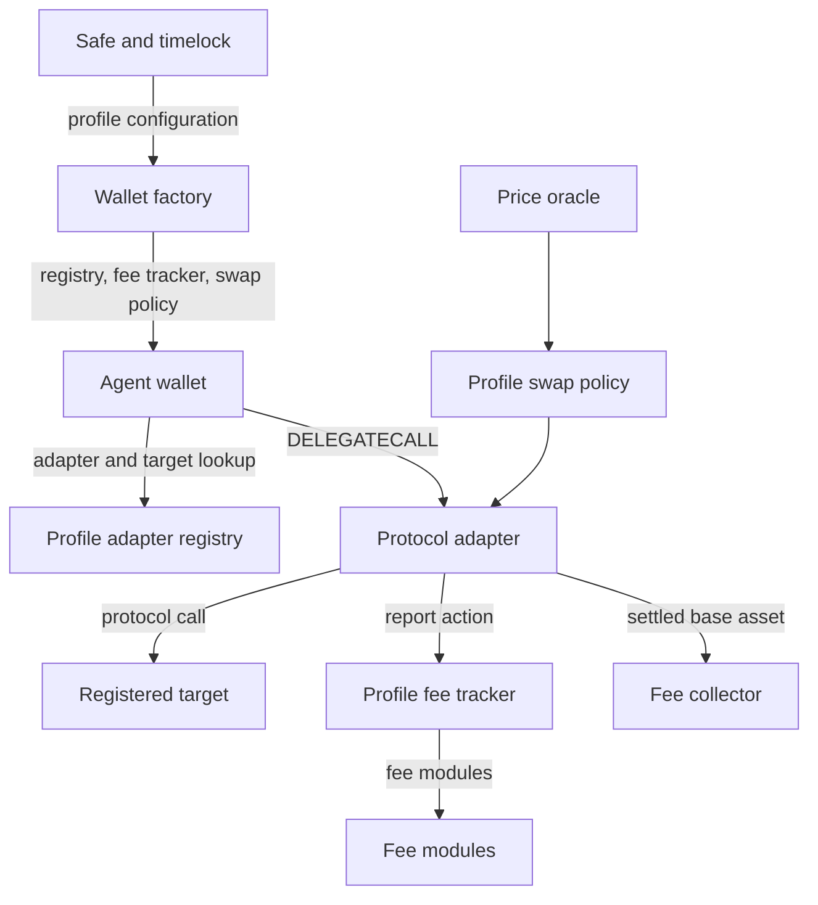

# YieldSeeker contracts

Smart wallets for DeFi agents. Each user owns a wallet; an agent operator can run it, but only through audited adapters and registered protocol targets, and never to move funds out to an address of its choice.

## At a glance

- **Chain:** Base (chain ID `8453`). Scripts and config contain Base addresses.
- **Wallets:** ERC-4337 accounts behind UUPS proxies, created by one factory. A wallet's address depends only on the factory, the owner and the owner's agent index.
- **Agent types:** each wallet has a fixed profile. Today: `vault` (earn yield in vaults) and `borrow` (borrow against the base asset).
- **No arbitrary calls:** `execute` and `executeBatch` revert. Every protocol call goes through an adapter that the wallet runs with `DELEGATECALL`.
- **Fees:** a yield fee and a borrow fee, charged in the wallet's base asset as actions happen.
- **Admin:** every configuration change waits for a 4-day timelock that a Safe controls. Emergency roles can only pause or remove.
- **V2:** V1 and V2 wallets stay on the V2 factory, registry and adapters. They do not upgrade into V3.

## How a wallet runs an action

1. The owner or an operator calls `executeViaAdapter(adapter, target, data)`, directly or through an ERC-4337 EntryPoint.
2. The wallet checks its own blocklists, then asks its registry whether `target` is mapped to `adapter`.
3. The wallet runs the adapter with `DELEGATECALL`, so the adapter acts as the wallet.
4. The adapter validates the inputs, applies the YieldSeeker rules (base asset, swap policy) and calls the protocol.
5. The adapter reports the action to the fee tracker, and pays any fee due to the fee collector.

A wallet caches the factory's operators and its profile's registry, fee tracker and swap policy. Anyone can refresh the cache with `syncFromFactory()`. Registry contents are read live on every call.

## Code layout

The code has two layers:

| Layer | Folder | What it holds |
|---|---|---|
| Agent Wallet Kit (AWK) | `src/agentwalletkit/` | Reusable wallet, factory, registry and protocol adapters. No fees and no YieldSeeker rules. Usable on its own. |
| YieldSeeker | `src/` | Fee tracking, swap policies, the price oracle, and the rules each adapter applies. |

Every protocol adapter is built the same way:

| Piece | Example | Role |
|---|---|---|
| Kit base | `AWKBorrowAdapter` | Decodes and validates a call, then calls an operation hook. |
| Venue core | `AWKMorphoBlueBorrowAdapterCore` | The protocol calls for one venue. Abstract. |
| Kit operations | `AWKBorrowOperations` | Implements the hooks as the plain protocol call. Core + this = the standalone kit adapter `AWKMorphoBlueBorrowAdapter`. |
| YieldSeeker rules | `YieldSeekerBorrowAdapter` | Implements the hooks with base-asset checks and fee reports. Core + this = the deployed `YieldSeekerMorphoBlueBorrowAdapter`. |

## Contracts

### Core

| Contract | File | Role |
|---|---|---|
| `YieldSeekerAgentWalletV3` | `src/AgentWalletV3.sol` | The wallet: fee-aware owner withdrawals, profile fee tracker and swap policy. |
| `AWKAgentWalletV3` | `src/agentwalletkit/AWKAgentWalletV3.sol` | Signature validation, operator cache, blocklists, adapter execution, upgrade authorisation. |
| `YieldSeekerAgentWalletFactory` | `src/AgentWalletFactory.sol` | Creates wallets; holds each profile's registry, fee tracker and swap policy. |
| `AWKAgentWalletFactory` | `src/agentwalletkit/AWKAgentWalletFactory.sol` | CREATE2 proxy factory, wallet implementation pointer, operator roles. |
| `YieldSeekerAdapterRegistry` | `src/AdapterRegistry.sol` | Maps each target to one adapter. Emergency pause and removal. |
| `YieldSeekerAdminTimelock` | `src/AdminTimelock.sol` | Timelock for all administrative changes. |
| `YieldSeekerPriceOracle` | `src/PriceOracle.sol` | Chainlink prices with staleness limits and an L2 sequencer check. |

### Fees and swap policies

| Contract | File | Role |
|---|---|---|
| `YieldSeekerFeeTracker` | `src/fees/FeeTracker.sol` | Passes each reported action to the fee modules; stores fee plans. |
| `YieldSeekerYieldFeeModule` | `src/fees/YieldFeeModule.sol` | Tracks cost basis per position and charges a share of yield. |
| `YieldSeekerBorrowFeeModule` | `src/fees/BorrowFeeModule.sol` | Tracks debt and charges a yearly rate on it. |
| `FeeActions` | `src/fees/FeeActions.sol` | Action IDs and data structs shared by adapters and modules. |
| `YieldSeekerVaultSwapPolicy` | `src/swaps/VaultSwapPolicy.sol` | Allows selling listed reward tokens for the base asset. |
| `YieldSeekerBorrowSwapPolicy` | `src/swaps/BorrowSwapPolicy.sol` | Also allows buying a borrowed token with the base asset, above an oracle price floor. |
| `YieldSeekerSwapSellPolicy` | `src/adapters/SwapSellPolicy.sol` | The list of sellable tokens, shared by both policies. |

### Adapters

| Kind | Venues | YieldSeeker contracts (`src/adapters/`) |
|---|---|---|
| Vault | ERC-4626, Aave V3, Compound V3 | `ERC4626Adapter`, `AaveV3Adapter`, `CompoundV3Adapter` |
| Borrow | Aave V3, Aave V4, Morpho Blue | `AaveV3BorrowAdapter`, `AaveV4BorrowAdapter`, `MorphoBlueBorrowAdapter` |
| Swap | Uniswap V3, Aerodrome V2, Aerodrome Slipstream | `UniswapV3SwapAdapter`, `AerodromeV2SwapAdapter`, `AerodromeCLSwapAdapter` |
| Rewards | Merkl | `MerklAdapter` |
| Transfer | Between one owner's wallets | `AgentTransferAdapter` |

- The shared rules are in `VaultAdapter.sol`, `BorrowAdapter.sol`, `SwapAdapter.sol` and `Adapter.sol`.
- The kit adapters are in `src/agentwalletkit/adapters/`.
- V3 has no Compound V2 or Moonwell adapter. Moonwell positions stay with V2 wallets.

## Agent types

| Profile | Registry and fee tracker | Swap policy | What it does |
|---|---|---|---|
| `vault` | `vaultAdapterRegistry`; `vaultFeeTracker` with the yield fee | `YieldSeekerVaultSwapPolicy` | Supplies the base asset to registered vaults and sells listed rewards for the base asset. |
| `borrow` | `borrowAdapterRegistry`; `borrowFeeTracker` with the yield and borrow fees | `YieldSeekerBorrowSwapPolicy` | Supplies the base asset as collateral, borrows another token, repays, and can swap base asset into a token it owes. |

A profile is `keccak256` of its name and is fixed when the wallet is created. To add an agent type:

1. Wire a new profile's registry, fee tracker and swap policy in `script/Deploy.s.sol`.
2. Register its adapters and targets in that registry. For routine targets, add a section to `script/config/base.json` and `Configure.s.sol`, and add the registry to `_isAnyRegistryTarget` and the drift report there.
3. Add or reuse fee modules and a swap policy. A new fee action needs an ID and struct in `FeeActions.sol`; deployed modules ignore unknown action IDs.
4. Update the profile setup in the integration tests.

## Fees

- **Yield fee:** a share of yield. Deposits add to a position's cost basis; a withdrawal releases basis in proportion, and anything paid out above it is yield. Base-asset rewards and reward sales are yield.
- **Borrow fee:** a yearly rate on each debt position's last reported debt, converted to the base asset at the lending market's own price.
- **Plans:** each wallet gets a fee plan per fee type at creation. Plans never change.
- **Payment:** fees are paid from the wallet's base asset when an action is reported. A failing fee module blocks adapter actions, but not an owner's base-asset withdrawal.

Details and the rules for changing fee logic: [docs/fees.md](docs/fees.md).

## Roles

| Role | Can do |
|---|---|
| Wallet owner | Withdraw the base asset, accounted tokens and ETH; block an adapter or target; run adapters; upgrade to the factory-approved implementation. |
| Agent operator | Create wallets and run adapters, by direct call or by a paymaster-sponsored UserOperation. Cannot withdraw, upgrade or spend the wallet's ETH on gas. |
| Timelock | Admin of the factory, registries, fee trackers, oracle and sell list. Every change waits 4 days. |
| Safe | Timelock admin, proposer, canceller and only executor. Its address fixes the factory address. |
| Emergency role | Pause a registry, remove a target, adapter, price source, sell token or operator. Cannot add or unpause. |
| Anyone | Call `syncFromFactory()` on a wallet. |

The wallet accepts UserOperations from the canonical EntryPoints v0.6, v0.7, v0.8 and v0.9.

## Security

A compromised operator **cannot** make an arbitrary call, use an unregistered adapter or target, withdraw to an address of its choice, spend the wallet's ETH on gas, or upgrade a wallet.

It **can** still, within the adapters' rules:

- move funds between registered positions and the owner's other wallets;
- sell reward tokens at a bad price, because reward sales have no price floor;
- in borrow wallets, lose up to 1% per swap of base asset into a borrowed token, and push a position into liquidation.

Full detail, including every accepted risk: [docs/security.md](docs/security.md). What to do when a key is compromised: [docs/incident-response.md](docs/incident-response.md).

## Deployment and operations

| Task | Where |
|---|---|
| Deploy or redeploy contracts | `script/Deploy.s.sol` |
| Add a vault, reward token, price feed or borrow market | `script/config/base.json`, then `script/Configure.s.sol` |
| Rehearse a deployment on a local fork | `script/dry-run-deploy.sh` |
| List timelock operations and build the Safe transaction | `script/check-timelock.sh` |
| Hand the factory from the Safe to the timelock | `script/factory-handover.sh` |

The full runbook, including the environment variables, the same-address-on-every-chain rules and the borrow market rules: [docs/deployment.md](docs/deployment.md).

## Development

Foundry is required. Everything runs locally.

| Command | What it runs | Time |
|---|---|---|
| `make test` | Unit, integration, fuzz and invariant tests (what CI runs) | about 2 minutes |
| `make test-fork` | Adapters against the real protocols, through a Base fork node at `127.0.0.1:8545` | depends on the RPC |
| `make test-deep` | The fuzz and invariant tests with many more runs | about 6 minutes |
| `make prove-halmos` | Halmos proofs (`test/formal/halmos/README.md`) | about 6 minutes |
| `make prove-certora` | Certora proofs with a local prover (`certora/README.md`) | about 20 minutes |
| `make test-mutation` | Plants bugs in contracts changed since `main` and checks a test catches each one; `FULL=1` mutates every core contract and takes hours | seconds when nothing changed |
| `make prove-certora-mutation` | The same for the Certora proofs | seconds when nothing changed |

- **Fork tests without a local node:** `forge test --match-path 'test/fork/*' --fork-url "$RPC_NODE_URL_8453"`.
- **When to run what:** `make test` on every change; the deep run and the proofs before a deploy or an audit. Mutation runs are pre-audit measurements.
- **Tested properties:** `test/PROPERTIES.md` lists each promise the contracts make and the tests and proofs that check it.
- **Storage:** wallet state uses fixed `keccak256(namespace)` slots, not the ERC-7201 formula. `test_StorageSlotsStayFixedForUpgrades` pins them; keep them when changing storage.
- **Factory bytecode:** wallet addresses depend on it. See [Same wallet address on every chain](docs/deployment.md#same-wallet-address-on-every-chain) before touching `AgentWalletFactory.sol` or `AWKAgentWalletFactory.sol`.

### Toolchain and dependencies

Solidity `0.8.38` (EVM `cancun`, via IR) and Foundry `1.9.0`. Protocol interfaces come from the protocols' own packages, as git submodules pinned in `foundry.lock`:

| Folder | Package | Version |
|---|---|---|
| `lib/openzeppelin-contracts`, `lib/openzeppelin-contracts-upgradeable` | OpenZeppelin Contracts | `v5.7.0` |
| `lib/account-abstraction` | ERC-4337 account abstraction | `v0.6.0` |
| `lib/morpho-blue` | Morpho Blue (interfaces, `MarketParamsLib`, `SharesMathLib`) | `v1.0.0` |
| `lib/aave-v3` | Aave V3 origin | `v3.7.0` |
| `lib/aave-v4` | Aave V4 | `v0.5.11` |
| `lib/uniswap-swap-router`, `lib/uniswap-v3-periphery`, `lib/uniswap-v3-core` | Uniswap V3 | `v1.3.0`, `v1.3.0`, `v1.0.0` |
| `lib/aerodrome-slipstream`, `lib/aerodrome-contracts` | Aerodrome | `v1.0.0`, `v1.0` |
| `lib/chainlink` | Chainlink | `1.3.0` |
| `lib/morpho-bundler3` | Morpho bundler3, for its Compound V3 interface (Comet itself pins Solidity 0.8.15) | pinned by commit |
| `lib/vendored-interfaces` | Our own copy of the two Merkl functions we call (Merkl publishes no interface) | in this repository |

Aave V4 imports its own files as `src/…`, so `foundry.toml` maps `src/interfaces/`, `src/hub/`, `src/spoke/` and `src/dependencies/` to `lib/aave-v4`. Do not create folders with those names in this repository's `src/`.
